# Foreshadow

English · [简体中文](README.zh-CN.md)

**A plugin-driven workbench for signal capture, waveform research, recovery, and traceable evidence.**

Foreshadow brings receiver, detection, display and research plugins together in one desktop workspace. Most signal-specific capabilities live in providers: connect hardware, observe wideband I/Q, freeze an interval, isolate a channel, compare a reference model, recover supported signals, and trace a result back to its source samples. The host supplies the shared infrastructure that lets these modules work together.

Runs on **Windows, Linux, and macOS**. Hardware is optional: recordings and synthetic review cases support a complete offline research workflow.


*Installed 0.2.12 r4 English desktop on the receiver workstation, receiving real I/Q through the independent service. Receiver controls, spectrum, waterfall, events, recordings, and research panels share a dockable layout. Image provenance is recorded in the [gallery](docs/screenshots.md).*

## Contents

- [Plugins at the center](#plugins-at-the-center)
- [Capabilities](#capabilities)
- [Screenshots](#screenshots)
- [Installation](#installation)
- [Start without hardware](#start-without-hardware)
- [Connect a receiver](#connect-a-receiver)
- [Monitoring, recording, and replay](#monitoring-recording-and-replay)
- [Waveform research workflow](#waveform-research-workflow)
- [Models, recovery, and EVM](#models-recovery-and-evm)
- [FM and television](#fm-and-television)
- [Workspace and language](#workspace-and-language)
- [Toolboxes and updates](#toolboxes-and-updates)
- [Files and compatibility](#files-and-compatibility)
- [Command-line examples](#command-line-examples)
- [Build from source](#build-from-source)
- [Architecture](#architecture)
- [Validation and limitations](#validation-and-limitations)
- [Documentation](#documentation)
- [Contributing and licensing](#contributing-and-licensing)

## Plugins at the center

**Most Foreshadow capabilities are delivered by plugins and providers.** The host supplies shared sample/stream contracts, receiver sessions and leases, recording/replay, a dockable workspace, generic parameter/evidence views, and controlled installation. Providers supply device knowledge, signal methods and their user-facing operations.

| Plugin family | What it provides | How it ships today |
|---|---|---|
| Receiver plugins | RTL-SDR/AIO2 and SDRplay; discovery, device capabilities, parameters, dependencies, recommendations, application/readback, driver runtimes and resources | Runtime native modules; independently installable receiver toolboxes |
| Detection modules | LoRa, FSK/OOK/ASK, FM, PSK, OFDM, CSS and DTMB detection semantics, requirements and event evidence | Registered built-ins, updated with the application |
| Display and live research providers | Spectrum/waterfall/I/Q; waveform laboratory; independent FM receiver and television panels, state, operations and reception demands | Built-in providers hosted by the generic workspace |
| Reference-model providers | Tone, AM, FM, FSK, chirp, LoRa, PSK and OFDM generation, parameters and validation | Registered research implementations; shared comparison workflow |
| Recovery providers | FSK frames, LoRa PHY, paired-code research, trained PSK/OFDM synchronization, channel estimation, equalization and EVM evidence | Registered research implementations; shared evidence, persistence and export |
| External research tools | Native power report and compatible snapshot tools, with declared parameters, output formats, resources and runtimes | Separate executables/manifests; independently installable research toolboxes |
| Media codec providers | FFmpeg-backed decoders and DRA, with track capabilities and diagnostics | Native providers in the isolated media helper |

A **plugin/provider** is a functional implementation; a **toolbox** is an installation and version unit. One bundled-analysis entry can contain many providers. Built-in plugins currently update with the application; they are not all independently downloadable dynamic libraries.

Open **Plugins → Toolbox Center** to inspect packages and activation, **Module settings** for exposed module choices, **Receiver settings** for receiver-owned controls, and **View** for registered panels. In the laboratory, select the model or recovery provider and edit its complete configuration. See the [plugin guide](docs/plugins.md) for ownership, discovery, update behavior and extension examples.

## Capabilities

| Area | Owning module | Implemented behavior | Interpretation |
|---|---|---|---|
| Receivers | Receiver plugins | Runtime plugins; RTL-SDR / uConsole AIO2 and SDRplay; enumeration, generic parameter controls, whole-configuration evaluation, recommendations, and startup readback | Capabilities and device rules come from the provider and actual hardware |
| Wideband observation | Display/detection providers + shared DSP | Spectrum, waterfall, I/Q, candidate events, overlapping channelization, separate processing stages | Simultaneous coverage is limited to the current effective acquisition window |
| Detection | Detection providers | Live LoRa structure, 2-FSK/GFSK, OOK, ASK, FM pilot evidence, and periodic DTMB structure; offline 4-FSK, BPSK, QPSK, CSS, and CP-OFDM candidates | A waveform candidate is not a decoded protocol or an identified device |
| Recording | Shared recording/session services | Manual I/Q, LoRa-triggered capture, pre-trigger memory, quotas, export, and software replay | Automatic event recording currently uses LoRa structure triggers |
| Waveform laboratory | Waveform live research provider | Recorded input, bounded live capture, freeze/resume, linked selections/cursors, A/B measurements, source coordinates, and saved analysis | Freezing research does not stop other receiver users |
| Signal views | Waveform research/display providers | I/Q, amplitude, wrapped/unwrapped phase, adjacent phase difference, instantaneous frequency, and complex trajectories | Invalid low-amplitude regions and discontinuities remain explicit |
| Channel extraction | Research workflow + shared DSP | Frequency translation, low-pass filtering, rational resampling, original/processed comparison | Filter support, delay, valid edges, and clock mapping remain in the evidence |
| Window analysis | Waveform research provider + shared kernels | Configurable STFT, PSD, autocorrelation, frequency histograms, power, and statistics | Results retain their window, units, parameters, and source interval |
| Reference models | Reference-model providers | Constant, AM, FM, 2-FSK, linear chirp, LoRa, explicit BPSK/QPSK, and CP-OFDM | Alignment/fitting freedoms are disclosed; a small residual is not modulation proof |
| Recovery | Recovery providers | Bounded 2-FSK framing, LoRa PHY, an explicit paired-encoding/CRC frame family, trained PSK and OFDM receivers | Each provider requires its declared waveform/framing assumptions |
| PSK | PSK recovery provider | BPSK/QPSK frame/timing/carrier synchronization, training-based channel estimation, equalization, tracking, and data EVM | Supply symbol rate, pulse conditions, training, and data length |
| OFDM | OFDM recovery provider | CP/repeated-training acquisition, frequency correction, per-carrier channel estimation/equalization, pilot tracking, erasures, and EVM | Declare FFT/CP, active carriers, training, pilots, and mapping |
| Evidence | Provider results + generic evidence consumers | Symbols, bits, bytes, frames, Hex/ASCII, check states, complex measurements, JSON and known-byte export | Unknown values, repaired candidates, absent checks, and failed checks are distinct |
| Broadcast | FM/television live research and media providers | Independent mono FM listening; DTMB transport/media recovery and playback | Detection evidence and successful program recovery are separate |
| Workspace | Generic host workspace | Docking, floating, tabs, saved layouts, explicit presets, small-screen support | Resizing preserves the user's layout |
| Distribution | Distribution services and package-type adapters | Signed official catalog, managed toolboxes, offline package matching, application activation and rollback | Built-ins update with the app; native changes activate after restart |
| Localization | Provider resources + common resolution | English and Simplified Chinese; provider catalogs and per-key fallback | Languages are resource additions, not implementation-ID branches |

## Screenshots

These are English native application views captured on the receiver-connected Linux workstation. Synthetic inputs demonstrate research workflows; physical RF captures are labelled separately. The [gallery](docs/screenshots.md) records each capture's source and scope.

### Linked waveforms and measurements

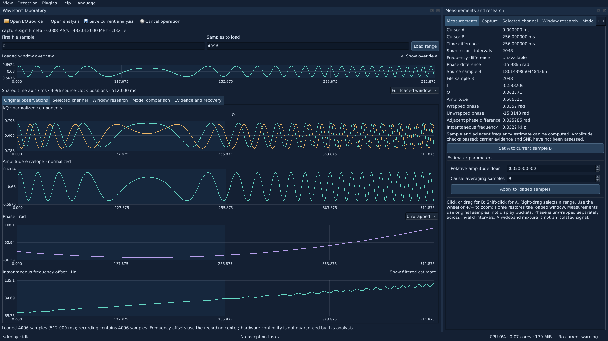

Use a shared time selection, sample-based cursors, and A/B markers. Invalid phase/frequency regions are not connected across gaps.

### Time-frequency research

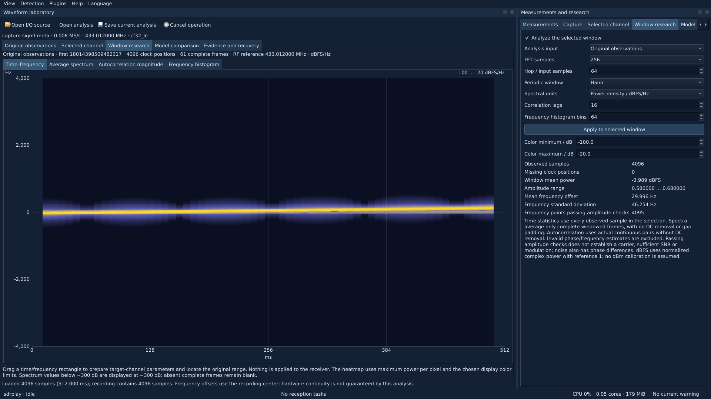

### Explicit reference comparison

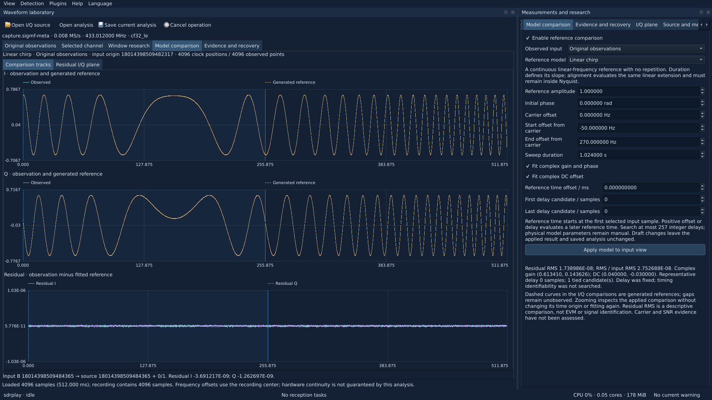

Compare measurements with a declared model. Generated reference data, fitted freedoms, and residuals remain separate from observations.

### Bytes, frames, and validation

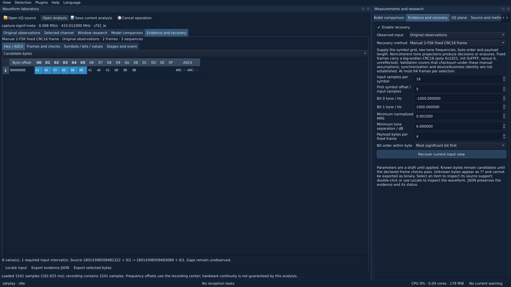

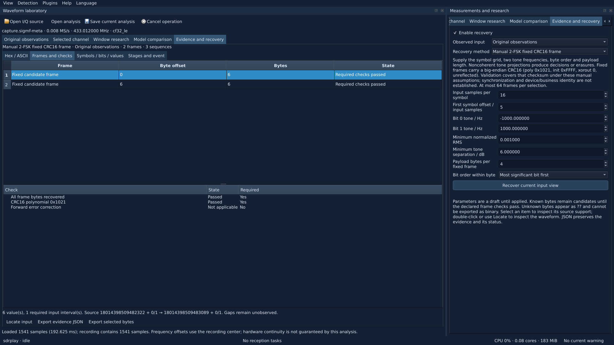

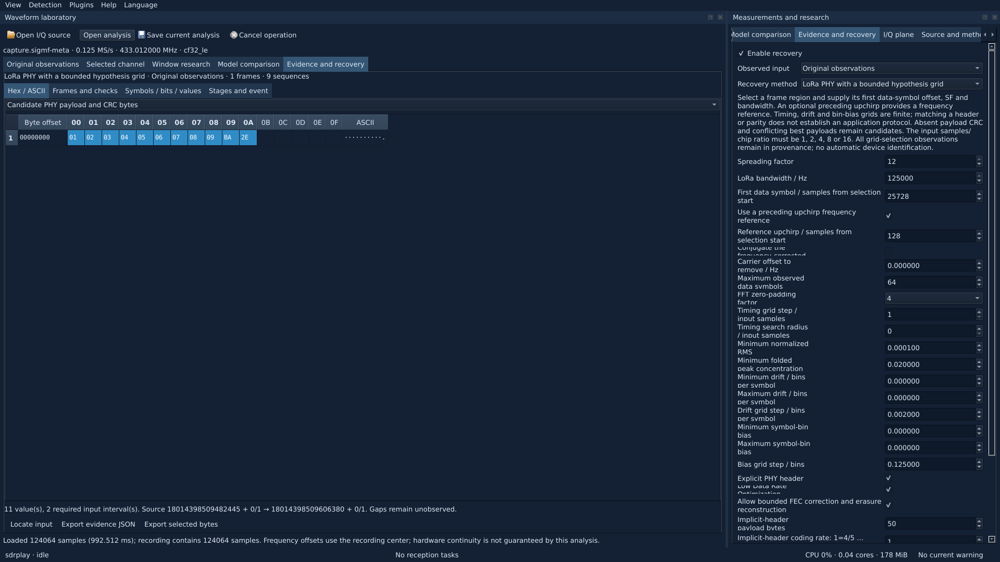

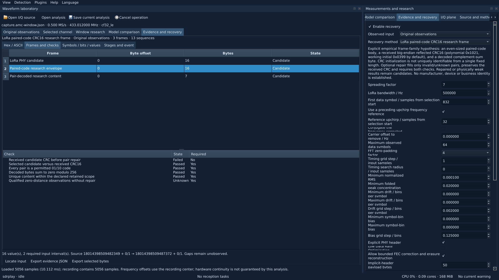

Inspect method parameters, frame boundaries, validation states, and source support. The paired example is an explicit empirical frame family, not a universal LoRa application decoder.

### PSK and OFDM

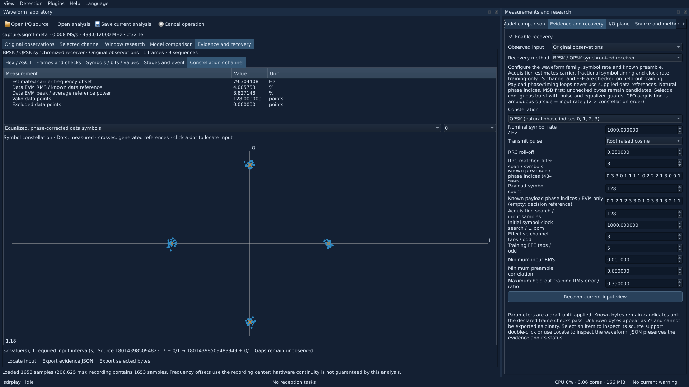

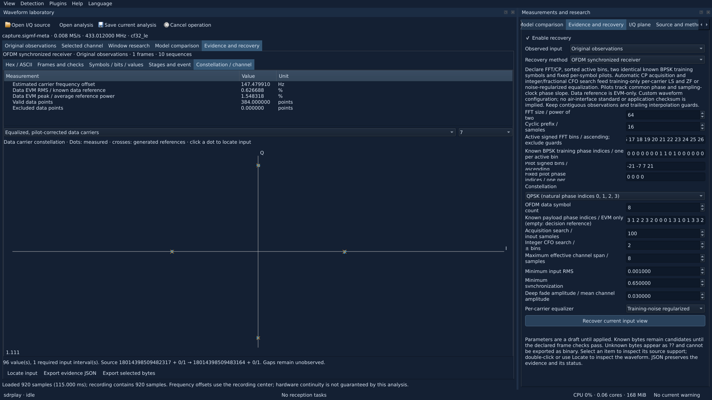

Both use independent synthetic transmitter truth. Data EVM excludes training, pilots, transients, and invalid points.

### Compact layouts and television

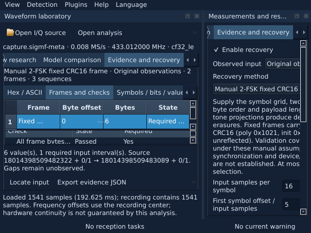

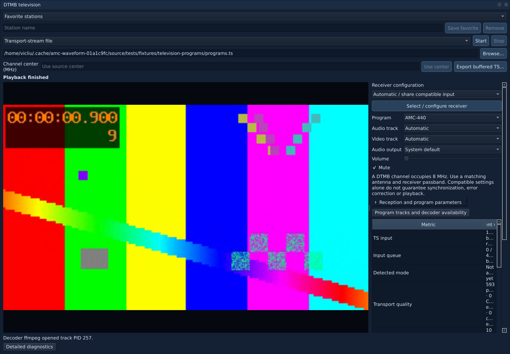

The television provider plays the redistributable synthetic test stream, with muted device output. This is actual native file playback; local over-the-air DTMB program reception remains unverified. Historical native Mac evidence stays in its dated report.

### Actual receiver settings, FM and toolboxes


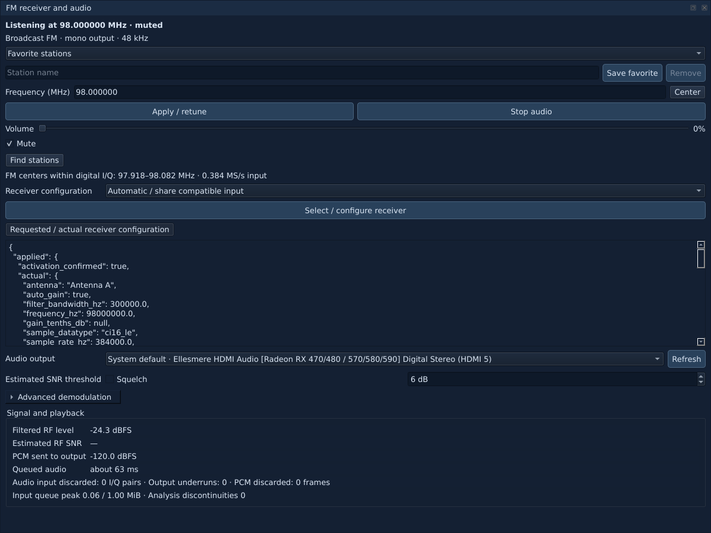

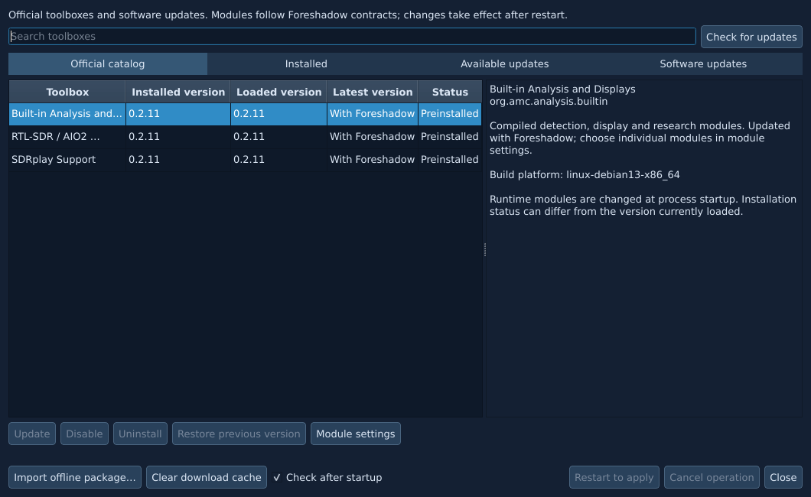

## Installation

This new repository initially publishes source only. Windows/Linux binary downloads will be released separately through [GitHub Releases](https://github.com/vicliu624/Foreshadow/releases). Until then, use the source build instructions below; historical review packages are not presented as a new public binary release. For a future binary installation, extract the complete archive and keep runtime libraries, resources, receiver modules and notices together.

**Source-branch capability and published-release capability are different.** This branch includes the waveform laboratory and trained PSK/OFDM work. A published catalog may describe an earlier accepted release; check its notes/version. Existing assets can carry the historical AMS name.

| Platform | Entry in a new installation | Host conditions |
|---|---|---|
| Windows x64 | `bin/signalscope-gui.exe` | Distributed Qt/media runtimes plus the intended hardware driver |
| Linux | `bin/signalscope-gui` | Matching CPU/distribution baseline, USB access, and device-specific API/service |
| macOS | `Foreshadow.app` | Matching architecture/system/runtime; older packages use `AMS.app` |

`signalscope`, `signalscope-gui`, and `signalscope-toolboxes` remain compatibility command names. **Foreshadow is the product name.** The source repository is now [vicliu624/Foreshadow](https://github.com/vicliu624/Foreshadow), initialized with a new Git history. See [repository transition](docs/repository-transition.md) for historical evidence and release scope.

Latest native Mac acceptance used Intel x86_64, macOS 14.3.1, Qt 6.8.3, and deployment target 14.0. This does not qualify every macOS version or Apple Silicon; see [platform evidence](docs/reports/2026-11-12-native-macos-deployment.md).

## Start without hardware

1. Launch the desktop. Hardware is needed only for live acquisition.
2. Choose the waveform laboratory preset under **View → Layout**, or show its panels through View.
3. Open a supported recording (`capture.sigmf-meta`) or saved analysis (`*.amc-analysis.json`) using the laboratory toolbar.
4. Select a time interval and inspect raw views. Enable window analysis or a reference model, edit parameters, and apply them.
5. For supported digital input, select a recovery provider and its complete configuration. Inspect check states before exporting bytes.
6. Save the analysis, close it, and reopen it to reproduce the processing chain from the referenced samples.

The CLI `synth` example below creates a simple tone for view inspection. Developers can generate all six portable review cases with the built native workflow tool:

```sh
./build/waveform_recovery_workflow_test --export-review-fixtures ./review-cases
```

Visual Studio builds place this executable under `build/Release/`; use `.exe` on Windows. The destination must be new. Cases cover a chirp/model, validated FSK bytes, LoRa PHY, paired encoding, QPSK, and OFDM. The exporter uses real native controls and reopens each saved analysis. All six use synthetic known truth and require no receiver.

## Connect a receiver

1. Install the provider's prerequisites and select it in **Receiver settings**. The base includes RTL-SDR/AIO2; SDRplay uses an optional client toolbox and an independent receiver service. Install its vendor API/driver on the receiver computer, enter **Receiver service**, and refresh devices. See [service setup](docs/receiver-services.md).
2. Enumerate devices and choose the device and antenna/input port. Use serial selection where supported; indexes can change with USB topology.
3. Set frequency, rate, gain, input mode, and provider-specific controls. Recommendations are starting points; validation evaluates the **whole pending configuration**.
4. Inspect hardware compatibility and analysis coverage separately. A legal rate may exceed the machine's continuous processing capacity.
5. Apply settings and inspect actual startup/readback values. Undeclared calibration and hardware-loss facts remain unknown.
6. Start monitoring and watch acquisition, recording, and per-analysis counters separately.

AIO2 direct sampling/board rules and SDRplay ports/gains belong to their providers. See [receiver capabilities](docs/13-receiver-capabilities-and-configuration.md) and [receiver plugins](docs/15-receiver-plugin-protocol.md).

## Monitoring, recording, and replay

Choose detectors from **Detection** or module settings. Spectrum, waterfall, events, recordings, and status can remain visible together. Each candidate carries its detector description and evidence.

Manual recording preserves I/Q. LoRa structure triggers can preserve pre/post-event input. The default event-store quota is **1 GiB**; export recordings that must survive automatic eviction.

Replay is software processing, not RF transmission. Original sample time, host observation time, save time, and replay progress are different. Derived slices retain parent identity and sample offsets.

Default analysis buffering is bounded by **16 MiB / 5 seconds**, and pre-trigger memory by **32 MiB / 8 seconds**; the first exhausted limit applies. Actual duration depends on rate and encoding. Finite queues absorb bursts, not a sustained throughput deficit.

## Waveform research workflow

1. **Preserve an observation.** Open a recording/event interval or freeze a bounded live capture. Keep source identity, rate, encoding, sample coordinates, and continuity. Research capture reports its own rejected-input and retention-eviction counts.
2. **Inspect raw samples.** Use linked I/Q, amplitude, phase, phase-difference, and frequency traces. Zoom from bursts to samples; inspect cursors/A–B measurements. A raw I/Q trajectory is not a synchronized constellation.
3. **Isolate the target channel.** Select time/frequency, translate, filter, and resample. Compare raw and processed views. Rational clock ratios and filter support prevent invented exact-original-sample claims.
4. **Measure a window.** Apply STFT/PSD, correlation, histograms, or statistics with explicit window length/function/hop and units. Drawing aggregation does not alter full-resolution measurements.
5. **Compare or recover.** Test an explicit reference hypothesis or run a declared receiver/framing method. Acquisition, model, and recovery parameters have separate ownership and applied states. Draft edits do not silently rewrite displayed results.
6. **Trace and reproduce.** Inspect assumptions, checks, bytes/complex points, and sample dependencies. Locate them in original/processed data, save the configuration, and export evidence. Reopening recomputes; missing/changed sources produce an explicit error.

## Models, recovery, and EVM

Reference models generate theoretical data for a configured comparison. Delay, DC, phase/gain fitting, and other allowed freedoms are explicit. A residual is not automatically an EVM value or a protocol identity.

Recovery providers own synchronization, demapping, framing, validation, parameters, and language resources. The shared UI displays their generic results; different providers have different preconditions.

**BPSK/QPSK:** declare symbol rate, rectangular/RRC pulse conditions, training symbols, and data length. Automatic acquisition searches frame/timing/carrier conditions, estimates a training-based effective channel, equalizes, and tracks data.

**OFDM:** declare FFT/CP, ordered active carriers, repeated training, pilots, and mapping. Acquisition corrects timing/frequency, estimates per-carrier channels, equalizes, tracks common phase/clock slope, and preserves deep-fade erasures.

RMS EVM is `100 × sqrt(sum(|z − r|²) / sum(|r|²))`, measured on equalized/phase-corrected data. Reference origin is known data or decision-derived data. Known payload references do not participate in synchronization/channel fitting. Training, pilots, transients, and invalid points are excluded. Fewer than eight valid points, over 20% excluded data, or lost lock prevents usable EVM. Decision-derived EVM is not BER.

Low EVM does not validate an application frame. Payload CRC, application checks, repaired candidates, and unknown business meaning stay separate. See [PSK/OFDM](docs/25-psk-ofdm-and-evm.md) and [recovery evidence](docs/24-recovery-and-evidence-protocol.md).

## FM and television

The FM panel owns tuning, favorites/search, output, volume, mute, squelch, de-emphasis, and deviation settings. Independent reception leases let listening and monitoring stop separately; receiver disconnection stops all live users. Current FM audio is **mono**; stereo/RDS decoding is not claimed.

DTMB television accepts live I/Q, recorded I/Q, or a transport-stream file. Its native pipeline covers synchronization, system information, equalization/FEC, transport recovery, program/audio selection, picture/sound playback, and buffered TS export. Live reception requires the full channel inside the acquisition window; structure observation needs a complete **8 MHz** passband.

Actual AVS+ and DRA decoder paths have separate reference-input evidence. Detected PN or recovered program tables do not establish complete reception. Local field investigations have not confirmed antenna-to-program DTMB success. See [television](docs/20-dtmb-television.md) and its [dated acceptance](docs/reports/2026-11-11-dtmb-television-release.md).

## Workspace and language

View automatically discovers panels. Dock, float, tab, resize, reopen closed panels, select an explicit preset, save a layout, or restore defaults. Ordinary resizing preserves arrangement/visibility. Hidden research/audio panels can keep running; hiding is not stopping.

Geometry, docking, locks, receiver preferences, and language are saved. English and Simplified Chinese are included. Language selection supports installed languages or following the system; restart applies changes. Documentation defaults to English with a Chinese counterpart on every page.

Use an isolated review profile without changing the normal saved workspace:

```sh
./bin/signalscope-gui --language en --settings-dir ./review-profile --output ./review-events
```

## Toolboxes and updates

Open **Plugins → Toolbox Center** for the official catalog, installed packages, compatibility explanations, available updates, and pending activation. Ed25519 authenticates the catalog; archive hashes verify content. Offline import still requires a trusted catalog match.

Receiver support and external research tools are separate packages. Built-in detectors, displays, and research modules update with the application. Native module changes activate after restart. The external update helper waits for shutdown, changes activation, verifies startup, and rolls back a failed launch.

Network access uses the system proxy. Failed checks leave offline research available. Installation/activation changes conflicting with listening, recording, export, research, or device queries are rejected with a reason. See [distribution and release operations](docs/17-toolboxes-and-updates.md).

## Files and compatibility

| Interface | Meaning |
|---|---|
| `capture.sigmf-meta` + `capture.sigmf-data` | Metadata and interleaved I/Q; keep both files |
| CU8 / CI16-LE / CF32-LE | Existing sample encodings through the shared codec; source/provider availability applies |
| `*.amc-window.json` | Explicit saved-window/container descriptor and continuity |
| `*.amc-analysis.json` | Processing configuration; complex recovery uses analysis v8; supported older files remain compatible |
| Evidence JSON | Methods, measurements, checks, unknown fields, and source dependencies; complex evidence uses v2 |
| Byte export | Eligible known data with the provider's candidate/validation interpretation |
| Event-store markers | Owned quota-managed storage; an arbitrary folder is not automatically an event store |

The rename preserves `SignalScope` settings/data roots, `signalscope:*` SigMF fields, toolbox IDs including `org.amc.ams`, analysis suffixes, public namespaces, and old commands. Historical reports/hashes keep original names. These are compatibility protocols.

Power generally uses digital dBFS with an explicit normalization/window, not calibrated RF dBm. Host/sample-derived timestamps are not hardware timestamps.

## Command-line examples

CLI frequencies use Hz; GUI `--frequency` uses MHz. Destinations must be new; validate hardware settings first.

```sh
./bin/signalscope --help
./bin/signalscope --build-info
./bin/signalscope receiver-plugins
./bin/signalscope devices --receiver rtlsdr
./bin/signalscope probe --receiver rtlsdr --device 0
./bin/signalscope parameters --receiver rtlsdr
./bin/signalscope recommend --receiver rtlsdr

# Offline tone, no receiver.
./bin/signalscope synth --output ./tone-demo --rate 2000000 --seconds 0.1 --tone 25000
./bin/signalscope inspect --input ./tone-demo/capture.sigmf-meta
./bin/signalscope replay --input ./tone-demo/capture.sigmf-meta --speed 0

# Live capture after configuration validation.
./bin/signalscope capture --receiver rtlsdr --device 0 \
  --frequency 433500000 --rate 2000000 --gain auto --seconds 10 --output ./capture-001

# Recorded candidates, not transmission.
./bin/signalscope scan --input ./capture-001/capture.sigmf-meta --modulations all
./bin/signalscope detect --input ./capture-001/capture.sigmf-meta \
  --bw 125000 --sf-min 7 --sf-max 12 --search-width 1000000
./bin/signalscope monitor --input ./capture-001/capture.sigmf-meta --output ./replay-events --seconds 0
./bin/signalscope replay --input ./capture-001/capture.sigmf-meta \
  --start 1 --duration 0.5 --speed 0 --output ./slice-001
```

PowerShell uses `.\bin\signalscope.exe` and one-line commands or PowerShell continuation. The macOS CLI is inside `Foreshadow.app/Contents/MacOS/`. `signalscope-toolboxes check` / `list` share the GUI's catalog/installation services. See [CLI details](docs/07-building-and-cli.md).

## Build from source

Requires **C++20, CMake 3.20+, Threads, OpenSSL Crypto, and libarchive**. nlohmann/json and KissFFT are hash-pinned; FFTW/VOLK can accelerate supported work. Desktop requires Qt Widgets/Network/LinguistTools, with Multimedia for playback; macOS requires Qt 6.8+. Receiver libraries belong to their providers. Native television dependencies are built from pinned sources; see [third_party](third_party/README.md).

### Linux

Install a C++20 compiler, CMake/Ninja, Qt development packages, OpenSSL/libarchive, and intended receiver libraries. Debian/Ubuntu package names include `build-essential`, `cmake`, `ninja-build`, `qt6-base-dev`, `qt6-tools-dev`, `qt6-tools-dev-tools`, `qt6-multimedia-dev`, `qt6-serialport-dev`, `libssl-dev`, `libarchive-dev`, `librtlsdr-dev`, `libsoapysdr-dev`, `libfftw3-dev`, and `libvolk2-dev`; names vary by distribution. Full television also needs a shell, Make, and NASM on x86.

```sh
cmake -S . -B build -G Ninja -DCMAKE_BUILD_TYPE=Release \
  -DSIGNALSCOPE_REQUIRE_GUI=ON -DSIGNALSCOPE_REQUIRE_AUDIO=ON
cmake --build build --parallel 4
ctest --test-dir build --output-on-failure
cmake --install build --component SignalScope --prefix "$PWD/stage"
./stage/bin/signalscope-gui
```

### Windows

Use VS 2022 C++ tools and a matching Qt MSVC kit. Supply OpenSSL/libarchive and receiver libraries through a suitable toolchain, such as the [release workflow's vcpkg configuration](.github/workflows/release.yml). Full television additionally needs MSYS2 shell/Make/NASM.

```powershell
cmake -S . -B build -G "Visual Studio 17 2022" -A x64 `
  -DCMAKE_PREFIX_PATH="C:/Qt/6.8.3/msvc2022_64" `
  -DSIGNALSCOPE_REQUIRE_GUI=ON -DSIGNALSCOPE_REQUIRE_AUDIO=ON
cmake --build build --config Release --parallel 4
ctest --test-dir build -C Release --output-on-failure
cmake --install build --config Release --component SignalScope --prefix "$PWD/stage"
.\stage\bin\signalscope-gui.exe
```

Qt's prefix alone does not supply the other dependencies. Full configuration is in the [build guide](docs/07-building-and-cli.md).

### macOS

Use Xcode command-line tools, a verified C++20 compiler/runtime pair, Qt 6.8+, and native dependencies. Accepted Intel testing used LLVM 21.1.8 with matching packaged non-system runtimes.

```sh
cmake -S . -B build -G Ninja -DCMAKE_BUILD_TYPE=Release \
  -DCMAKE_OSX_DEPLOYMENT_TARGET=14.0 \
  -DSIGNALSCOPE_REQUIRE_GUI=ON -DSIGNALSCOPE_REQUIRE_AUDIO=ON
cmake --build build --parallel 4
ctest --test-dir build --output-on-failure
cmake --install build --component SignalScope --prefix "$PWD/stage"
open ./stage/Foreshadow.app
```

Explicitly select a suitable compiler/runtime if the default lacks required facilities. A deployment-target setting alone does not prove compatibility. See [Mac runtime and package requirements](docs/26-native-macos-acceptance.md).

| Option | Purpose |
|---|---|
| `SIGNALSCOPE_GUI=OFF` | Omit Qt desktop |
| `SIGNALSCOPE_REQUIRE_GUI=ON` | Fail if desktop dependencies are unavailable |
| `SIGNALSCOPE_REQUIRE_AUDIO=ON` | Require desktop playback dependencies |
| `SIGNALSCOPE_REQUIRE_RTLSDR=ON` / `SIGNALSCOPE_REQUIRE_SDRPLAY=ON` | Require these providers' dependencies |
| `SIGNALSCOPE_TELEVISION=OFF` | Intentionally omit television |
| `SIGNALSCOPE_FFMPEG_ROOT` | Explicit development SDK override; codec names alone do not establish equivalence |
| `SIGNALSCOPE_LEGACY_TESTS=ON` | Enable retained Python-dependent tests |
| `SIGNALSCOPE_HARDWARE_ACCEPTANCE=ON` | Build manually invoked physical-input acceptance; ordinary CTest does not open real hardware |

Python supports tooling/optional tests, not production real-time DSP. The build guide includes offline dependency caches and installed-package checks.

## Architecture

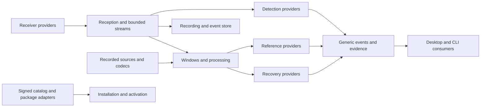

Receiver facts belong to receiver providers; detection semantics to detectors; model/recovery parameters and rules to research providers; encoding to codecs. Stable UI/session/export/installer consumers use those protocols. New implementations add providers, resources, and registration; new capabilities require explicit protocol upgrades.

See the [source map](src/README.md), [architecture](docs/03-architecture-and-interfaces.md), mandatory [extension boundaries](docs/16-extension-boundaries.md), [distribution](docs/17-toolboxes-and-updates.md), and [workspace rules](docs/18-desktop-workspaces.md).

## Validation and limitations

Tests cover independent transmitter truth, negative cases, budgets, discontinuities, cancellation, source mapping, independent providers, resource-only languages/fallback, persistence, native UI, and real package transactions. Build success or a screenshot alone is not feature acceptance.

The [0.2.12 r4 qualification](docs/reports/2026-11-14-receiver-service-review.md)
records the current Windows/Linux service architecture and actual archives:

| Environment | Recorded full regression | Additional evidence |
|---|---|---|
| Windows | 105 passed; one existing FM output-device compatibility check skipped; no failures | Independent base/client archives, Unicode/non-BMP workflows, physical service capture, source rebuild and Qt replacement |
| Linux | 107 passed; no skips/failures | Same package/source checks, physical capture and installed English GUI monitoring on the receiver workstation |
| macOS | Not accepted for 0.2.12 | Historical native results remain in their dated reports |

Full regression counts belong to `cb6fedf`; the final freeze `f763a30` changes only the packaged-desktop CMake checker and has its own final archive workflows and clean source rebuilds. The earlier pre-rename Windows/Linux/Mac baseline and later Mac failures remain in the dated reports and [13 November maintenance report](docs/reports/2026-11-13-foreshadow-maintenance.md).

The [subsequent release preparation](docs/reports/2026-11-14-public-release-preparation.md) repairs the bilingual build example at freeze `0c5fb5e`, repins materials, and requalifies new archives and all four documented source commands. Runtime binaries remain identical to the preceding accepted build.

- PSK/OFDM synchronization requires declared waveform/training; it is not arbitrary air-interface blind decoding.
- Weak signals, edges, overlapping signals, and unknown protocols can remain unresolved.
- General 24-hour lossless real-time processing and hardware-no-loss are unproven. Sustained synthetic tests separately report accepted/rejected input.
- Receiver configuration compatibility is not calibrated sensitivity, continuous ADC observation, or successful decoding.
- Local over-the-air DTMB program reception, broad macOS-version coverage, Apple Silicon qualification for the latest research branch, and universal hardware performance remain separate work.
- `research/v4` is retained research, not the delivered detection baseline. Pager firmware is a separate bounded test transmitter.

Read [PSK/OFDM acceptance](docs/reports/2026-11-12-psk-ofdm-acceptance.md), [native Mac deployment](docs/reports/2026-11-12-native-macos-deployment.md), and the [completion audit](docs/reports/2026-11-12-waveform-completion-audit.md) for versions, corrections, failures, and limits.

## Documentation

Every maintained document has English and Simplified Chinese counterparts. English is the default. The [index](docs/README.md) separates current contracts, historical designs, decisions, and dated evidence. Historical names and findings remain attached to their dates.

| Topic | References |
|---|---|
| Plugins and extension ownership | [Plugin guide](docs/plugins.md), [source map](src/README.md), [extension contracts](docs/16-extension-boundaries.md) |
| Use the application | [User guide](docs/09-delivery-and-user-guide.md), [laboratory](docs/22-waveform-laboratory.md), [models](docs/23-reference-model-protocol.md), [recovery](docs/24-recovery-and-evidence-protocol.md) |
| Develop and build | [Build/CLI](docs/07-building-and-cli.md), [source map](src/README.md), [native dependencies](third_party/README.md) |
| Requirements and tests | [Requirements](docs/01-product-requirements-and-acceptance.md), [testing](docs/04-algorithms-and-testing.md), [risks/status](docs/05-implementation-and-risks.md) |
| Receivers | [Configuration](docs/13-receiver-capabilities-and-configuration.md), [wideband](docs/14-wideband-and-multirate-analysis.md), [plugins](docs/15-receiver-plugin-protocol.md) |
| Contributor contracts | [AGENTS.md](AGENTS.md), [extension rules](docs/16-extension-boundaries.md), [updates](docs/17-toolboxes-and-updates.md), [workspace](docs/18-desktop-workspaces.md) |
| Images and evidence | [Gallery](docs/screenshots.md), dated reports in the [index](docs/README.md) |

Run `python tools/docs/check_docs.py` to check pairs and local links. [docs/documents.json](docs/documents.json) inventories the pairs. Update both languages and affected evidence when behavior changes.

## Contributing and licensing

Read [AGENTS.md](AGENTS.md), identify owners/consumers/assembly points, and run applicable architecture, contract, and regression checks. Keep private recordings, device backups, credentials, and signing keys outside tracked source. Distinguish verified results, unverified results, and external blockers.

The main application, CLI and first-party plugins are **GPL-3.0-or-later**; see [LICENSE](LICENSE) and the precise [licensing scope](LICENSING.md). Third-party libraries retain their original terms. [Third-party notices](THIRD_PARTY_NOTICES.md) cover Qt's LGPLv3 route, DSP/receiver/codec dependencies and Windows runtimes. [Corresponding source and replacement instructions](SOURCE_AND_REPLACEMENT.md) explain rebuilding and replacing libraries, including static receiver dependencies.

Packaged builds expose **Help → Licenses and source**. Every application and independent receiver/research package carries a versioned material inventory, original notices, real source archives, patches/build recipes and unresolved conditions under `share/foreshadow/compliance/`. Packaging checks source/build versions, hashes and executable ownership; official signing reopens archives and checks against repository-reviewed profiles. A review flag cannot bypass missing materials. [The assessment](docs/licensing-assessment.md) records evidence and remaining boundaries: the earlier direct-link SDRplay profile is superseded by an independent service client, whose actual closure is checked separately from the base. Vendor API redistribution and embedded firmware clearance remain outside those delivered binaries. See [receiver services](docs/receiver-services.md). A review package is not a public-release clearance.

The [r4 service qualification](docs/reports/2026-11-14-receiver-service-review.md) records the independent base/client, four passing mechanical archive gates on each platform, clean first-party source rebuilds, Qt replacement probes, physical service capture and current review entry points. The [r3 licensing qualification](docs/reports/2026-11-13-license-adoption-review.md) remains historical evidence of the superseded in-process arrangement.

The [free/open-source codec patent assessment](docs/codec-patent-assessment.md) separates free downloads, royalty rates and permission. Full television functionality remains in the prepared base; its specific patent decision is open. The SDRplay client has its own prepared asset set. [Release preparation](docs/reports/2026-11-14-public-release-preparation.md) records these separate statuses; mechanical material validation is not patent clearance.

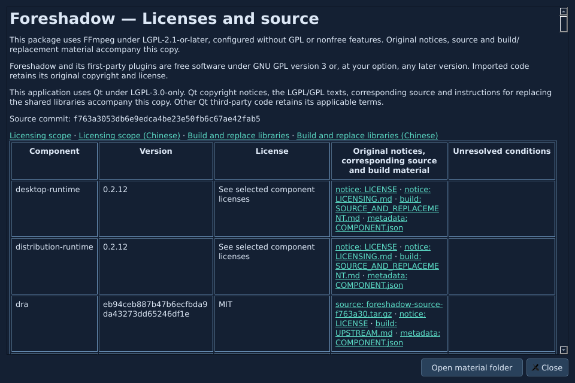
