# Foreshadow

[English](README.md) · 简体中文

**以插件驱动的信号采集、波形研究、恢复与证据追溯工作台。**

Foreshadow 在同一桌面工作区中组织接收机、检测、显示和研究插件。大部分信号领域能力由提供者完成：连接硬件、观察宽带 I/Q、冻结片段、提取信道、比较参考模型、恢复受支持信号，再追溯到支撑结果的原始采样。宿主提供这些模块共同使用的基础设施。

支持 **Windows、Linux 和 macOS**。接收机是实时采集的条件；使用录制文件或合成评审用例，可以完全离线体验研究流程。


*接收机工作站上已安装的 0.2.12 r4 英文桌面，通过独立服务接收实体 I/Q。接收控制、频谱、瀑布、事件、录制和研究面板共同组成可停靠工作区。图片来源见[截图集](docs/screenshots.zh-CN.md)。*

## 目录

- [以插件为中心](#以插件为中心)
- [功能范围](#功能范围)
- [核心功能截图](#核心功能截图)
- [安装与启动](#安装与启动)
- [没有接收机也可以开始](#没有接收机也可以开始)
- [连接接收机](#连接接收机)
- [监听、录制与重放](#监听录制与重放)
- [完整的波形研究流程](#完整的波形研究流程)
- [模型、恢复与 EVM](#模型恢复与-evm)
- [FM 与电视](#fm-与电视)
- [工作区与语言](#工作区与语言)
- [工具箱与在线更新](#工具箱与在线更新)
- [文件与兼容性](#文件与兼容性)
- [命令行示例](#命令行示例)
- [从源码构建](#从源码构建)
- [架构与扩展](#架构与扩展)
- [验证范围与限制](#验证范围与限制)
- [文档导航](#文档导航)
- [贡献与许可证](#贡献与许可证)

## 以插件为中心

**Foreshadow 的大部分功能由插件和提供者完成。** 宿主提供公共样本/流协议、接收会话与租约、录制重放、可停靠工作区、通用参数/证据视图和受控安装；设备知识、信号方法及相应操作由提供者交付。

| 插件类别 | 负责的功能 | 当前交付方式 |
|---|---|---|
| 接收机插件 | RTL-SDR/AIO2、SDRplay；发现、能力、参数、联动、推荐、应用/回读、驱动运行库与资源 | 运行时原生模块，可独立安装为接收机工具箱 |
| 检测模块 | LoRa、FSK/OOK/ASK、FM、PSK、OFDM、CSS、DTMB、ADS-B 的检测语义、输入要求与事件证据 | 注册内置实现，随应用更新 |
| 显示与实时研究提供者 | 频谱/瀑布/I/Q；波形实验室、独立 FM、电视、ADS-B 航空器及 WSPR 接收／录音工作区、状态、操作及接收需求 | 内置提供者，由通用工作区承载 |
| 参考模型提供者 | 单音、AM、FM、FSK、Chirp、LoRa、PSK、OFDM 的生成、参数与校验 | 注册研究实现，使用共享对照流程 |
| 恢复提供者 | FSK 帧、LoRa PHY、ADS-B 帧、成对编码研究、训练式 PSK/OFDM 同步、信道估计、均衡及 EVM 证据 | 注册研究实现，使用公共证据、持久化和导出 |
| 外部研究工具 | 原生功率报告及兼容快照工具，声明参数、输出、资源和运行库 | 独立可执行程序/清单，可独立安装为研究工具箱 |
| 媒体编解码提供者 | FFmpeg 解码器和 DRA、轨道能力及诊断 | 隔离媒体辅助进程中的原生提供者 |

**插件/提供者**是功能实现，**工具箱**是安装和版本管理单位。一项“内置分析”可以包含多个提供者；内置插件目前随应用更新，并非全部都是可单独下载的动态库。

**Plugins → Toolbox Center** 查看包与激活状态，**Module settings** 管理已开放模块选择，**Receiver settings** 展示接收机拥有的参数，**View** 打开注册面板；实验室中选择模型或恢复提供者并编辑整套配置。[插件指南](docs/plugins.zh-CN.md)进一步说明所有权、发现、更新与扩展示例。

## 功能范围

| 领域 | 所属模块 | 已实现能力 | 如何理解结果 |
|---|---|---|---|
| 接收机 | 接收机插件 | 运行时插件；RTL-SDR / uConsole AIO2、SDRplay；枚举、通用参数、整套配置评估、推荐和启动回读 | 能力与设备规则来自提供者和实际硬件 |
| 宽带观察 | 显示/检测提供者与公共 DSP | 频谱、瀑布、I/Q、候选事件、重叠分信道与独立处理阶段 | 同时覆盖限于当前有效采集窗口 |
| 调制检测 | 检测提供者 | 实时 LoRa 结构、2-FSK/GFSK、OOK、ASK、FM 导频证据和周期 DTMB 结构；离线 4-FSK、BPSK、QPSK、CSS、CP-OFDM 候选 | 波形候选不等于协议解码或设备身份 |
| 录制 | 公共录制/会话服务 | 手动 I/Q、LoRa 触发、内存预录、配额、导出和软件重放 | 自动事件录制目前由 LoRa 结构触发 |
| 波形实验室 | 波形实时研究提供者 | 录制输入、有界实时捕获、冻结/继续、联动选区/光标、A/B 测量、来源坐标和分析保存 | 冻结研究不停止其他接收使用者 |
| 信号视图 | 波形研究/显示提供者 | I/Q、幅度、包裹/展开相位、相邻相位差、瞬时频率和复平面轨迹 | 低幅度无效区和不连续边界保留 |
| 目标信道 | 研究流程与公共 DSP | 频移、低通、有理重采样、原始/处理后对照 | 保留滤波支撑、延迟、边界有效区和时钟映射 |
| 窗口分析 | 波形研究提供者与共享内核 | 可配置 STFT、PSD、自相关、频率直方图、功率和统计量 | 保留窗口、单位、参数和输入区间 |
| 参考模型 | 参考模型提供者 | 常量、AM、FM、2-FSK、线性 Chirp、LoRa、显式 BPSK/QPSK 和 CP-OFDM | 披露对齐与拟合自由度；低残差不是调制证明 |
| 信号恢复 | 恢复提供者 | 有界 2-FSK 成帧、LoRa PHY、显式成对编码/CRC 帧族、训练式 PSK/OFDM 接收 | 各提供者有明确的波形及成帧前提 |
| PSK | PSK 恢复提供者 | BPSK/QPSK 帧/定时/载波同步、训练信道估计、均衡、跟踪和数据 EVM | 需要给定符号率、脉冲、训练及数据长度 |
| OFDM | OFDM 恢复提供者 | CP/重复训练捕获、频偏校正、逐载波估计/均衡、导频跟踪、擦除和 EVM | 需要声明 FFT/CP、活动载波、训练、导频和映射 |
| 证据 | 提供者结果与通用证据消费者 | 符号、比特、字节、帧、Hex/ASCII、校验状态、复数测量、JSON 和已知字节导出 | 未知值、修复候选、未携带校验和校验失败分别表示 |
| 广播研究 | FM/电视实时研究及媒体提供者 | 独立单声道 FM 收听；DTMB 节目流恢复与音视频播放 | 检测证据和成功节目恢复分开 |
| ADS-B | ADS-B 检测／恢复／实时提供者 | 周期候选、连续 PPM/CRC、DF17/DF18、带国家／省级归属和城市参照的离线地图 | 正式 0.2.15 在 RSPdx-R2 上实收带坐标飞机；附近城市不等于市级行政区归属 |
| WSPR | WSPR 实时研究提供者 | WSPR-2 实时与 I/Q 录音解码、原生表格、源坐标、断点分段及独立有界工作线程 | 独立合成参考解出 K1ABC／FN42／37；HF 实际观察单独记录，不提供 WSPR-15 或自动上传 |
| 工作区 | 通用宿主工作区 | 停靠、浮动、标签、保存布局、显式预设和小屏支持 | 缩放保留用户布局 |
| 分发 | 分发服务与包类型适配 | 签名官方目录、受管工具箱、离线包匹配、主体激活和回滚 | 内置模块随主体更新；原生变更重启生效 |
| 本地化 | 提供者资源与公共解析 | 英文、简体中文、提供者字典与逐 key 回退 | 新语言通过资源加入，不增加实现 ID 分支 |

## 核心功能截图

核心研究图来自连接接收机的 Linux 工作站，使用实际英文原生应用。合成输入用于演示研究流程，真实 RF 画面另行标注；最新 uConsole 更新截图在下方单独说明。[截图集](docs/screenshots.zh-CN.md)记录每张图片的采集方式和证据范围。

### 波形与测量

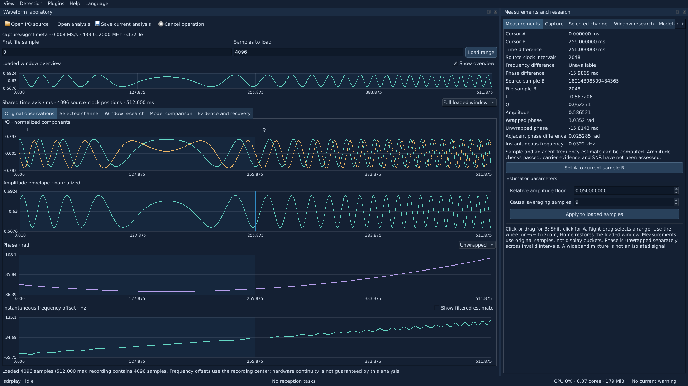

共享时间选区、样本光标与 A/B 标记；相位和频率无效处不会跨缺口连线。

### 时频研究

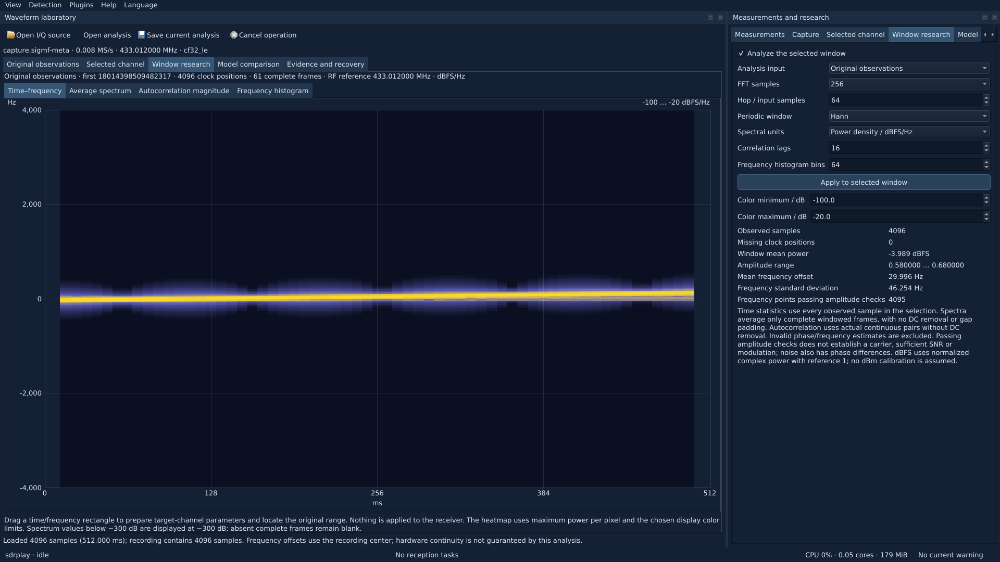

### 显式参考模型

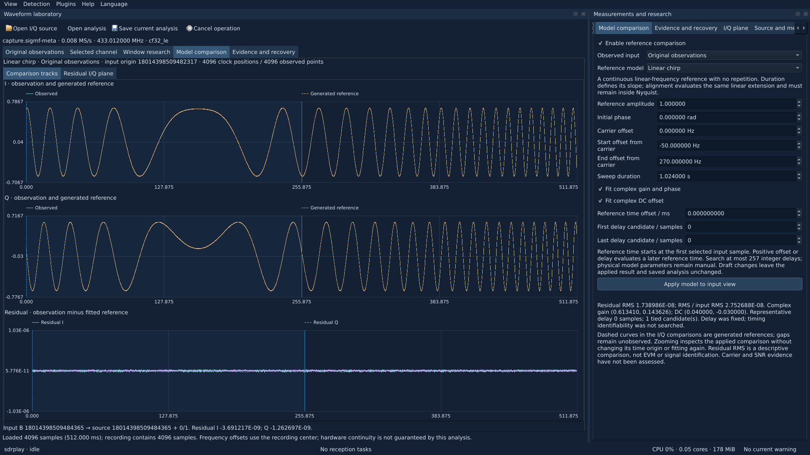

比较观测与声明模型，分别保留生成参考、拟合条件、残差和实际观测。

### 字节、帧与校验

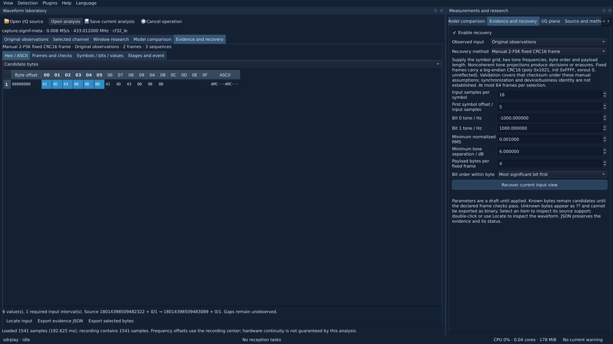

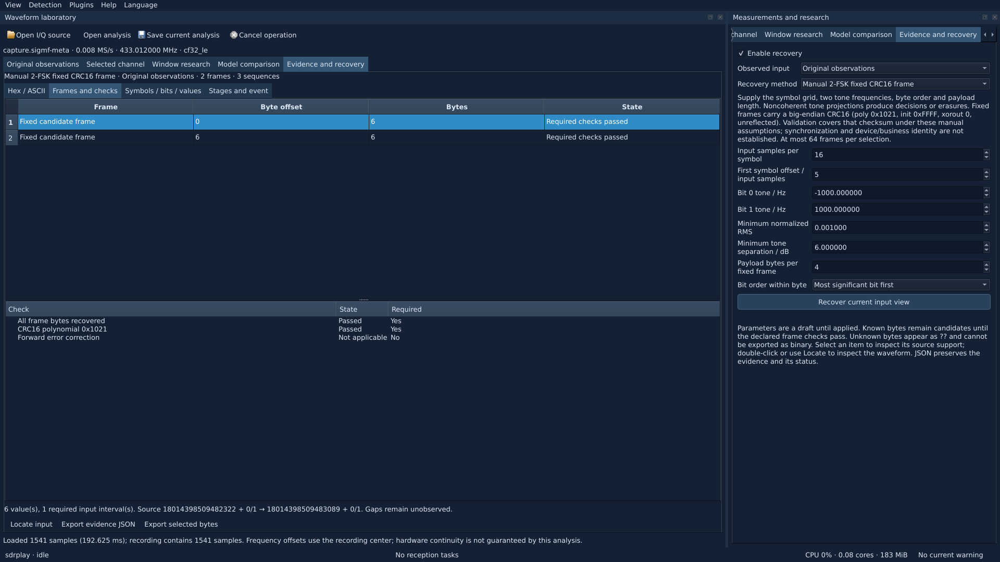

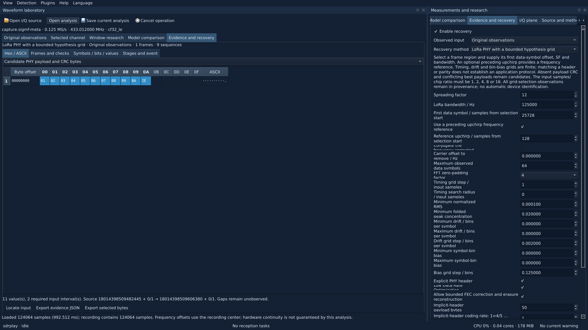

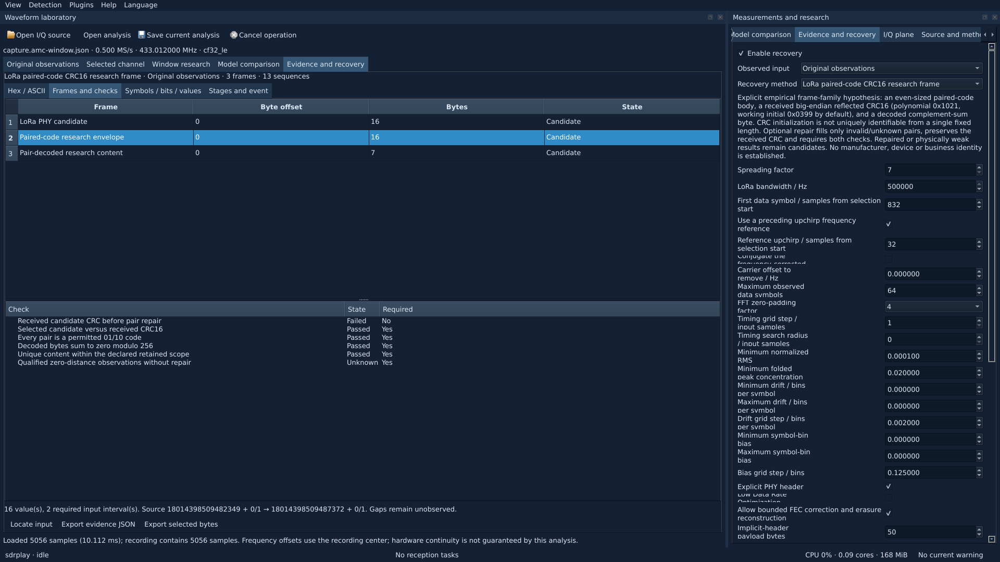

查看方法参数、帧边界、校验状态和源采样支撑。成对编码示例是显式配置的经验帧族，不是通用 LoRa 应用协议解码器。

### PSK 与 OFDM

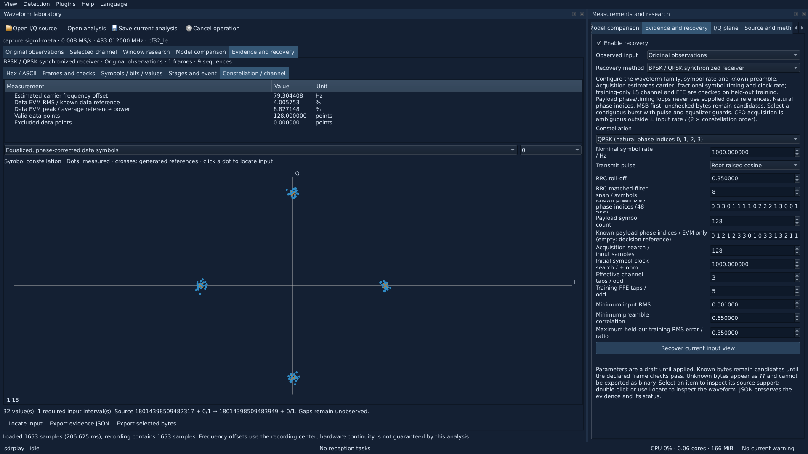

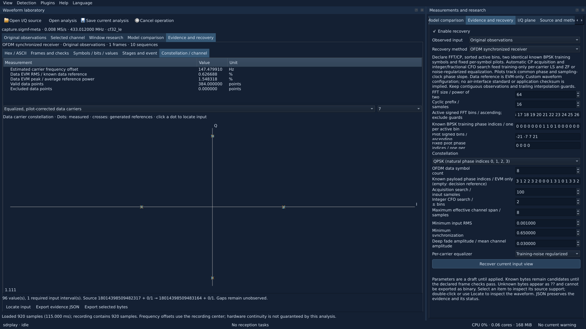

两组使用独立合成发射真值。数据 EVM 不包含训练、导频、瞬态和无效点。

### 紧凑布局与电视

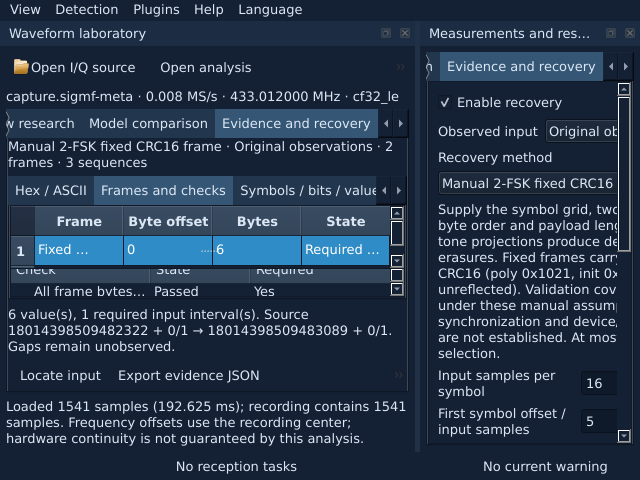

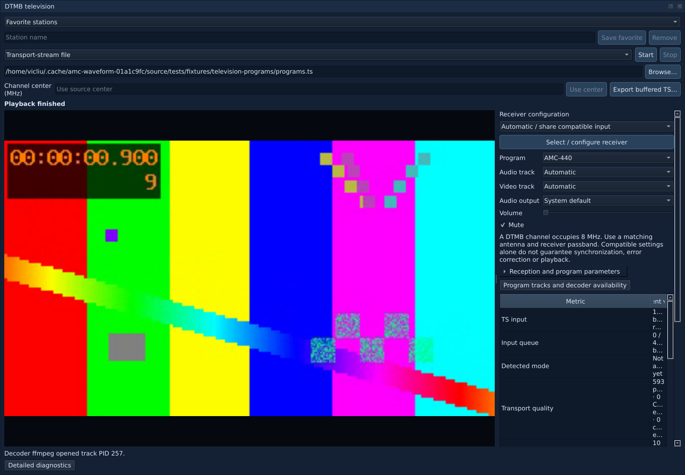

电视提供者播放可再分发的合成测试流，设备输出静音。这是实际原生文件播放；当地天线 DTMB 节目实收仍未验证。历史原生 Mac 证据保留在有日期的报告中。

### 实体接收机设置、FM 与工具箱

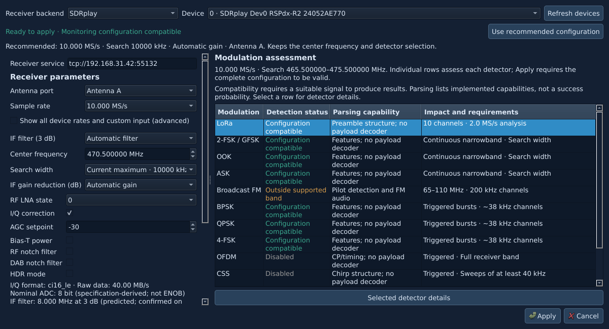

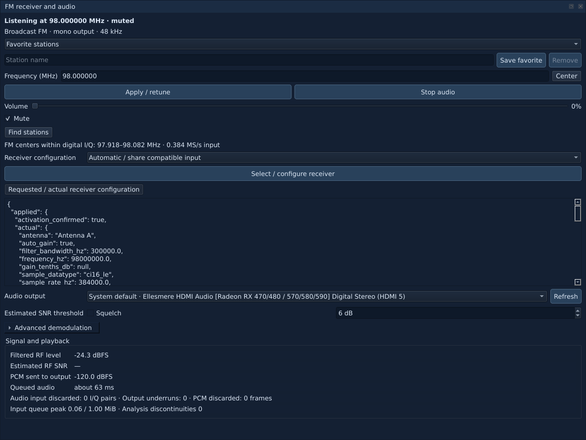

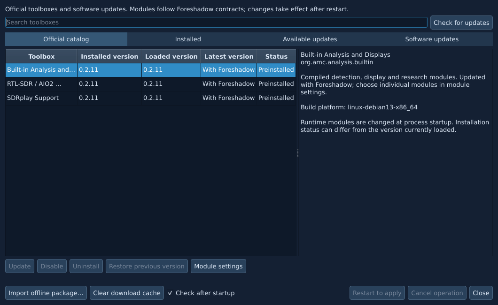

### ADS-B 地域地图与持续接收

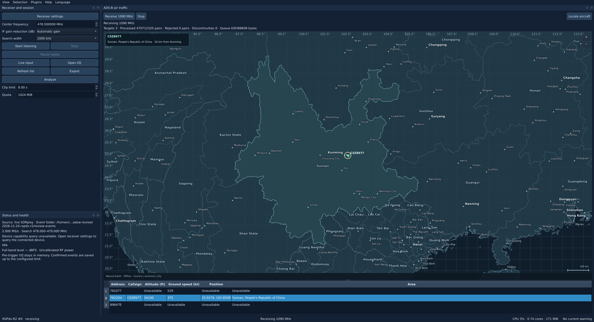

内置 [ADS-B 提供者](docs/adsb.zh-CN.md)显示实际飞机坐标、国家／省级行政区归属、城市名称、选中区域与附近城市距离。界面还提供 Area 列、缩放及比例尺；数据离线随包，行政区包含关系与最近城市分别显示。实际正式包、接收计数及截图来源见[本次发布验收](docs/reports/2026-11-24-0.2.15-release-and-update.zh-CN.md)。

### WSPR 实时与录音解析

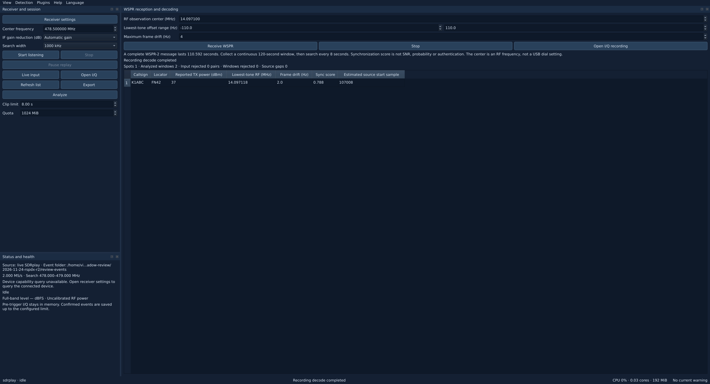

通过 **View → WSPR reception and decoding** 打开内置 [WSPR 提供者](docs/wspr.zh-CN.md)。**Receive WSPR** 申请自己的接收需求；**Open I/Q recording** 使用相同内核解析文件。上图来自接收机电脑实际正式英文界面，输入明确为独立 WSJT-X 符号生成的合成录音，结果为 K1ABC／FN42／37 dBm。表格提供最低音调频率、漂移、同步分数和源样本位置；同步分数不是 SNR，未知呼号哈希不猜测。HF 实际接收与合成参考分别留证，不提供 WSPR-15 或自动 WSPRnet 上传。

### uConsole 的 0.2.16 正常更新

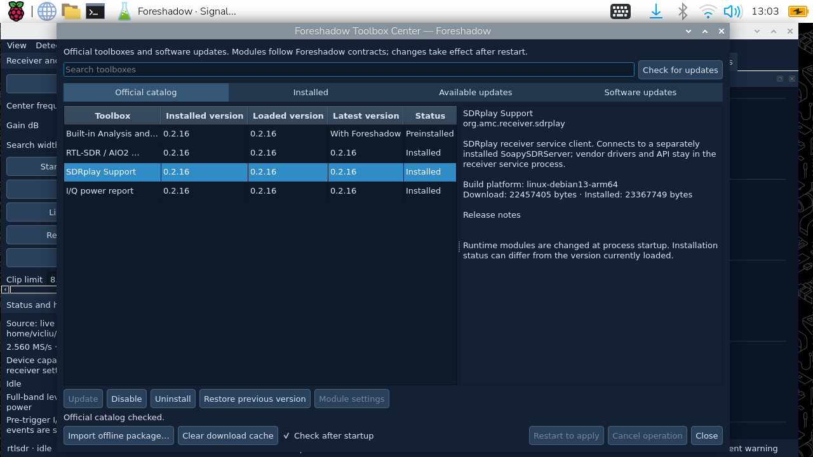

图片来自通过公开目录安装并完成重启健康检查后的实际英文 uConsole 桌面，与接收机工作站截图分别标注；后者的前台升级和新截图仍等待用户解锁。详见[发布／更新报告](docs/reports/2026-11-25-0.2.16-release-and-update.zh-CN.md)。

## 安装与启动

**[Foreshadow 0.2.16 已正式发布](https://github.com/vicliu624/Foreshadow/releases/tag/v0.2.16)**，提供已验收的 Windows x64、Debian 13 x64 和 Debian 13 ARM64 下载包。

| 已验收便携包 | 下载 |
|---|---|
| Windows x64 | [Foreshadow-windows-x64.zip](https://github.com/vicliu624/Foreshadow/releases/download/v0.2.16/Foreshadow-windows-x64.zip) |
| Debian 13 x64 | [Foreshadow-debian13-amd64.tar.gz](https://github.com/vicliu624/Foreshadow/releases/download/v0.2.16/Foreshadow-debian13-amd64.tar.gz) |
| Debian 13 ARM64 / uConsole | [Foreshadow-debian13-arm64.tar.gz](https://github.com/vicliu624/Foreshadow/releases/download/v0.2.16/Foreshadow-debian13-arm64.tar.gz) |

请完整解压到新目录，保留运行库、资源、接收机模块和依赖通知的相对位置。基础包包含 RTL-SDR，独立 SDRplay 服务客户端和 Power Report 工具箱通过 **Plugins → Toolbox Center** 获取。另见 [SHA256SUMS](https://github.com/vicliu624/Foreshadow/releases/download/v0.2.16/SHA256SUMS.txt)、[验收记录](https://github.com/vicliu624/Foreshadow/releases/download/v0.2.16/release-qualification.json)和[发布说明](docs/releases/0.2.16.zh-CN.md)。此前的[一次性迁移步骤](docs/releases/0.2.13.zh-CN.md)仍适用于旧 AMS 安装。

0.2.16 下载包包含波形实验室、训练式 PSK/OFDM、离线地域 ADS-B 地图与 WSPR 实时／录音模块。每个版本分别记录平台与功能证据，评估下载包时请查阅对应版本的验收记录；历史报告和旧资产可能使用 AMS 名称。

| 平台 | 新构建安装目录入口 | 外部条件 |
|---|---|---|
| Windows x64 | `bin/signalscope-gui.exe` | 随包 Qt/媒体运行库及目标硬件驱动 |
| Linux | `bin/signalscope-gui` | CPU/发行版基线匹配、USB 权限和设备 API/服务 |
| macOS，历史／源码构建 | `Foreshadow.app` | 0.2.16 未发布或验收 macOS 包；旧包为 `AMS.app` |

`signalscope`、`signalscope-gui`、`signalscope-toolboxes` 保留为兼容命令名。**产品名为 Foreshadow**，源码仓库现为 [vicliu624/Foreshadow](https://github.com/vicliu624/Foreshadow)，采用全新 Git 历史。历史证据及发布范围见[仓库迁移说明](docs/repository-transition.zh-CN.md)。

最近的原生 Mac 验收环境为 Intel x86_64、macOS 14.3.1、Qt 6.8.3，部署下限 14.0。它不等于所有 macOS 或 Apple Silicon 已通过，见[平台证据](docs/reports/2026-11-12-macOS原生部署与接收流程验收.md)。

0.2.16 修复远程日志资源保留和录制锁继承问题。请同时更新主程序与 **SDRplay Support** 再重启；日志修复位于独立接收机工具箱。

## 没有接收机也可以开始

1. 启动应用；只有实时采集需要接收机。
2. 从 **View → Layout** 选择波形实验室预设，或从 View 显示其面板。
3. 在实验室工具栏打开 `capture.sigmf-meta` 或 `*.amc-analysis.json`。
4. 选择时间区间，查看原始轨迹；启用窗口分析或参考模型，编辑并应用参数。
5. 数字输入选择适用恢复提供者，填写完整配置，核对校验状态后导出字节。
6. 保存分析、关闭再重开，从原始样本复现处理链。

后文 `synth` 命令可以生成用于视图检查的单音。开发者可用已构建的原生工作流工具生成六组便携评审用例：

```sh
./build/waveform_recovery_workflow_test --export-review-fixtures ./review-cases
```

Visual Studio 构建通常位于 `build/Release/`，Windows 添加 `.exe`。目标目录必须全新。六组覆盖 Chirp/模型、已验证 FSK 字节、LoRa PHY、成对编码、QPSK 和 OFDM；导出器通过实际原生控件生成，并逐份保存重开。它们均为合成已知真值，不需要接收机。

## 连接接收机

1. 安装提供者所需依赖，在 **Receiver settings** 选择它。基础包包含 RTL-SDR/AIO2；SDRplay 使用可选客户端工具箱及独立接收机服务。在接收机电脑安装厂商 API/驱动，填写 **Receiver service** 后刷新设备。见[服务安装](docs/receiver-services.zh-CN.md)。
2. 枚举并选择设备、天线/输入端口；支持时使用序列号，避免 USB 索引变化。
3. 设置频率、采样率、增益、输入模式及设备参数。推荐只是起点，校验针对**整套待应用配置**。
4. 分别查看硬件兼容性与分析覆盖；硬件合法采样率可能超过主机持续处理能力。
5. 应用并查看启动回读；未声明的校准或硬件丢样信息保持未知。
6. 开始监听，分别观察采集、录制和各分析阶段计数。

AIO2 直采/板卡规则和 SDRplay 端口/增益由各提供者维护，见[接收机能力](docs/13-接收机能力与配置联动.md)与[插件协议](docs/15-接收机插件协议与扩展.md)。

## 监听、录制与重放

从 Detection 或模块设置选择检测器。频谱、瀑布、事件、录制和状态可以并列展示；每条候选携带所属检测器的说明与证据。

手动录制保留 I/Q；LoRa 结构触发可保留事件前后输入。默认事件仓库配额 **1 GiB**，需要长期保留的录制应导出，避免自动淘汰。

重放是软件处理，不发送射频。原始样本时间、主机观察时间、保存时间与重放进度分别表示；派生切片保留父录制和样本偏移。

默认分析缓冲 **16 MiB / 5 秒**，预录内存 **32 MiB / 8 秒**，先触及的限制生效。可缓冲时长随采样率和编码变化；有限队列只能吸收短突发，不能解决持续吞吐不足。

## 完整的波形研究流程

1. **保留观测。** 打开录制/事件区间，或冻结有界实时捕获。保留来源身份、采样率、编码、样本坐标和连续性；研究捕获单列拒收与保留淘汰计数。
2. **检查原始样本。** 联动观察 I/Q、幅度、相位、相位差和频率，从突发缩放到单样本，使用光标和 A/B 测量。原始 I/Q 轨迹不是同步后的星座。
3. **提取目标信道。** 选择时频区间、频移、滤波、重采样，比较原始和处理后数据；有理时钟比例及滤波支撑进入来源映射。
4. **测量窗口。** 配置 STFT/PSD、自相关、直方图或统计量的窗口、长度、hop 和单位；绘图聚合不改变完整分辨率测量。
5. **模型对照或恢复。** 测试显式模型假设，或运行声明的接收/成帧方法。采集、模型和恢复分别保存参数与应用状态；未应用草稿不会悄悄更改当前结果。
6. **追溯与复现。** 检查前提、校验、字节/复数点及样本依赖，定位原始或处理后波形，保存配置并导出证据。重开重新计算；源数据缺失/变化明确报错。

## 模型、恢复与 EVM

参考模型生成理论信号进行声明条件下的比较，延迟、DC、复增益/相位拟合等自由度明确。残差不自动成为 EVM 或协议身份结论。

恢复提供者拥有同步、映射、成帧、校验、参数和语言资源；通用界面展示协议结果。各方法的前提不同。

**BPSK/QPSK：** 声明符号率、矩形/RRC 脉冲、训练符号和数据长度；自动搜索帧、定时与载波，训练区估计有效信道，再均衡并跟踪数据。

**OFDM：** 声明 FFT/CP、有序活动子载波、重复训练、导频和映射；自动完成时频同步、逐载波信道估计/均衡、公共相位与时钟斜率跟踪，保留深衰落擦除。

RMS EVM 为 `100 × sqrt(sum(|z − r|²) / sum(|r|²))`，测量均衡与相位校正后的数据。参考来源为已知数据或判决；已知载荷不参与同步和信道拟合。训练、导频、瞬态及无效点被排除。有效点少于 8、排除超过 20% 或失锁时不提供可用 EVM；判决参考 EVM 不是误码率。

低 EVM 不等于应用帧有效。载荷 CRC、应用校验、修复候选和未知业务含义分开，见 [PSK/OFDM](docs/25-PSK与OFDM接收及EVM规格.md)与[恢复证据](docs/24-信号恢复与证据协议规格.md)。

## FM 与电视

FM 面板拥有调谐、收藏/搜台、输出设备、音量、静音、静噪、去加重与频偏参数。独立接收租约允许分别停止收听和监听；断开接收机停止所有实时使用者。当前 FM 音频为**单声道**，不声称立体声/RDS 解码。

DTMB 电视接收实时 I/Q、录制或节目流文件。原生流水线包括同步、系统信息、均衡/FEC、节目流恢复、节目/音轨选择、画面/声音与缓冲 TS 导出。实时频道必须完整处于采集窗口；结构观察需要完整 **8 MHz** 通带。

实际 AVS+、DRA 解码路径有独立参考输入证据。PN 命中或节目表恢复不等于完整接收。当地调查尚无已确认的天线到节目实收正例，见[电视规格](docs/20-DTMB节目流与电视播放规格.md)及[验收报告](docs/reports/2026-11-11-DTMB电视播放与0.2.10发布验收.md)。

## 工作区与语言

View 自动登记面板，支持停靠、浮动、标签、尺寸、找回关闭面板、显式预设、保存及恢复默认布局。普通缩放保留布局和显隐；隐藏研究/音频面板不会停止其任务。

窗口、停靠、锁定、接收偏好及语言会保存。内置英文和简体中文；Language 可选已安装语言或跟随系统，重启生效。文档默认英文，每篇均有中文对应。

隔离评审配置，不影响正常保存的工作区：

```sh
./bin/signalscope-gui --language en --settings-dir ./review-profile --output ./review-events
```

## 工具箱与在线更新

“插件 → 工具箱中心”显示官方目录、已安装包、兼容原因、可用更新和待生效版本。Ed25519 认证目录，哈希校验包内容；离线导入仍须匹配可信目录。

接收机支持包和外部研究工具独立管理；内置检测/显示/研究随主体更新。原生变更重启生效。外部助手等待退出、切换激活、核对启动，失败回滚。

网络使用系统代理，检查失败不影响离线研究。监听、录制、导出、研究和设备查询冲突时，安装/激活明确拒绝并说明原因，见[分发与发布操作](docs/17-受控工具箱与在线更新规格.md)。

## 文件与兼容性

| 接口 | 含义 |
|---|---|
| `capture.sigmf-meta` + `capture.sigmf-data` | 元数据与交织 I/Q，须一起保存 |
| CU8 / CI16-LE / CF32-LE | 经统一编解码接口处理；具体来源/提供者决定可用格式 |
| `*.amc-window.json` | 显式窗口/容器描述及连续性 |
| `*.amc-analysis.json` | 处理配置；复数恢复使用分析 v8，支持的旧版本继续兼容 |
| 证据 JSON | 方法、测量、校验、未知字段和源依赖；复数证据使用 v2 |
| 字节导出 | 提供者允许的已知数据，保留候选/校验解释 |
| 仓库所有权标记 | 受配额管理的自有存储，不能把任意目录当作事件仓库 |

改名保留 `SignalScope` 设置/数据根、`signalscope:*` SigMF 字段、`org.amc.ams` 等工具箱 ID、分析后缀、公开命名空间和旧命令。历史报告及哈希保持原名；这些属于兼容协议。

功率通常为明确归一化与窗口的数字 dBFS，不是校准 dBm；主机/样本推导时间不是硬件时间戳。

## 命令行示例

CLI 频率用 Hz，GUI `--frequency` 用 MHz。输出目录必须全新；实机先校验参数。

```sh
./bin/signalscope --help
./bin/signalscope --build-info
./bin/signalscope receiver-plugins
./bin/signalscope devices --receiver rtlsdr
./bin/signalscope probe --receiver rtlsdr --device 0
./bin/signalscope parameters --receiver rtlsdr
./bin/signalscope recommend --receiver rtlsdr

# 离线单音，不打开接收机。
./bin/signalscope synth --output ./tone-demo --rate 2000000 --seconds 0.1 --tone 25000
./bin/signalscope inspect --input ./tone-demo/capture.sigmf-meta
./bin/signalscope replay --input ./tone-demo/capture.sigmf-meta --speed 0

# 校验配置后进行实机采集。
./bin/signalscope capture --receiver rtlsdr --device 0 \
  --frequency 433500000 --rate 2000000 --gain auto --seconds 10 --output ./capture-001

# 文件检测与软件重放，不发送射频。
./bin/signalscope scan --input ./capture-001/capture.sigmf-meta --modulations all
./bin/signalscope detect --input ./capture-001/capture.sigmf-meta \
  --bw 125000 --sf-min 7 --sf-max 12 --search-width 1000000
./bin/signalscope monitor --input ./capture-001/capture.sigmf-meta --output ./replay-events --seconds 0
./bin/signalscope replay --input ./capture-001/capture.sigmf-meta \
  --start 1 --duration 0.5 --speed 0 --output ./slice-001
```

PowerShell 使用 `.\bin\signalscope.exe`，命令写为单行或使用 PowerShell 续行。Mac CLI 位于 `Foreshadow.app/Contents/MacOS/`。`signalscope-toolboxes check` / `list` 与 GUI 共享目录/安装服务，见[完整命令说明](docs/07-构建与命令行操作.md)。

## 从源码构建

需要 **C++20、CMake 3.20+、Threads、OpenSSL Crypto 和 libarchive**。nlohmann/json、KissFFT 固定归档哈希；FFTW/VOLK 可加速相应处理。桌面需要 Qt Widgets/Network/LinguistTools，播放还需 Multimedia；Mac 要求 Qt 6.8+。接收机库由提供者声明。原生电视固定源码及构建工具见 [third_party](third_party/README.zh-CN.md)。

### Linux

安装编译器、CMake/Ninja、Qt、OpenSSL/libarchive 和所需接收机开发库。Debian/Ubuntu 包名示例：`build-essential`、`cmake`、`ninja-build`、`qt6-base-dev`、`qt6-tools-dev`、`qt6-tools-dev-tools`、`qt6-multimedia-dev`、`qt6-serialport-dev`、`libssl-dev`、`libarchive-dev`、`librtlsdr-dev`、`libsoapysdr-dev`、`libfftw3-dev`、`libvolk2-dev`；具体随发行版变化。完整电视还需要 shell、Make，x86 需要 NASM。

```sh
cmake -S . -B build -G Ninja -DCMAKE_BUILD_TYPE=Release \
  -DSIGNALSCOPE_REQUIRE_GUI=ON -DSIGNALSCOPE_REQUIRE_AUDIO=ON
cmake --build build --parallel 4
ctest --test-dir build --output-on-failure
cmake --install build --component SignalScope --prefix "$PWD/stage"
./stage/bin/signalscope-gui
```

### Windows

使用 VS 2022 C++ 工具与匹配 Qt MSVC 套件。OpenSSL/libarchive、接收机库通过合适工具链提供，可参考[发布工作流的 vcpkg 配置](.github/workflows/release.yml)；完整电视需要 MSYS2 shell/Make/NASM。

```powershell
cmake -S . -B build -G "Visual Studio 17 2022" -A x64 `
  -DCMAKE_PREFIX_PATH="C:/Qt/6.8.3/msvc2022_64" `
  -DSIGNALSCOPE_REQUIRE_GUI=ON -DSIGNALSCOPE_REQUIRE_AUDIO=ON
cmake --build build --config Release --parallel 4
ctest --test-dir build -C Release --output-on-failure
cmake --install build --config Release --component SignalScope --prefix "$PWD/stage"
.\stage\bin\signalscope-gui.exe
```

Qt 前缀不自动提供其他依赖，完整配置见[构建指南](docs/07-构建与命令行操作.md)。

### macOS

需要 Xcode 命令行工具、经验证的 C++20 编译器/运行库组合、Qt 6.8+ 及原生依赖。Intel 验收使用 LLVM 21.1.8，并随包分发匹配的非系统运行库。

```sh
cmake -S . -B build -G Ninja -DCMAKE_BUILD_TYPE=Release \
  -DCMAKE_OSX_DEPLOYMENT_TARGET=14.0 \
  -DSIGNALSCOPE_REQUIRE_GUI=ON -DSIGNALSCOPE_REQUIRE_AUDIO=ON
cmake --build build --parallel 4
ctest --test-dir build --output-on-failure
cmake --install build --component SignalScope --prefix "$PWD/stage"
open ./stage/Foreshadow.app
```

默认工具链缺少所需设施时，应显式指定匹配编译器/运行库。设置部署下限不等于二进制兼容，见[原生 Mac 包要求](docs/26-macOS原生构建与部署验收规格.md)。

| 选项 | 用途 |
|---|---|
| `SIGNALSCOPE_GUI=OFF` | 不构建桌面 |
| `SIGNALSCOPE_REQUIRE_GUI=ON` | 缺少桌面依赖时失败 |
| `SIGNALSCOPE_REQUIRE_AUDIO=ON` | 要求播放依赖 |
| `SIGNALSCOPE_REQUIRE_RTLSDR=ON` / `SIGNALSCOPE_REQUIRE_SDRPLAY=ON` | 要求对应接收机依赖 |
| `SIGNALSCOPE_TELEVISION=OFF` | 显式省略电视 |
| `SIGNALSCOPE_FFMPEG_ROOT` | 开发 SDK 覆盖；同名 codec 不代表等价 |
| `SIGNALSCOPE_LEGACY_TESTS=ON` | 启用保留的 Python 测试 |
| `SIGNALSCOPE_HARDWARE_ACCEPTANCE=ON` | 构建手动实机验收工具；普通 CTest 不打开真实硬件 |

Python 用于工具及可选测试，不承担生产实时 DSP。构建指南还说明离线依赖缓存和实际安装包检查。

## 架构与扩展

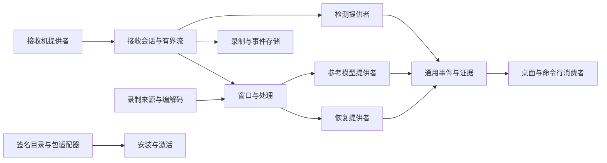

设备事实属于接收机，检测语义属于检测器，模型/恢复规则与参数属于研究提供者，编码属于编解码。稳定界面、会话、导出和安装器消费协议；新增实现增加提供者/资源/注册，新能力明确升级协议。

见[源码地图](src/README.zh-CN.md)、[架构](docs/03-架构与接口设计.md)、强制[扩展边界](docs/16-扩展边界与开闭原则规格.md)、[分发](docs/17-受控工具箱与在线更新规格.md)和[工作区](docs/18-桌面工作区与模块界面规格.md)。

## 验证范围与限制

测试覆盖独立发射真值、反例、预算、不连续、取消、源映射、独立提供者、资源语言/回退、持久化、原生界面和真实包事务。构建或截图成功不能单独作为功能验收。

[0.2.16 正式构建](https://github.com/vicliu624/Foreshadow/actions/runs/45543592669)对应冻结源码 `d33e438c0c2ca8c693dd4905c6ce2392aec5bcd8`：

| 正式平台 | 完整 CTest | 实际归档与运行验收 |
|---|---|---|
| Windows x64 | 129 通过，2 项因声音设备跳过，0 失败 | 实际归档、独立工具箱、AVS+/DRA、中文／非 BMP 路径与提供者发现均通过 |
| Debian 13 x64 | 130 通过，2 项因声音设备跳过，0 失败 | 实际归档、独立工具箱、AVS+/DRA、中文／非 BMP 路径与提供者发现均通过 |
| Debian 13 ARM64 / uConsole | 130 通过，2 项因声音设备跳过，0 失败 | 实际归档、独立工具箱、AVS+/DRA、中文／非 BMP 路径与提供者发现均通过 |

[验收记录](https://github.com/vicliu624/Foreshadow/releases/download/v0.2.16/release-qualification.json)包含源码／SDK 身份、包哈希、原生运行结果及明确限制。[发布与更新报告](docs/reports/2026-11-25-0.2.16-release-and-update.zh-CN.md)区分隔离归档验证与已安装桌面的正常升级。接收机工作站的原桌面升级仍等待用户解锁；同机独立目录中的实际 0.2.16 包已通过实体采集、录制、回放、历史导出和外部 Power Report 检查。

资源检查复用客户端进程：64 轮录制／回放、32 轮创建拒绝／成功及 16 轮故意日志断线恢复均要求原生资源计数不增长。实际 Linux 接收机包另通过 32 轮探测／采集。RSPdx-R2 工作站的实际客户端包完成 12 轮实体设备操作及 60 秒、2 MS/s 的采集（1.2 亿对 I/Q），随后完成新的 600 万对录制和历史数据逐字节一致导出；原有 26 个数据文件哈希均保留。这些是有界观察，不能唯一归因已重启的昨夜进程，也不构成无限期硬件无损保证。

ADS-B 六十秒、WSPR 一百四十秒的 2 MS/s 持续输入回归仍属于三个正式平台的完整测试。生产源码在接收机电脑使用未升级的 Qt 6.8.2／OpenSSL 3.5.7 重建并安装；这不是托管 OpenSSL 3.5.9 SDK 构建的字节复现。27 项发布材料契约通过，相应包提供原始声明、对应源码及 BSL-1.0 客户端本地补丁配方。实体声音输出与 macOS 验收仍不在已验证范围。此前 [0.2.15 实机报告](docs/reports/2026-11-24-0.2.15-release-and-update.zh-CN.md)保留该版本实际 ADS-B 位置、WSPR 参考截图及观察。

[0.2.12 r4 验收](docs/reports/2026-11-14-receiver-service-review.zh-CN.md)记录此前 Windows/Linux 服务架构及真实归档：

| 环境 | 完整回归 | 其他证据 |
|---|---|---|
| Windows | 105 通过，1 个既有 FM 输出设备兼容检查跳过，无失败 | 独立基础包／客户端、Unicode／非 BMP 流程、实体服务采集、源码重建及 Qt 替换 |
| Linux | 107 通过，无跳过或失败 | 同类包／源码检查、实体采集及接收机工作站的英文评审 GUI 实体监听 |
| macOS | 未验收 0.2.12 | 历史原生成果保留在对应日期报告中 |

完整回归计数对应 `cb6fedf`；最终冻结 `f763a30` 只改变发布包桌面 CMake 检查脚本，并完成其最终归档流程与源码干净重建。更早的改名前 Windows/Linux/Mac 基线及后续 Mac 失败保留在带日期报告和[11 月 13 日维护报告](docs/reports/2026-11-13-foreshadow-maintenance.zh-CN.md)。

[后续发布准备](docs/reports/2026-11-14-public-release-preparation.zh-CN.md)在冻结 `0c5fb5e` 修正双语构建示例、更新材料哈希，并重新验收新归档和文档中的四条源码命令。运行时二进制与此前已验收构建一致。

- PSK/OFDM 自动同步依赖声明的波形/训练，不是任意空口盲解码。
- 弱信号、边缘、重叠信号和未知协议可能仍无法解决。
- 尚无通用 24 小时实时无损或硬件绝无丢样保证；持续合成输入分别报告接受/拒收。
- 配置兼容不是校准灵敏度、持续 ADC 观测或成功解码。
- 当地 DTMB 节目实收、广泛 macOS 版本、最新研究分支的 Apple Silicon 和通用硬件性能仍需独立验收。
- `research/v4` 是保留研究，不是交付检测基线；Pager 固件是独立有界测试发射器。

版本、修正、失败与限制见 [PSK/OFDM 验收](docs/reports/2026-11-12-PSK与OFDM接收验收.md)、[原生 Mac 部署](docs/reports/2026-11-12-macOS原生部署与接收流程验收.md)及[完成审计](docs/reports/2026-11-12-波形实验室完成条件审计.md)。

## 文档导航

所有维护文档具有英文和简体中文版本，默认英文。[总览](docs/README.zh-CN.md)区分当前契约、历史设计、决策和带日期的证据；历史名称与结论保留原日期语境。

| 主题 | 入口 |
|---|---|
| 插件与扩展所有权 | [插件指南](docs/plugins.zh-CN.md)、[源码地图](src/README.zh-CN.md)、[扩展协议](docs/16-扩展边界与开闭原则规格.md) |
| 使用 | [用户指南](docs/09-交付与使用说明.md)、[实验室](docs/22-波形实验室与可追溯分析实施规格.md)、[模型](docs/23-参考模型与对照协议规格.md)、[恢复](docs/24-信号恢复与证据协议规格.md) |
| 开发构建 | [构建/CLI](docs/07-构建与命令行操作.md)、[源码地图](src/README.zh-CN.md)、[原生依赖](third_party/README.zh-CN.md) |
| 需求测试 | [需求](docs/01-产品需求与验收.md)、[测试](docs/04-算法与测试方案.md)、[风险/状态](docs/05-实施计划与风险决策.md) |
| 接收机 | [配置](docs/13-接收机能力与配置联动.md)、[宽带](docs/14-宽带接收与多速率分析.md)、[插件](docs/15-接收机插件协议与扩展.md) |
| 贡献约束 | [AGENTS](AGENTS.zh-CN.md)、[扩展](docs/16-扩展边界与开闭原则规格.md)、[更新](docs/17-受控工具箱与在线更新规格.md)、[工作区](docs/18-桌面工作区与模块界面规格.md) |
| 图片证据 | [截图集](docs/screenshots.zh-CN.md)与[总览中的验收报告](docs/README.zh-CN.md) |

使用 `python tools/docs/check_docs.py` 校验配对与本地链接，清单见 [docs/documents.json](docs/documents.json)。行为变更同时更新两种语言及相关证据。

## 贡献与许可证

原创第一方作品：**Copyright (C) 2026 liu weikai**。其他贡献保留各自版权。
权利归属、准确署名及独立分发、衍生版本和插件的身份说明，见[版权声明](COPYRIGHT.zh-CN.md)
与[品牌使用说明](BRANDING.zh-CN.md)。这些文档不为 GPL 授权增加限制。

先阅读 [AGENTS](AGENTS.zh-CN.md)，识别变化轴、所有者、稳定消费者和组装位置，运行适用架构、契约及回归。私人录制、设备备份、凭据和签名私钥不进入仓库；区分已验证、未验证和外部阻断。

主程序、CLI 与自研插件采用 **GPL-3.0-or-later**，见 [LICENSE](LICENSE) 及明确的[许可范围](LICENSING.zh-CN.md)。第三方库保留原条款。[第三方许可声明](THIRD_PARTY_NOTICES.zh-CN.md)覆盖 Qt 的 LGPLv3 路径、DSP／接收机／编解码依赖与 Windows 运行时；[对应源码及替换说明](SOURCE_AND_REPLACEMENT.zh-CN.md)说明重新构建、替换动态库及静态接收机依赖的方式。

打包版本提供 **Help → Licenses and source**。主体和独立接收机／研究插件包均在 `share/foreshadow/compliance/` 携带带版本的材料清单、原始声明、真实源码归档、补丁／构建规则及未决条件。组包检查源码与构建版本、哈希和可执行文件归属；正式签名重新打开归档，对照仓库评审过的平台配置复查。评审选项不能绕过材料缺失。[许可证评估](docs/licensing-assessment.zh-CN.md)记录证据与剩余边界：此前直连 SDRplay 配置已由独立服务客户端替代，其实际闭包与基础包分别检查；厂商 API 再分发及嵌入式固件清权不属于这些交付二进制。见[接收机服务](docs/receiver-services.zh-CN.md)。评审包不等于取得普遍公开发布授权。

[r4 服务验收](docs/reports/2026-11-14-receiver-service-review.zh-CN.md)记录独立基础包／客户端、两平台各四包的机械材料门禁通过、第一方源码干净重建、Qt 替换、实体服务采集及当前评审入口。[r3 许可落地验收](docs/reports/2026-11-13-license-adoption-review.zh-CN.md)保留为已替代的进程内方案历史证据。

[免费开源编解码专利评估](docs/codec-patent-assessment.zh-CN.md)区分免费下载、版税与许可。已发布的 0.2.16 基础包保留完整电视功能；发布本身不解决现有具体专利评估，也不构成新授权。SDRplay 客户端已作为独立包发布。带日期的[发布准备报告](docs/reports/2026-11-14-public-release-preparation.zh-CN.md)记录此前决策，机械材料验收不等于专利清权。

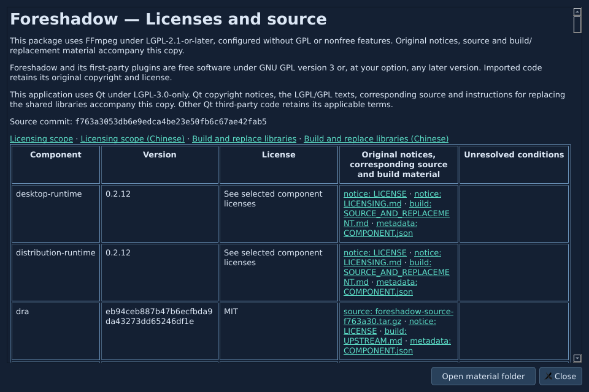
