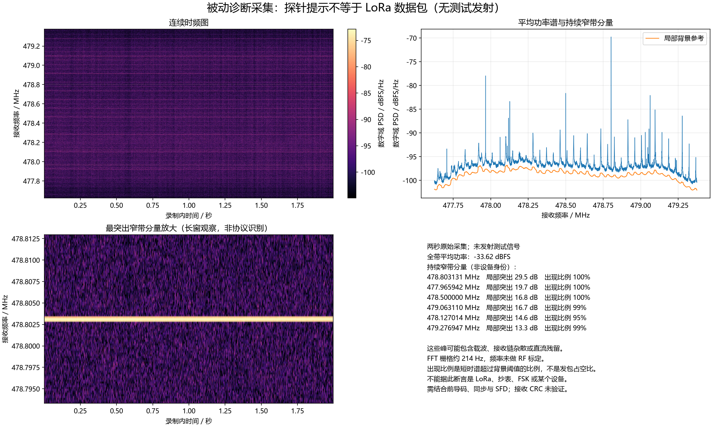

# Passive investigation of unverified candidates

English · [简体中文](2026-11-04-待验证候选调查.md)

Historical investigation,4 November 2026. Scrolling `chirp_probe` entries were single-window probe peaks, without confirmed consecutive chirps or LoRa preamble structure. Their BW/SF described the reference template, not measured transmitter settings. Counts were neither packet nor device counts.

The two-second passive sample mainly contained persistent narrow lines/noise; the default detector found no LoRa structure. Carrier-like features could be external signals, receiver spurs or DC residue. Their source/protocol remained unknown, and weak bursts at other times were not excluded.

## UI/process evidence

The existing session had run about3.07hours, with `storage.triggered=0`, `completed=0`, `recent_lora_events=[]`; the latest recording was an older test. One minute of read-only observations added62diagnostic hints.59distinct sampled records were all `chirp_probe`, approximately13.001–13.766 dB, across17 BW/SFtemplate combinations.

A single-window peak passing at least13 dB and local prominence could emit a probe; consecutive preamble/sync/SFD validation occurred later. Normal mode did not persist all unconfirmed I/Q, so earlier scrolling hints could not each be reconstructed. A clearer label was “single-window probe peak (unclassified)” rather than wording suggesting confirmed chirp awaiting decoding. This investigation did not modify/rebuild the running version.

## Two-second passive input

The receiver was temporarily stopped for a two-second capture and immediately restarted with the same version/configuration. No Pager controller/transmission was used. Rate1.75 MS/s, center478.5 MHz, gain38.6 dB,3,500,000 CU8 complex samples/7,000,000 bytes. Driver completion, zero source-queue rejection and zero endpoint clipping were reported; no hardware sequence existed. Mean whole-band power was approximately−33.62 dBFS, not RF  dBm. Blind BW 125/250/500, SF7–12, both polarities produced no LoRa structure or probe in this particular sample, without one-to-one correspondence to earlier hints.

An8192-point Hann FFT with4096hop gave approximately214Hz spacing. Widths include window/leakage and are not measured modulation bandwidths.

| Approximate frequency | Observation and permitted description |
|---|---|
|478.8031 MHz|Persistent narrow line, local prominence29.5 dB; unknown carrier-like source|
|477.9659 MHz|Persistent line,19.7 dB; outside center-search interval but inside captured I/Q|
|478.5000 MHz|Persistent at center; DC-like residue, source not confirmed by one tuning|
|479.0631 MHz|Almost continuous; unclassified carrier/spur-like component|
|478.1270 MHz|Present much of the time; cannot identify FSK/metering|

An independent one-second noise-plus-weak-fixed-carrier control generated similar probes without LoRa. Pure noise and a stronger carrier in those controls did not. Multiple relative-peak conditions make the probe unlike a simple power/packet counter. Controls neither predict field hint counts nor identify every field candidate as the same interference.

Separating external carrier from internal spur requires antenna/tuning controls; protocol attribution requires modulation/decoded evidence. Neither was established. The original long observation was marked `interrupted`, retaining samples/maintenance reason, rather than joining pre/post-maintenance time into continuous acceptance. The same UI/configuration resumed with a new process clock.

Private finite input: `recordings/passive-probe-study-1793767136475704123`; statistics/plot data `build/rf-tests/pending-investigation`; minute snapshots `build/rf-tests/pending-live-snapshots.json`. These are manual diagnostic inputs, without automatic confirmed LoRa or all-day raw recording.
