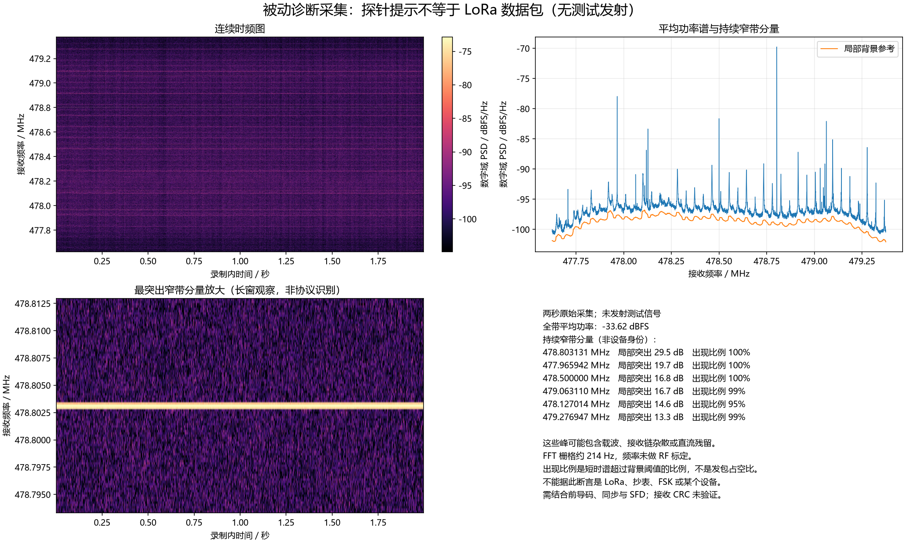

# 待验证候选的被动调查

[English](2026-11-04-unverified-candidates.md) · 简体中文

## 结论

界面滚动的条目是 `chirp_probe` 单窗探针峰，尚未确认连续 Chirp 或 LoRa 前导码结构。其 BW/SF 是当时使用的参考模板，不能当作已经测出的发射参数。当前证据不支持把这些条目数当作接收到的数据包数或发射设备数量。

本次两秒真实被动采样中，主要可辨认成分为持续窄带谱线与底噪；默认 LoRa 检测器没有给出结构匹配。窄带分量可能来自外部载波、接收链杂散或直流残留，尚不能区分来源或具体协议，也不能排除其他时刻出现的弱突发。

## 界面与程序证据

调查开始时，当前接收会话运行约 3.07 小时，`storage.triggered=0`、`completed=0`、`recent_lora_events=[]`。最新自动录制仍是历史测试数据，没有新保存的环境 LoRa 事件。

连续一分钟只读采样中，诊断提示计数增加 62；从最近条目中抽样取得 59 条不同探针记录，全部为 `chirp_probe`，峰比约 13.001–13.766 dB，分散在 17 种 BW/SF 模板组合上。本计数不是独立无线电包数。

代码中，单窗峰超过至少 13 dB 并满足局部显著性就可能产生探针提示；连续前导码、同步与 SFD 的验证发生在后续步骤。普通模式不持久保存未确认探针的 I/Q，界面仅保留最近候选，因此不能逐条倒查一分钟之前每个提示的实际波形。

“Chirp 待验证”文案容易被理解为已确认 Chirp、等待解码。更精确的表述应为“单窗探针峰（未分类）”，并把模板参数和已验证事件的参数估计区分开。本次没有修改或重新编译运行程序。

## 两秒真实被动采样

为取得真实波形，临时停止接收程序、采集两秒 I/Q 后立即恢复相同版本和配置。没有打开 Pager 发射控制或发射测试包。

- 采样率：1.75 MS/s；中心：478.5 MHz；手动增益：38.6 dB。
- 数据：3,500,000 对 I/Q、7,000,000 字节，cu8。
- 驱动正常完成，软件来源队列拒收零、ADC 截幅计数零。没有硬件序号，不能据此证明 USB 物理零丢样。
- 全带平均数字功率约 −33.62 dBFS，不能当作射频 dBm。
- 本机默认 BW125/250/500、SF7–12、双极性检测没有产生 LoRa 结构事件。本次样本中也没有探针输出，不能将它与此前每一条滚动提示一一对应。

使用 8192 点 Hann 窗、4096 点步进，频率栅格约 214 Hz。突出分量如下；宽度只是高于局部背景的谱峰宽度，包含 FFT 窗和泄漏影响，不能直接当作实际调制带宽。

| 频率约值 | 本样本中的表现 | 可支持的描述 |
|---|---|---|
| 478.8031 MHz | 持续窄带线，局部突出约 29.5 dB | 载波样窄带分量，来源未知 |
| 477.9659 MHz | 持续窄带线，局部突出约 19.7 dB | 位于中心识别窗口外，但仍在原始采集范围内 |
| 478.5000 MHz | 位于接收中心，持续存在 | 直流样分量；可能为接收链残留，不能单次定频确认来源 |
| 479.0631 MHz | 几乎持续存在的窄带分量 | 未分类载波/杂散样分量 |
| 478.1270 MHz | 大部分时间存在的窄带分量 | 未分类，不能直接认定为 FSK 或抄表信号 |

## 情景对照及边界

独立合成的一秒噪声加弱固定窄带载波输入，也能在没有 LoRa 的情况下产生同类 `chirp_probe`。纯噪声和更强载波的该次对照未产生探针。探针由多个相对峰值条件共同决定，不能把它当作简单功率计或发包计数器；这些情景不能拟合现场提示数量，也不证明现场所有候选都是某一种干扰。

要进一步区分外部载波与内部杂散，需要额外的天线或调谐对照；具体协议需要清楚的调制结构或解调证据。本次未做该来源定位，也未恢复任何业务载荷。

## 维护及证据保存

诊断中断了原先的连续长稳观察。旧摘要已明确标记 `interrupted`，保留原采样记录和维护原因；没有把中断前后拼成连续验收。接收界面已恢复，背景观察从新进程重新计时，软件版本及配置保持不变。

原始有限诊断数据位于 `recordings/passive-probe-study-1793767136475704123`；它是本次人工研究样本，不是自动确认的 LoRa 包，也不是全天连续 I/Q 落盘。统计与图数据位于 `build/rf-tests/pending-investigation`，一分钟状态采样位于 `build/rf-tests/pending-live-snapshots.json`。
