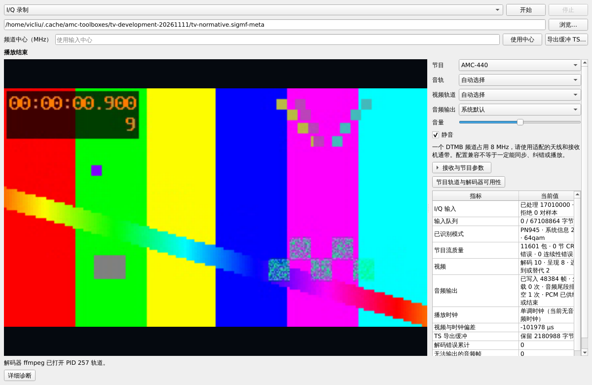

# DTMB 电视播放与 0.2.10 发布验收

[English](2026-11-11-dtmb-television-release.md) · 简体中文

正式构建、签名发布及 31.42／uConsole 部署已完成。发布源码为 `3612f78392e2d3b43288770f82721bca7ccdac5a`，版本为 [AMS 0.2.10](https://github.com/vicliu624/AMC/releases/tag/v0.2.10)。六平台流水线、包身份、两台设备及原生媒体结果汇集于[最终证明](2026-11-11-dtmb-release-0210-proof.json)。功能通过、跳过项、平台时延资格受阻和天线实收未验证分别报告。

## 软件交付范围

DTMB 电视提供者完成实时 I/Q／SigMF I/Q 文件到节目播放的链路：采样定时、PN 与系统信息、均衡、解交织、LDPC／BCH、解扰、有效 TS、PAT／PMT／SDT、节目与音视频轨道、画面及 PCM 输出。可直接打开 TS，选择音频设备、音量与静音，开始／停止，导出有界缓冲中的有效 TS。

提供者通过既有实时研究注册进入 View 和 DTMB 事件操作。接收参数、联动、推荐、整体校验、节目文本编码与媒体解码分别由所属模块维护；稳定主窗口没有新增 DTMB 或接收机 ID 行为分支。具体约束见[播放规格](../20-DTMB节目流与电视播放规格.md)。

媒体输出独立调度，等待未来视频不再阻塞音频生产。编码后的消息头、JSON、载荷和正在写出的消息计入预算。输入拒绝、纠错或传输异常、解码错误、视频迟到、音频欠载和正常尾段排空分别保留。

## 输入、模式与实际媒体

| 范围 | 已验证的结果 | 证据边界 |
|---|---|---|
| 独立规范波形，恒定 SI | 72／72：66 种 C3780 PN／SI 组合与 6 种当前支持的 PN595／4QAM C1 配置；全部 593 个合成媒体包逐包一致，节目 101／202，CRC、连续性、最终 LDPC 校验重量和 BCH 未清洁块均为 0 | 每组 1200 帧，约 0.667–0.750 秒 |
| 独立规范波形，超帧首帧 SI1／SI2 | 另 72／72，保留规范 PN 相位表，全部媒体包及纠错检查通过 | 不包括运行中改变调制、编码率或交织方式 |
| 10 MS/s CI16LE／CU8 | 各自实际经过同一接收链路，自动 PN945／SI22、双节目、全部 593 个媒体包和完整传输／纠错检查通过，无量化削顶 | 约 1.125 秒；不是 USB 设备实收 |
| 独立 16 MS/s I/Q 参考 | 6651 个 TS 包；四种样本起点以及 ±50 ppm 恒定偏差有恢复对照 | 0.78125 秒，不是长期漂移跟踪 |
| 真实 AVS+ | 官方参考的五帧校验和全部相符；实际播放呈现验证 | 视频单轨，不能作为音频证明 |
| 真实 DRA | 291 帧视频、599040 帧非零 PCM，实际 PID 与节目选择验证 | 保留参考中两项已知部分输入诊断 |
| 实时订阅与过载 | 短 I/Q 按时钟循环 8 秒后主动突发；第二订阅者收到相同 113548576 对样本；电视分析队列峰值 67104704 字节，不超过 67108864 字节预算；拒绝 57211888 对样本并报告 | 循环边界与突发过载不是独立长广播；不能把电视分析拒绝写为采集或另一订阅者丢样 |

上述历史实验、具体输入、哈希及原生开发验证见[阶段记录](2026-11-11-DTMB节目解码阶段验证.md)、[模式矩阵](2026-11-11-dtmb-waveform-matrix.json)和[补充证明](2026-11-11-dtmb-output-qualification.json)。它们证明相应输入与算法行为，不能替代最终发布包的来源身份。

外部广播参考只用于验证，未随应用、工具箱或源码分发。仓库中的双节目测试图与正弦波为独立合成夹具，有单独的命令、来源和哈希说明。

## 音频调度与平台时延资格

最初在同一连续音频上复现约 175 ms 的供给空档，媒体回归修复前实测 174437 µs。独立输出调度修复后，本地三次固定观测为 24104／24068／24074 µs，中位数 24074 µs；没有增加播放器缓冲来掩盖该错误。

macOS 托管环境随后反复出现原始间隔超限，全部失败数据保留：

| 发布候选验证轮次 | 三轮最大原始音频到达间隔（µs） | 中位数（µs） |
|---|---|---|
| 42975327453 | 126718／130233／154945 | 130233 |
| 42975933462 | 139242／161163／148354 | 148354 |
| 42978533967，已申请交互 QoS | 172614／167911／152253 | 167911 |
| 42981537068，已加入独立控制 | 171282／101596／168500 | 168500 |

42978533967 中 QoS 申请成功，但写出截止时间仍延迟约 133–150 ms，实际管道写出只有几十到几百微秒。不能写成“QoS 已修复 macOS 的时延问题”。

独立[原生等待探针](https://github.com/vicliu624/AMC/actions/runs/42980961157)没有加载 Qt 或媒体编解码器。在相同的交互 QoS 下，标准条件变量、pthread 相对条件等待、Mach 信号量和 Mach 绝对等待分别运行三批、每批 32 次的 24 ms 请求；十二批中位数为约 53.6–84.7 ms，最大等待约 98–108 ms。这表明该托管环境的定时能力不足以直接资格认定低延迟输出，不能把每个音频空档都归因为应用代码；也不能据此确定某一次空档的具体原因。

正式回归保留 120 ms 原始中位数门槛和固定三轮，同时运行独立 24 ms 控制。只有满足播放规格中明示的反复控制失准条件，时延才记为平台外部阻断（CTest 77／跳过）；完整媒体帧、零新增解码错误、队列预算及 EOF 排空仍必须通过。原始超限不改写成通过，也不扣除控制时间后宣称达到原门槛。每个平台的完整 LastTest.log 随流水线保留。

42981537068 的控制中位数分别为 94113／144322／87564 µs，但第二轮媒体结束时只有 6 个控制观测，未满足规定的最少 8 个，因而保持失败。后续只修正控制采样生命周期：媒体结束后最多再收集两秒，以补足相邻控制窗口；门槛、最少样本数和原始媒体结果均保持不变。

候选源码 `32e83de` 的三轮原始间隔为 117060／162248／165753 µs，中位数 **162248 µs，未达到原始时延门槛**。控制样本数分别为 8／8／12，中位数为 85399／128784／44156 µs；控制中位数的中位数为 85399 µs，符合预先声明的平台失准条件。该项明确记为平台时延资格受阻；媒体完整性、队列预算和排空检查通过。这不是 macOS 低延迟通过的证明。

同一候选在实际归档中另取得 141499／120081／113282 µs，中位数 120081 µs，控制数据再次满足平台失准条件。但归档检查器当时尚未识别该调用声明的 77，仍以错误终止。后续为通用检查器增加单项声明的跳过协议，只有此调用明确声明 77；默认非零和该调用的其他错误仍失败。成功、声明跳过、未声明跳过及真实错误四种独立进程返回情况均检查，后续媒体与界面检查继续执行。

Apple 的 [QoS 指引](https://developer.apple.com/library/archive/documentation/Performance/Conceptual/power_efficiency_guidelines_osx/PrioritizeWorkAtTheTaskLevel.html)说明其与调度、I/O 和计时延迟的关系；上述结果是本次实测，不是 Apple 对硬实时的保证。

## 正式包与原生平台

[同一冻结提交的正式流水线](https://github.com/vicliu624/AMC/actions/runs/42987202863)六个原生平台任务均成功。原生 CTest 合计 424 项通过、6 项按原因跳过、0 失败；Ubuntu x64 另运行 7 项历史 Sub-GHz 回归，全部通过。

| 平台 | 原生通过／总项数 | 跳过项 |
|---|---|---|
| Debian 13 x64 | 71／72 | 默认音频输出不可用，FM 设备输出恢复测试 |
| Debian 13 ARM64 | 71／72 | 默认音频输出不可用，FM 设备输出恢复测试 |
| Ubuntu 24.04 x64 | 71／72 | 默认音频输出不可用，FM 设备输出恢复测试 |
| Ubuntu 24.04 ARM64 | 71／72 | 默认音频输出不可用，FM 设备输出恢复测试 |
| Windows x64 | 69／70 | 默认音频输出不可用，FM 设备输出恢复测试 |
| macOS ARM64 | 71／72 | 独立控制失准，媒体时延资格受阻 |

每个平台都使用真实安装目录／解压后的归档验证主程序、模块及电视提供者，实际解码 AVS+ 五帧校验和与 DRA 的 291 帧视频／599040 帧 PCM，检查参数控制、实际播放、停止及独立工具箱安装。路径包含中文与非 BMP 字符；Mac 检查移除了开发环境的动态库路径，核对 Mach-O 依赖。24 个包的 manifest、大小、SHA-256、六个 GUI 及媒体辅助进程、四个 DTMB 辅助进程、七个语言资源域、固定 FFmpeg 源码归档及相关许可证逐项检查。Mac 接收机工具箱携带其复制的运行库对应的源码与许可证。平台 CI 不接触正式发布私钥。

最终 Mac 构建目录的三轮原始音频间隔为 169914／121216／134712 µs，中位数 134712 µs；解压归档中另为 160061／151959／142454 µs，中位数 151959 µs。两组控制均满足预先声明的失准条件，因此均记录平台时延资格受阻。其余五个平台的构建与归档两组原始 120 ms 中位数检查通过；这些短输入结果仍不是硬实时保证。

## 发布、部署与实机复验

正式 Release 包含 24 个包、5 个独立归档和签名目录，共 30 项资产。远端资产大小和 SHA-256 全部与本地审查文件一致后才公开为 latest。Ed25519 目录序号为 `1794387016`，合并后包含 128 条包记录；签名前验证旧目录、资产与编译信任锚，签名后再次验签。私钥始终在仓库外的开发机使用。

两台设备均通过同一受信任目录和通用安装事务安装应用、RTL-SDR 接收机支持、SDRplay 接收机支持及功率报告工具箱，四个本次官方包均为 0.2.10。激活助手启动实际 GUI，验证 nonce／版本／PID 启动凭据；随后核对运行进程的可执行文件、发布包 GUI 哈希、稳定 CLI 入口和实际加载的受管接收机模块。

| 设备 | 平台 | 实际进程 | GUI SHA-256 前 12 位 | 结果 |
|---|---|---|---|---|
| 31.42 | Debian 13 x64 | 1252198 | `5c7dff324406` | 0.2.10 激活及运行核对通过 |
| uConsole | Debian 13 ARM64 | 26108 | `36dfd8446f9a` | 0.2.10 激活及运行核对通过 |

31.42 由受管 0.2.9 更新；激活时旧进程已退出，使用既有桌面会话启动新版。uConsole 由已知旧式安装迁至受管入口；原有 current 链接、通用及接收机专用桌面入口指向稳定启动器。沿用用户配置目录，安装没有删除用户录制。31.42 保留系统代理，运行进程未带入开发用临时代理；在线访问失败仍按原有网络错误语义显示。

uConsole 未接天线。按用户本次明确要求，uConsole 实机验收仅包含 ARM64 构建来源、安装、启动、版本及模块加载，不做射频扫描、吞吐或实际性能测试；原生播放及设备输出数据属于 31.42，不扩写为 uConsole 的性能证据。

31.42 的短输入复验使用正式安装包中的媒体／DTMB 辅助进程、运行库及语言资源，并核对媒体辅助进程与审查包的 SHA-256。独立原生验证驱动在实际 X11／Pulse 会话中操作提供者；实际应用进程身份另按上表核验。

| 输入 | 视频解码／呈现 | 写入 PCM 帧 | 音频欠载／正常尾段排空 | 有效音频时钟最大偏差 |
|---|---|---|---|---|
| 完整规范 I/Q、节目 101 | 10／8 | 48384 | 0／1 | 13148 µs，7 次音频时钟观测 |
| AVS+ 官方参考 | 5／5 | 不含音轨 | 0／0 | 不适用 |
| DRA 参考、节目 301 | 291／290 | 599040 | 0／1 | 14999 µs，286 次音频时钟观测 |

规范输入实际恢复 11601 个 TS 包及双节目；初次呈现中两帧迟到或替代如实计数。实际切换节目 101 的音轨 PID 257／258，以及节目 202（PID 258），均取得相应解码与 PCM 输出。规范及 AVS+ 的解码错误为 0，DRA 保留两项已知输入诊断。上述音频均静音，不是人工听感确认。

## 实收与使用限制

31.42 的实际天线扫描发现 554／562 MHz 附近的 PN945 候选，但尚未恢复有效节目流；[白天复扫](2026-11-11-DTMB白天复扫.md)的环境限制仍然成立。此版本不宣称当地 DTMB 已经实收成功。

短参考、144 组短波形、恒定偏差和循环输入，不能证明长广播、连续变化时钟、运行中帧级模式变化或长时间硬件无丢样。设备输出验证使用静音，验证实际 PCM、设备时钟与欠载计数，没有人工确认扬声器听感。

通过 View → DTMB 电视进入模块：实时模式先在接收机中覆盖完整的 8 MHz 频道并开始接收，再在电视面板选择频道中心及“开始”；也可选择 SigMF I/Q 录制或节目流文件。节目表恢复后才能选择节目和音轨，输入、纠错、解码及输出状态分别查看。连接 AIO2／RTL-SDR 的 uConsole 可以播放兼容的录制或 TS；实时 DTMB 仍需具备完整频道通带的接收机。
