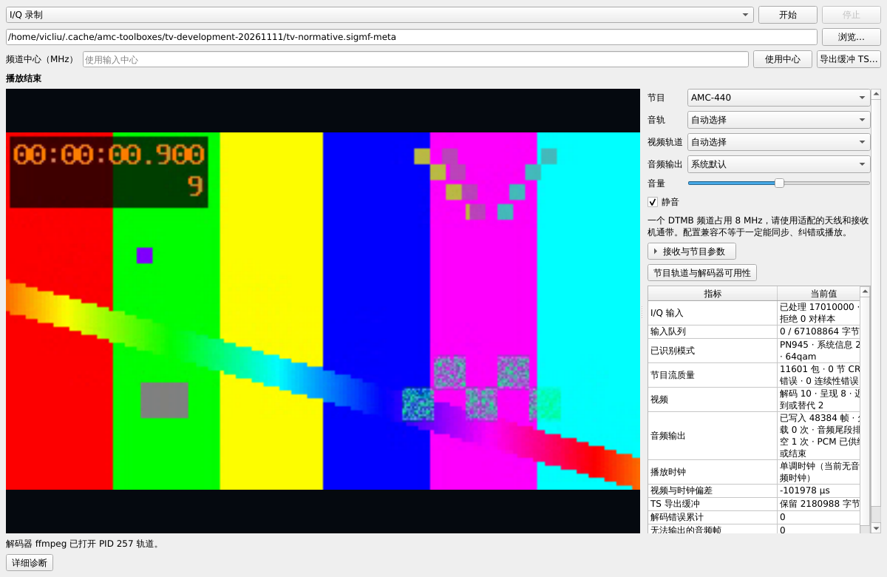

# DTMB television playback and 0.2.10 release acceptance

English · [简体中文](2026-11-11-DTMB电视播放与0.2.10发布验收.md)

Formal build, signed release and deployment to 31.42/uConsole completed from `3612f78392e2d3b43288770f82721bca7ccdac5a`, [AMS0.2.10](https://github.com/vicliu624/AMC/releases/tag/v0.2.10). [Final proof](2026-11-11-dtmb-release-0210-proof.json) collects platform/package/device/media evidence. Functional passes, skips, externally blocked timing qualification and unverified antenna reception remain distinct.

## Delivered chain

The television provider supports live or recorded SigMF I/Q through sampling timing, PN/SI, equalization, deinterleaving, LDPC/BCH, descrambling, valid TS, PAT/PMT/SDT, programs/tracks, video and PCM. TS files can also open directly. Controls include output device, volume/mute, start/stop and bounded valid-TS export.

Existing live-research registration exposes View/event actions. Owning modules maintain receiver parameters/dependencies/recommendations/whole validation, broadcast text and media codecs. The main window gained no DTMB/receiver-ID branches. See [specification 20](../20-dtmb-television.md).

Independent media output scheduling prevents waiting for future video from blocking audio production. Encoded headers/JSON/payload and in-flight writes count toward budgets. Input rejection, FEC/transport anomalies, decode errors, late video, underruns and normal EOF drain remain separate.

## Inputs and results

| Input/scope | Verified result | Limit |
|---|---|---|
| Independent standard waveform, constant SI |72/72:66 C3780PN/SI combinations plus6declared PN595/4QAMC1profiles; all593synthetic media packets exact; programs101/202; zero CRC/continuity/final LDPC syndrome/BCH unclean blocks |1200 frames/case, approximately0.667–0.750s|
| First-superframe SI1/SI2 markers |Another72/72, standardPNphase schedules, all packet/FEC checks |No midstream modulation/coding/interleaver changes|
|10 MS/s CI16LE/CU8 |Both discover PN945/SI22, two programs/all593 packets, complete transport/FEC checks, no quantization clipping |Approximately1.125s, not USB reception|
| Independent16 MS/s reference |6651 TS packets, four input origins and±50ppmconstant offsets |0.78125s, not long drift tracking|
| Real AVS+ |All five official frame checksums and actual presentation |Video-only, no audio proof|
| Real DRA |291video frames/599040nonzero PCM frames with actual PID/program selection |Two known partial-input diagnostics retained|
| Live subscription/overload |8spaced loop then burst; 113,548,576 pairs also reached an independent subscriber; TVqueuepeak67,104,704≤67,108,864 bytes; 57,211,888analysis rejects reported |Loop/burst not independent long broadcast; TVloss is not acquisition/other-subscriberloss|

Development history/inputs/hashes are in the [stage record](2026-11-11-dtmb-decoding.md), [mode matrix](2026-11-11-dtmb-waveform-matrix.json) and [supplementary proof](2026-11-11-dtmb-output-qualification.json). They qualify their inputs/algorithms, rather than replacing final package identity. External recorded media were not redistributed; repository test patterns/sine tracks are independently generated with provenance.

## Output scheduling and external timing qualification

The same continuous audio reproduced an approximately175msfeed gap; the new real-media regression failed before correction at174437 µs. Independent timestamp-scheduled output corrected it without larger buffering: three local maxima24104/24068/24074 µs, median24074 µs.

Hosted macOS repeatedly exceeded the original interval requirement; every failure remains:

| Candidate run | Three raw maxima µs | Median µs |
|---|---|---:|
|42975327453|126718/130233/154945|130233|
|42975933462|139242/161163/148354|148354|
|42978533967, interactiveQoSrequested|172614/167911/152253|167911|
|42981537068, independent control added|171282/101596/168500|168500|

QoSrequest succeeded in42978533967, yet deadlines were133–150mslate while actual pipe writes took tens/hundreds of µs. This did not prove QoSfixed timing.

An [independent native wait probe](https://github.com/vicliu624/AMC/actions/runs/42980961157), without Qt/codecs, tested standard condition variables, pthread relative waits, Mac h semaphores and absolute waits under the same interactiveQoS: three batches each,32requests of24ms. Twelve batch medians were approximately53.6–84.7ms, maxima98–108ms. That host could not directly qualify low-latency output. It neither assigns every media gap to application code nor establishes each gap's cause.

Regression retained the raw120msmedian threshold and fixed three runs, plus independent24mscontrols. Only the specification's repeated control-failure condition permits external-blocked timing (CTest 77/skip). Complete media, no added decode errors, budgets and EOF drain remain mandatory. Raw failure is not relabelled a pass or corrected by subtracting control latency. FullLastTestlogs are retained per platform.

Run42981537068had control medians94113/144322/87564 µs, but the second run had only6 observations versus minimum 8, so it remained failed. The subsequent change only extended control collection up to2safter media EOF to fill adjacent windows; thresholds/minimum counts/raw media stayed unchanged.

Candidate`32e83de`raw117060/162248/165753 µs had median162248 µs, **failing the original threshold**. Controls had8/8/12 samples and85399/128784/44156 µs medians; their median85399 µs met the predeclared external-failure condition. Media integrity/budgets/drain passed; low-latency macOS did not. The extracted archive separately measured141499/120081/113282 µs, median120081 µs, again externally blocked. The old archive checker did not recognize this invocation's declared77and failed. A generic per-invocation skip protocol then covered success/declaredskip/undeclaredskip/realerror; only this call declared77, other errors still fail and later checks still execute.

[AppleQoSguidance](https://developer.apple.com/library/archive/documentation/Performance/Conceptual/power_efficiency_guidelines_osx/PrioritizeWorkAtTheTaskLevel.html) describes scheduling/I/O/timing relationships, without hard-real-time guarantees. All numbers above are observations from these candidates.

## Actual packages and platforms

[Final frozen-source pipeline42987202863](https://github.com/vicliu624/AMC/actions/runs/42987202863) completed all six native jobs: 424 passed,6reasoned skips,0failures; Ubuntu x64also passed7legacySub-GHz checks.

| Platform | Passed/total | Skip |
|---|---|---|
| Debian 13x64 |71/72|Default audio unavailable, FM output recovery|
| Debian 13 ARM64 |71/72|Same|
| Ubuntu 24.04x64 |71/72|Same|
| Ubuntu 24.04 ARM64 |71/72|Same|
| Windows x64 |69/70|Same|
| macOS ARM64 |71/72|Independent-controlfailure, media timing externally blocked|

Each actual installation/extracted archive ran application/modules/TVprovider, real AVS+ five-frame checksums and DRA 291video/599040 PCM, parameter controls, actual playback/stop and independent toolbox installation. Paths includedChinese/non-BMP. macOS removed development library-path overrides and audited Mach-O closure. All24manifests/sizes/hashes, six GUIs/media helpers, four DTMB helpers, seven resource domains, pinned FFmpeg source archive/licenses were checked. Mac receiver toolboxes included source/notices for copied runtimes. Formal private keys stayed outside CI.

Final macOS buildraw169914/121216/134712 µs median134712; archived160061/151959/142454 µs median151959. Both controls met external-failure criteria. The other five platforms passed both build/archive raw120msmedian checks on these short inputs, without hard-real-time promises.

## Publication and actual deployment

Release30assets comprised24packages,5archives, catalog. Uploaded size/SHA-256 matched local review before publication aslatest. Ed25519catalog1794387016merged128records. Previous catalog/assets/compiled trust anchor were verified before signing and signature checked again afterward. The key remained outside the repository on the development machine.

Both devices installed application/RTL-SDR/SDRplay/powerreport0.2.10through the same trusted catalog/generic transactions. Helpervalidatednonce/version/PID healthcredentials; executable/path/hash/stable CLI/loaded modules were independently checked.

| Device | Platform | Observed PID | GUI SHA-256 prefix | Result |
|---|---|---:|---|---|
|31.42|Debian 13x64|1252198|`5c7dff324406`|Activated/verified0.2.10|
|uConsole|Debian 13 ARM64|26108|`36dfd8446f9a`|Activated/verified0.2.10|

31.42updated managed0.2.9after old-process exit using the existing desktop. uConsole migrated its known legacycurrent/desktopentries to stable launchers. Userconfig/recordings remained.31.42retained systemproxy/no development tunnel; online failure retained normal network-error semantics.

**uConsole had no antenna.** Under the user's explicit scope, its checks covered ARM64 source/install/start/version/modules, without RF scan/throughput/performance. Media/device-output numbers below belong to31.42, not uConsole.

An independent native driver exercised actual X11/Pulseprovider controls using formal installed helpers/runtimes/resources, whose media-helperhash matched the reviewed package. Actual application identity was checked separately above.

| Input | Video decoded/presented | PCM frames written | Underruns/normal EOF drains | Maximum valid audio-clock deviation |
|---|---|---:|---|---|
| Complete standardI/Q, program 101 |10/8|48384|0/1|13148 µs,7 observations|
| Official AVS+ |5/5|Noaudio|0/0|N/A|
| DRA program 301 |291/290|599040|0/1|14999 µs,286 observations|

Standard input recovered11601 TS packets/two programs; two late/replaced first-presentationframes remained counted. Actual program 101 PID 257/258andprogram202 PID 258switches produced corresponding decoder/PCM output. Standard/AVS+ had0decodeerrors; DRA retained2knowninputdiagnostics. Audio was muted, without human listening.

## Reception and use limits

Actual antenna scans at31.42found PN945 candidates near554/562 MHz without valid program streams; [daytime survey](2026-11-11-dtmb-daytime-rescan.md) limitations remain. No local DTMB program-reception positive is claimed. Short references,144shortwaveforms, constant offsets and loops do not qualify long broadcasts, continuously changing clocks, midstream mode changes or hardware continuity. Muted PCM/deviceclock/counterchecks are not subjective loudspeaker listening.

At this release date, View → DTMB television opened the module. Live use required complete8 MHz receiver coverage and reception before selecting center/start; SigMF/TS files were alternatives. Programs/tracks become selectable after catalog recovery; input/FEC/decoder/output states are inspected separately. AIO2/RTL-SDR hosts can play compatible recordings/TS, while live DTMB needs full-channel receiver bandwidth. Later independent-lease work changes acquisition lifecycle as specified in21.
