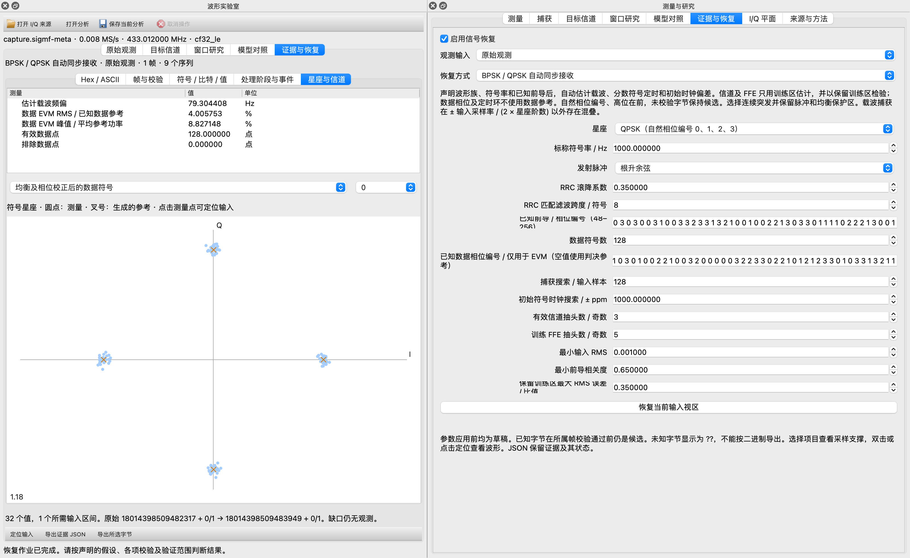
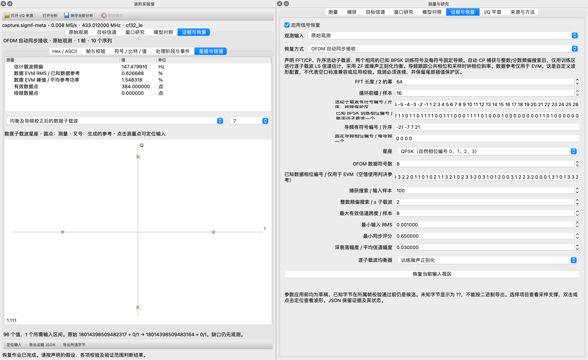

# macOS 原生部署与接收流程验收

[English](2026-11-12-native-macos-deployment.md) · 简体中文

用户提供 Intel Mac 后，macOS 本机验收和评审部署已经完成。此前报告中的“macOS 延期／没有原生环境”是历史状态，本报告更新该结论。验证范围为这台 **macOS 14.3.1、x86_64** 机器；Apple Silicon 和实体射频采集分别列为未验证。

## 版本与实际入口

- 构建源码：`b06c3b5c1f402680d67e1eb306e33b51688dc38c`，分支 `codex/waveform-lab`，应用版本 `0.2.11`。本轮为本地评审构建，没有创建正式发布标签、上传资产或签名在线目录。
- 源码归档 SHA-256：`f2e8a2a6b911281dba9b08d26019740180251efa8607781f1abcad3833717361`。
- 用户 Applications 与桌面入口：`AMS 波形实验室评审.app`。
- 安装根：`/Users/liuweikai/Applications/AMS-Review-PSK-OFDM-20261112-macOS-r1`。
- 样例：安装根下 `评审用例 📡`；同目录提供 `评审操作说明.md`。设置、事件和工具箱状态使用本评审目录。
- 部署后的 `--build-info` 返回 `macos-x86_64 / 0.2.11 / receiver_abi 1`；`rtlsdr`、`sdrplay` 模块被发现并加载。正常入口曾以 PID `22270` 运行，命令行指向上述实际安装，而非开发目录。
- 171 个普通文件逐一与已验收归档解出的树比对 SHA-256；符号链接另比对目标。应用签名、提供者发现和使用真实评审设置的布局重启再次通过。普通启动器不带截图退出或重复应用布局的参数。

## 构建与架构调整

使用机器已有的 LLVM 21.1.8、macOS 14.4 SDK，以及独立缓存内的 CMake 3.31.10、Ninja、Qt 6.8.3。部署下限为 macOS 14.0；实际包审计核对每个 Mach-O 的系统下限，不把本机结果外推到其他系统版本。源码与固定依赖归档校验后进入任务缓存；没有修改系统 SDK 或替换其他应用。

变化轴、所有者和验收约定见[规格 26](../26-macOS原生构建与部署验收规格.md)：

1. libc++ 缺少本项目使用的 `atomic<shared_ptr>` 特化。捕获与研究后台内部发布改用标准共享指针原子函数，沿用媒体播放既有做法。读、写、交换都保持原子访问和默认顺序一致性；没有扩大锁范围到 DSP 或文件操作，也没有修改公开协议。
2. LLVM 头文件与系统 libc++ 不配套时，链接缺少 `std::__1::__hash_memory`。构建使用匹配的运行库，通过通用 CMake 声明分发 `libc++`、`libc++abi`、`libunwind` 及通知文件；依赖按每个加载者计算相对路径。没有把运行库名称分支加入界面、会话或安装器。
3. 应用包在全部重定位完成后递归签名；独立工具及相邻运行库采用叶子签名。包内 Frameworks 进入部署工具搜索；最后一轮没有前期的 FFmpeg 依赖扫描错误。审计保留非系统绝对路径和缺失实际依赖的拒绝，只纠正合法目录锚点 `@loader_path` / `@executable_path` 的判定。
4. 功率报告提供者通过已有 `resources` 清单声明完整运行库与通知，开发和安装资产一起生成。GUI 回归夹具按清单复制载荷；保留的资源清单安装兼容接口及受管工具箱事务没有增加库名称或工具 ID 分支。当前界面的安装入口仍进入受控工具箱中心，本次没有增加任意本地导入入口。
5. 原生截图暴露出紧凑窗口的真实遮挡。文件范围编辑保留在原始观测／目标信道页，工具栏使用系统小图标；通用复数证据页使用滚动容器，测量、选择器和图各自保留空间。PSK/OFDM 的紧凑检查验证实际可见区域，独立复数提供者验证可见点命中及精确定位。没有按窗口缩放重新应用工作区布局。

独立运行库扩展另用 `libfuture-provider.1.dylib` 验证：只增加声明与资产，通用重定位器内容不变；归档解到 `独立提供者 📡`，撤走原提供者路径，程序仍执行成功，五个 Mach-O 分别通过依赖及签名检查。最终重定位器 SHA-256 为 `aaa5468b43b1f02e906a2dbdfc7529182a628d0f86e0fa74f54482ad46fcb20f`。

## 已验证的流程

| 项目 | 最终结果 |
|---|---|
| Mac 完整 CTest | 102 项全部通过，0 失败，0 跳过；约 119 秒 |
| Cocoa 组件流程 | 常规、请求 1.25 倍缩放、640×480 三种模式均通过；包括 FSK、LoRa、成对编码、PSK/OFDM、保存重开、导出、错误保留与独立提供者／语言资源 |
| 六组评审样例 | 原生控件生成、保存并由新组件逐份重开；均为明确配置的独立合成真值，不需要接收机 |
| 真正分发的四个包 | 应用、两个接收机工具箱、功率报告工具箱的真实解包、安装事务和组件加载均通过 |
| 中文及非 BMP 路径 | 从完整归档解到 `AMS 完整发布验收 📡`，主体、模块、实时研究提供者、实际 Cocoa 工作区启动均通过 |
| 实际 GUI 布局重启 | 安装后的程序在常规、紧凑、缩放场景跨进程恢复布局通过；部署后的实际评审设置再次重启通过 |
| 解包后的完整桌面回归 | 通过，约 121 秒；包括实际媒体解码和播放、DTMB 辅助程序、CLI、旧资源清单安装兼容接口、研究工具的实际 GUI 调用及移除、GUI 回放 |

原生组件的文件选择测试使用 Qt 文件对话框，检查对话框确实接受路径以及导出结果落盘；Cocoa 窗口渲染、实际应用进程和安装后的 GUI 检查分别留证。自动化通过不替代本次用户对原生交互体验的评审。

Mac 是 Retina 屏，截图像素不能当作逻辑窗口尺寸。最后一轮实际 PNG 为常规 `3200×1964`、请求 1.25 倍缩放 `3585×1965`、紧凑 `1280×960`；系统限制了较大窗口的可用尺寸。紧凑模式的逻辑 `640×480` 另有显式断言。没有将请求的宽屏尺寸写成系统实际回读尺寸。

六组文件依次为：`01-波形与模型`、`02-FSK字节与校验`、`03-LoRa-PHY`、`04-成对编码候选修复`、`05-QPSK同步均衡与EVM`、`06-OFDM同步均衡与EVM`，后缀均为 `.amc-analysis.json`。评审时可依次检查修改参数后应用、切换平面／组、选中数据定位输入、导出证据／允许的字节、另存分析和重新打开。

当前 Mac 样例截图中的 QPSK 已知数据 RMS EVM 为约 `4.005753%`、有效数据 128 点；OFDM 为约 `0.626688%`、有效数据 384 点。它们对应本报告的样例配置，不等同于此前长突发测试的数值，更不是射频性能保证。训练、导频、生成参考和实际数据的语义继续按[规格 25](../25-PSK与OFDM接收及EVM规格.md)区分。

[紧凑星座可见区域截图](2026-11-12-macOS-紧凑星座.png) · [实际安装应用的工作区截图](2026-11-12-macOS-评审工作区.png)

## 包与部署证据

| 包 | SHA-256 |
|---|---|
| `org.amc.ams` | `db82cc004ddcdf690f33e18f9c255694a9a124ff0472b05f590f62300e5bd2da` |
| `org.amc.receiver.rtlsdr` | `6e5cb0e40c49ddea6936d641a93b62a55434219a8e79cf641ecbbe382819e88c` |
| `org.amc.receiver.sdrplay` | `9979e672853a841ab8d3599ac08d66e22a4b770d44822d25d2618d5ae1a7f62a` |
| `org.amc.research.power-report` | `54d4ac1ad75a0b73267cb87f90f5f057b675be027dc06ed3e83de8c2242c9801` |

实际用于部署的完整归档 `AMS-macos-x86_64-full-stage.zip` SHA-256 为 `d0a9d25ab7d45890cd16007bc4594ae84d1c38b0e01974c56e7bd154e9ed3417`。真实分发树包含应用包和独立研究载荷；原始 CMake 安装树中供开发使用的重复 `bin` / `libexec` 不作为另一套便携应用分发。审计没有排除实际分发树中的任何 Mach-O。

Mac 私有证据根为 `/Users/liuweikai/.cache/amc-waveform-01a1c9fc-macos`，本轮包工作目录为 `release-qa/package-1794497504589631000`。最终原始记录包括 `native-build-result.json`、`logs/final-tests.log`、`logs/LastTest-b06c3b5.log`、包目录的 `result.json`、`bundle-audit.log`、`real-package-transactions.log`、`extracted-desktop-regression.log`，以及 `review-deployment.json`。登录凭据不进入仓库、报告或部署启动器。

## 跨平台回归与持续输入

同一 `b06c3b5` 源码在 Windows/Linux 重新构建，三平台的新原生组件常规／缩放／紧凑流程均通过。Linux 完整回归为 102 项中 99 通过，三项既有 SDRplay 外部条件检查跳过；Windows 最终完整串行回归为 100 项中 99 通过，一项既有音频设备条件检查跳过，0 失败，约 246 秒。本轮实际新增部署为 Mac；Windows/Linux 原有 `r2` 安装及其 `7e0111c` 包证据仍见[前次接收验收](2026-11-12-PSK与OFDM接收验收.md)，不把源码回归写成这些安装已替换。

Windows 日志为 `logs/native-b06c3b5/windows-tests-final.log`；Linux 为 `logs/final-tests.log`。三种原生组件截图与结果各保存在两平台 `native-qa/b06c3b5-*`，`native-qa/latest-final.json` 指向最后一轮。

捕获兼容改动另执行单次 180 秒、1 MS/s、256 对样本／块、64 KiB 输入队列和 128 KiB 保留预算的节拍合成输入。该独立捕获路径不包含实体设备，也不等同于整个应用在绘图、录制及全部分析同时开启时的吞吐资格。

| 平台 | 提供样本 | 接受 | 拒收 | 峰值队列字节 | 保留字节 |
|---|---:|---:|---:|---:|---:|
| Windows | 179,997,952 | 97,427,200 | 82,570,752 | 65,536 | 71,680 |
| Linux | 180,000,000 | 179,999,488 | 512 | 30,720 | 131,072 |
| Mac | 180,000,000 | 179,996,928 | 3,072 | 26,624 | 131,072 |

三者均通过预算、接受／拒收核算、处理完成和冻结不可变性断言。Windows 拒收较多，原始数据完整保留；旧实现的十秒对照也有拒收，但不据不同时长的两次运行断言原因或性能等价。**这些结果没有证明 1 MS/s 无丢样。** 基准链接的捕获库源码为 `7945031`，捕获实现与最终构建一致；手动时长测试源码为 `746fb2f`，SHA-256 `bfde8bc57e28adaa015456a9ced5c8754507d8729e38a9f57f9b74c61a2e3d41`。

## 失败历史与未验证范围

早期四并行 Mac 回归出现参数契约超时及媒体暂停检查失败，原始日志保留。媒体旧测试未先确认实际播放；延迟一秒启动的同一夹具能稳定产生两个零进度快照。修正后先限时等待活动播放，再在不处理 GUI 事件的 300 毫秒中分别验证音频解码和视频进度；延迟启动用例与最终全量检查通过。没有跳过该契约或放松播放进度断言。

早期安装还暴露了运行库闭包、合法目录锚点、签名顺序、分发树组装，以及外部工具完整资源声明的问题；截图复核补出了紧凑星座遮挡。各次原始记录均保留，最终新工作目录的十九个步骤全部成功。不能把后续通过写成此前从未失败。

Windows 的并行回归曾出现独立接收机子进程超时，单项复验通过；不根据伴随的 RDRND 警告判定原因。一轮串行复验又因本次执行时额外设置全局资源目录，遮蔽了独立资源布局夹具而失败，这是测试执行配置错误。移除该覆盖、由测试控制资源目录后，最终完整串行回归通过；前两轮日志及单项记录仍保留。没有修改产品逻辑、延长单项时限或跳过这两个扩展契约来取得通过。

**已验证：**本机 Intel 原生构建、数值／架构／扩展契约、Cocoa 控件流程、真实归档、工具箱事务、资源清单安装兼容接口、布局重启和实际评审部署。

**未验证：**Apple Silicon 原生构建与运行、其他 macOS 版本、Mac 上实体 SDR 的探测／采集及连续无丢样、射频校准、真实空口 PSK/OFDM 性能。模块可加载不等于相应设备和厂商后端可用；合成真值不等于任意空口自动识别。

**平台外部条件：**本次 Intel Mac 目标没有剩余环境阻断；Apple Silicon 环境与实体射频条件未提供。Windows/Linux 的既有跳过项保持原有外部条件说明。正式目录发布、Developer ID／公证及正式更新发布不属于本地评审部署。
