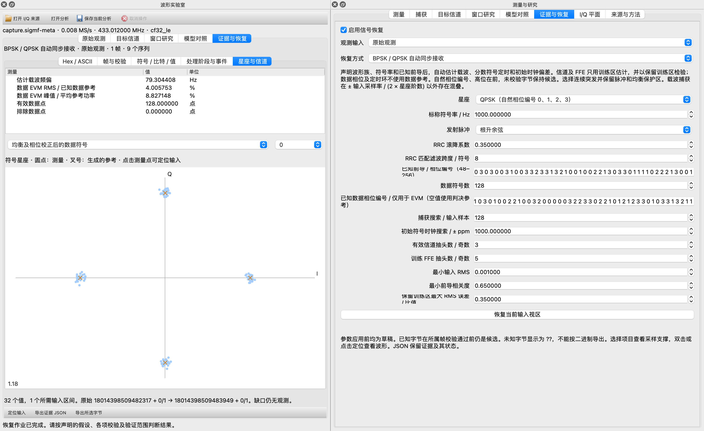
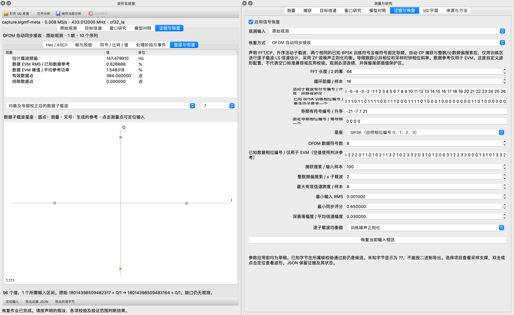

# Native macOS acceptance and review deployment

English · [简体中文](2026-11-12-macOS原生部署与接收流程验收.md)

After the user supplied an Intel Mac, native macOS and real-package acceptance and review deployment completed. Earlier reports' unavailable/deferred state is historical. This evidence applies to **macOS 14.3.1, x86-64**; Apple Silicon and physical SDR reception remain separate unverified items.

## Source and actual entry points

- Source `b06c3b5c1f402680d67e1eb306e33b51688dc38c`, branch `codex/waveform-lab`, application 0.2.11. This was a local review build, without release tags, public assets or a signed online catalog.
- Source archive SHA-256 `f2e8a2a6b911281dba9b08d26019740180251efa8607781f1abcad3833717361`.
- Applications/Desktop launcher: `AMS 波形实验室评审.app`; installation `/Users/liuweikai/Applications/AMS-Review-PSK-OFDM-20261112-macOS-r1`.
- Six cases in `评审用例 📡`, with `评审操作说明.md`; settings, events and toolbox state isolated under this review root.
- Installed `--build-info`: `macos-x86_64 / 0.2.11 / receiver_abi 1`; RTL-SDR and SDRplay modules discovered/loaded. Ordinary launcher PID 22270 was verified against the installed executable rather than a development tree.
- 171 ordinary files matched the accepted extracted archive by SHA-256; symlinks were checked by target. Signatures, providers and layout restart using actual review settings passed again. The ordinary launcher did not retain screenshot-exit or repeated-layout arguments.

These historical AMS names identify exact accepted artifacts. The later Foreshadow rename does not retroactively change their hashes or prove acceptance of a newly named bundle.

## Build and architecture corrections

The host used existing LLVM 21.1.8/macOS 14.4 SDK, with cached CMake 3.31.10, Ninja and Qt 6.8.3. Deployment minimum 14.0 was audited in every shipped Mach-O; this host does not qualify every OS version. Source/pinned dependencies were verified in task caches without changing the system SDK or other applications. Ownership is specified in [specification 26](../26-native-macos-acceptance.md).

1. The available libc++ lacked the used `atomic<shared_ptr>` specialization. Internal capture/research publication changed to standard shared-pointer atomic functions, matching the existing media approach. Reads/writes/exchange retained atomic access and default sequential consistency; DSP/file work did not move inside larger locks and public protocols stayed unchanged.
2. Mismatched LLVM headers/system libc++ lacked `std::__1::__hash_memory`. The build used matching libc++, libc++abi and libunwind with notices, declared generically in CMake and relocated relative to each loader. No library-name branches entered UI, sessions or installer.
3. Bundles were recursively signed after relocation; independent tools/adjacent runtimes were leaf-signed. Frameworks entered dependency search. The final scan no longer had the earlier FFmpeg error. Non-system absolute paths and genuinely missing dependencies remained rejected; only valid directory anchors `@loader_path`/`@executable_path` were classified correctly.
4. The power-report provider declared complete runtimes/notices through its existing `resources` list. Development/installed assets were generated together and GUI fixtures copied the declaration. Legacy resource-install compatibility and managed transactions gained no library/tool-ID branches. Installation still used the controlled Toolbox Center.
5. Native images exposed real compact-window occlusion. File-range controls remained on original/selected-channel pages, toolbars used small system icons and complex evidence used scrolling with separate space for measurements/selectors/plot. Compact PSK/OFDM checks asserted actual visibility; an independent provider checked visible hit-testing/exact location. Resizing did not reapply a workspace layout.

An independent `libfuture-provider.1.dylib` addition used declarations/assets only, without changing the relocator. Its archive ran after extraction into `独立提供者 📡` and removal of the original provider path; five Mach-O dependencies/signatures passed. Final relocator SHA-256: `aaa5468b43b1f02e906a2dbdfc7529182a628d0f86e0fa74f54482ad46fcb20f`.

## Verified workflows

| Item | Final result |
|---|---|
| Full native CTest |102 passed,0 failed/0skipped, about119s |
| Cocoa component workflows |Normal, requested1.25scale and640×480; FSK/LoRa/paired/PSK/OFDM, save/reopen/export, error retention and independent providers/language resources |
| Six review cases |Generated/saved/reopened by native components; explicitly configured independent synthetic truth, without receiver requirement |
| Four actual distributed packages |Application, two receiver toolboxes and power report: extraction, transactions and loading passed |
| Unicode/non-BMP installation |Complete archive extracted into `AMS 完整发布验收 📡`; application/modules/live providers/actual Cocoa workspace passed |
| Layout restart |Installed normal/compact/scaled cross-process restoration; actual deployed review settings checked again |
| Extracted desktop suite |Passed, about121s; actual media playback, DTMB helpers, CLI, legacy resource-install compatibility, GUI external-tool invocation/removal and replay |

Qt file-dialog tests asserted actual path acceptance and written output; Cocoa rendering, actual process and installed GUI had separate evidence. Automation does not replace the user's interaction review.

Retina pixels are not logical window size. Final PNGs were3200×1964(normal),3585×1965(requested1.25scale) and1280×960(compact). The OS constrained the larger request; 640×480 logical size had an explicit assertion. Requested dimensions were not misreported as actual readback.

Cases cover waveform/model, FSK bytes/checks, LoRa PHY, paired-code repair, QPSK and OFDM. Review parameter application, plane/group switching, source location, allowed-byte/evidence export and save/reopen. Sample QPSK known-data RMS EVM was4.005753%/128valid points; OFDM 0.626688%/384 points. These differ from earlier long-burst cases and are not RF guarantees. Training, pilots, generated reference and data follow [specification 25](../25-psk-ofdm-and-evm.md).

[Compact constellation](2026-11-12-macOS-紧凑星座.png) · [Installed workspace](2026-11-12-macOS-评审工作区.png). These are preserved historical images; the current showcase uses English screenshots from the receiver-connected workstation.

## Artifacts and deployment proof

| Package | SHA-256 |
|---|---|
| `org.amc.ams` |`db82cc004ddcdf690f33e18f9c255694a9a124ff0472b05f590f62300e5bd2da` |
| `org.amc.receiver.rtlsdr` |`6e5cb0e40c49ddea6936d641a93b62a55434219a8e79cf641ecbbe382819e88c` |
| `org.amc.receiver.sdrplay` |`9979e672853a841ab8d3599ac08d66e22a4b770d44822d25d2618d5ae1a7f62a` |
| `org.amc.research.power-report` |`54d4ac1ad75a0b73267cb87f90f5f057b675be027dc06ed3e83de8c2242c9801` |

Deployment archive `AMS-macos-x86_64-full-stage.zip`: SHA-256 `d0a9d25ab7d45890cd16007bc4594ae84d1c38b0e01974c56e7bd154e9ed3417`. The actual distribution tree contained bundle and independent research payload; development-only duplicate `bin`/`libexec` trees were not a second portable distribution. No shipped Mach-O was excluded from audit.

Private evidence: `/Users/liuweikai/.cache/amc-waveform-01a1c9fc-macos`, batch `release-qa/package-1794497504589631000`; `native-build-result.json`, `logs/final-tests.log`, `logs/LastTest-b06c3b5.log`, package `result.json`, `bundle-audit.log`, `real-package-transactions.log`, `extracted-desktop-regression.log`, `review-deployment.json`. Credentials were excluded from repository, reports and launchers.

## Cross-platform and sustained-input checks

The same `b06c3b5` was rebuilt on Windows/Linux. Normal/scaled/compact native components passed on all three. Linux: 99/102 passed,3existing SDRplay environment skips. Windows final serial run: 99/100 passed,1existing audio skip,0failures, about246s. Only Mac was newly deployed in this batch; earlier Windows/Linux r2 installations and `7e0111c` package evidence remain in the [previous report](2026-11-12-psk-ofdm-acceptance.md).

Windows log `logs/native-b06c3b5/windows-tests-final.log`; Linux `logs/final-tests.log`. Native results/images are under `native-qa/b06c3b5-*`, with `native-qa/latest-final.json` identifying the final run.

Capture compatibility was also exercised once per platform with180 seconds of paced synthetic input at1 MS/s,256 samples/block,64 KiB ingress and128 KiB retained budget. This isolated capture path excludes physical hardware and does not qualify simultaneous plotting/recording/all-analysis throughput.

| Platform | Offered | Accepted | Rejected | Peak queue bytes | Retained bytes |
|---|---:|---:|---:|---:|---:|
| Windows |179,997,952|97,427,200|82,570,752|65,536|71,680|
| Linux |180,000,000|179,999,488|512|30,720|131,072|
| Mac |180,000,000|179,996,928|3,072|26,624|131,072|

All passed budgets, accepted/rejected accounting, completion and frozen immutability assertions. Windows rejected substantially more; raw evidence is retained. The old implementation also rejected input in a ten-second control, but different-duration runs do not establish cause or performance equivalence. **No1 MS/s lossless guarantee follows.** Linked capture source was `7945031`, matching final capture code; manual-duration test source `746fb2f`, SHA-256 `bfde8bc57e28adaa015456a9ced5c8754507d8729e38a9f57f9b74c61a2e3d41`.

## Failure history and limits

An early four-way Mac run had a parameter-contract timeout and media-pause failure. The old media test did not first confirm active playback; a one-second delayed-start fixture consistently produced two zero-progress snapshots. It now waits boundedly for playback, then separately checks audio decoding and video progress during300ms without GUI event processing. Delayed-start and final whole-suite checks passed without skipping the contract or relaxing progress assertions.

Early package attempts exposed runtime closure, legal directory anchors, signing order, distribution-tree assembly and complete external-tool resources; image review exposed compact constellation occlusion. Original logs remain. The final new work directory completed all nineteen steps; later success does not erase earlier failures.

Windows parallel tests had an independent-receiver subprocess timeout; focused rerun passed. An accompanying RDRND warning did not establish cause. Another serial run mistakenly set a global resource directory, hiding independent-resource fixtures. Removing that execution override made the complete serial run pass. Those logs remain; no product change, longer timeout or skipped extension contract was used to obtain that result.

Verified: this Intel native build, numerical/architecture/extension contracts, Cocoa workflows, actual archives/transactions, resource-install compatibility, restart and deployment. Unverified: Apple Silicon, other macOS versions, physical Mac SDR discovery/capture/continuity, RF calibration and on-air PSK/OFDM performance. Module loading does not establish device/vendor-runtime availability; synthetic truth does not imply arbitrary-air-interface recognition.

No environmental blocker remained for this Intel target. Apple Silicon/physical-RF conditions were not supplied. Windows/Linux skips retain their external explanations. Formal catalog publication, Developer ID/notarization and formal updates were outside this local review deployment.
