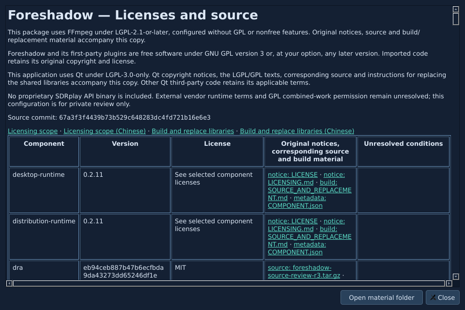

# GPL adoption and Windows/Linux review qualification

English · [简体中文](2026-11-13-license-adoption-review.zh-CN.md)

Runtime/source freeze: `67a3f3f4439b73b529c648283dc4fd721b16e6e3`. Qualified local review: **r3**. The main
application, CLI and first-party plugins now use **GPL-3.0-or-later** under
[the scope notice](../../LICENSING.md). Third-party components retain their terms.
These are private review deployments; no official catalog was signed or published.
The [machine evidence](2026-11-13-license-adoption-proof.json) records archives,
hashes, source identities, native tests, loaded-library paths and deployments.

## What is delivered

The application and each independent receiver/research package carry applicable
original notices, real pinned source archives, upstream copyright/license texts,
build/patch recipes and [replacement instructions](../../SOURCE_AND_REPLACEMENT.md).
The reviewed profiles contain 28 Windows and 27 Linux component records, including
assembly groups. The main application closure carries 396 Windows / 349 Linux
material entries. Complete stage sets contain 400 / 353 entries respectively.
They include original files from upstream LICENSES directories, Qt SDK SPDX/build
metadata, Debian original/patch source packages and Windows vcpkg port/triplet/
helper recipes. These are component/material counts, not counts of shipped libraries.

**Help → Licenses and source** renders provider-owned notices and the actual
source commit. Links and **Open material folder** expose the delivered files.
The native dialog below was rendered on the receiver-connected Debian workstation
using the packaged material and the desktop's own view/theme code, through the QA harness.

The material protocol is documented in [distribution compliance](../distribution-compliance.md).
Provider declarations and generic closure/ownership checks keep dependency logic
out of receiver/session/UI/installer consumers. The composer and signer reject
missing/changed material, source/build mismatches, unowned binaries and unresolved
conditions. The signer reopens archives and compares them with repository-reviewed
profiles, including retained catalog entries. Removing an issue or a prominent
notice cannot authorize publication. Review-only is a publication qualification,
not an additional restriction on rights granted by the GPL.

## Verified

| Check | Windows | Linux |
|---|---|---|
| Full native CTest | 105 total: 104 passed, 1 existing FM output skip, 0 failed | 106 total: 103 passed, 3 existing SDRplay mock-isolation skips, 0 failed |
| Licensing contracts | 14 passed, including an independent provider, missing/tampered source, issue erasure, deep notice paths and notice-view tampering | Same contracts passed |
| Real application + 2 receiver + research archive transactions | Passed in Chinese/non-BMP paths | Passed in Chinese/non-BMP paths |
| Extracted desktop/media regressions | Passed | Passed |
| Native license dialog and local material resolution | Passed | Passed |
| Clean first-party build from delivered production source | Passed; build info, receiver discovery and research provider startup passed | Passed; same checks passed |
| Compatible QtCore replacement and actual loaded path | Passed, inert PE trailer | Passed, inert ELF trailer and alternate prefix |

The Windows installer also has a native directory-reader contract: short-lived
readers can release and allow the final rename; persistent readers fail within
five seconds without advancing registry state. Errors retain native UTF-8 paths.
An early real-package failure motivated this generic transaction correction;
the final frozen archive passed on its first qualification run, without disabling
system protection or weakening package validation. The earlier lock owner's
identity was not established.

Qt source correspondence checks matched 21,617 qtbase, 2,637 qtmultimedia, 155
qtserialport and 3,396 qttools files against installed SDK source SPDX records,
including documented Windows CRLF checkout equivalence. Release archives omit
only Git ignore/attribute metadata in those comparisons, with separate `.tag`
metadata differences. qtsvg/translations source pins and SDK module metadata are
also retained. This is evidence of the supplied source identity, not a claim of
a byte-identical independent Qt rebuild.

## Review entry points and artifact identity

| Platform | Installed review | Full-stage archive SHA-256 |
|---|---|---|
| Windows | `C:\Users\vicliu\Apps\Foreshadow-Review-20261113-r3` | `5f03d657af966d1136c7a73440b8d26839b10a35bb0bdf2c6dcd67972c192280` |
| Linux | `/home/vicliu/Applications/Foreshadow-Review-20261113-r3` | `e78021eccf2e1083ec10dbaae0e54e78196cdfc14448942526643895d093da7a` |

The Windows **Foreshadow Review** desktop shortcut and Linux application menu now
point to r3. Both GUIs launched with `--language en`; build info, receiver modules
and research providers passed after deployment. Prior r2 directories and their
profiles remain available. The review folders retain the existing synthetic cases
and workflow guides. Source/code remains on branch `codex/foreshadow`; this report
and screenshot are later documentation evidence for the frozen runtime.

## External permission and unverified boundaries

The independent RTL-SDR and power-report archives pass the formal mechanical
material checks. The application and SDRplay archives deliberately fail that gate
on their recorded external permission condition. The API 3.15 installer-v2 AMD64
library hash matches the workstation installation; its included EULA is effective
2021-01-12. Hardware-use/reverse-engineering restrictions remain, and no explicit
redistribution/GPL combined-work permission has been established. The API binary
is excluded. Cached SoapySDRPlay3 source and matching installed/cached GNU build IDs
support attribution; their ELF byte hashes differ. No request was sent to the vendor.

The [firmware evidence](2026-11-13-firmware-license-evidence.json) comes from a real
build without flashing or RF transmission. It distinguishes initial archive
inclusion from final allocated sections: `libcoexist.a` contributes 1,275 bytes;
the named net80211/pp/phy/btbb/btdm binary archives have no measured live-section
contribution. Separate firmware grant, SDK component terms and Arduino LGPL
source/relink delivery remain open before firmware publication. Firmware images
and source are outside the desktop corresponding-source subset.

Complete Qt and all dependency SDKs were not freshly rebuilt. Clean first-party
builds reused the exact qualified Qt/native SDKs. Replacement tests used inert
compatible trailers and verified loaded paths; they do not establish arbitrary
ABI compatibility. Debian source uploader signatures were not independently
verified. macOS, long-duration live RF acceptance, codec patents and external
media rights are outside this qualification. Functional tests do not supply
missing upstream permission.
