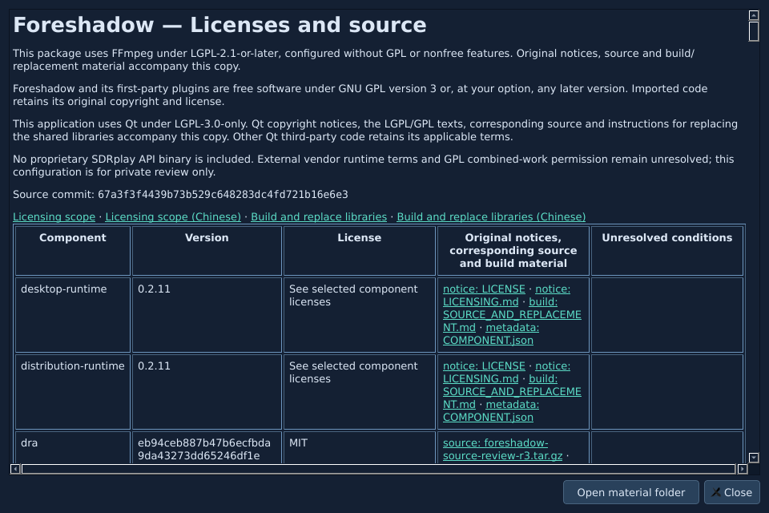

# GPL 落地与 Windows/Linux 评审版验收

[English](2026-11-13-license-adoption-review.md) · 简体中文

运行时／源码冻结：`67a3f3f4439b73b529c648283dc4fd721b16e6e3`，本地评审版 **r3**。主程序、CLI 与自研插件已按
[许可范围](../../LICENSING.zh-CN.md)采用 **GPL-3.0-or-later**，第三方保留各自条款。
本次是私下评审部署，没有签署或发布正式目录。[机器证据](2026-11-13-license-adoption-proof.json)
记录归档、哈希、源码身份、原生测试、实际加载路径与部署。

## 已交付的材料

主体与各独立接收机／研究包均携带适用的原始声明、真实固定源码归档、版权／许可证、
构建／补丁规则及[替换说明](../../SOURCE_AND_REPLACEMENT.zh-CN.md)。配置包含 Windows
28 个、Linux 27 个组件记录（含组装组）；主体闭包分别有 396／349 项材料，完整安装树
分别有 400／353 项。这些是组件／材料数量，不是运行库数量。包括上游 LICENSES 目录
原文、Qt SDK SPDX／构建元数据、Debian 原始与补丁源码包，以及 Windows vcpkg port、
triplet 和辅助规则。

**Help → Licenses and source** 按提供者声明显示醒目许可与实际源码提交，链接和
**Open material folder** 可查看附带材料。以下英文窗口来自接收机所在 Debian 工作站，
使用实际包材料及桌面同一份视图／主题代码，由验收程序调用原生渲染。

详细协议见[分发许可材料](../distribution-compliance.zh-CN.md)。提供者声明与通用闭包／
归属检查使接收机、会话、界面、安装器不增加按厂商 ID 的许可行为分支。组包和签名
拒绝缺失／变化的材料、源码／版本不符、未知二进制和未决条件；签名器重新打开归档，
对照仓库评审过的配置复查，保留的旧目录条目也须提供归档重验。删除未决项或醒目声明
不能获得发布资格。review-only 是发布资格结论，不是给 GPL 授予的权利添加限制。

## 已验证

| 检查 | Windows | Linux |
|---|---|---|
| 完整原生 CTest | 共 105：104 通过、1 个既有 FM 输出环境跳过、0 失败 | 共 106：103 通过、3 个既有 SDRplay 模拟隔离跳过、0 失败 |
| 许可契约 | 14 项通过，含独立提供者、缺失／篡改源码、删除未决项、深目录声明、篡改展示页 | 同一套契约通过 |
| 实际主体＋2 接收机＋研究包安装事务 | 中文／非 BMP 路径通过 | 中文／非 BMP 路径通过 |
| 解压后桌面／媒体回归 | 通过 | 通过 |
| 原生许可证窗口与本地材料路径 | 通过 | 通过 |
| 从交付生产源码干净重建第一方目标 | 通过；构建信息、接收机发现、研究提供者启动通过 | 通过，同样检查 |
| 兼容 QtCore 副本替换及实际加载路径 | 通过，使用无语义 PE 尾部数据 | 通过，使用无语义 ELF 尾部数据及独立前缀 |

Windows 另有真实目录读取句柄契约：短暂占用解除后可以完成目录提交，持续占用在
五秒内失败且不推进注册状态；错误保留原生 UTF-8 路径。早期真实安装失败推动了该
通用事务修正，最终冻结归档首次完整验收通过；未关闭系统防护，未放宽验收。此前
实际占用者的身份没有确定。

Qt 源码与 SDK 源 SPDX 比对分别匹配 qtbase 21,617、qtmultimedia 2,637、qtserialport
155、qttools 3,396 个文件，包含记录过的 Windows CRLF 等价校验。发行源码仅缺这些
比对中的 Git ignore／attribute 元数据，另有 .tag 元数据差异；qtsvg／翻译源码固定项
与 SDK 模块元数据也已保留。这证明交付源码身份，不代表独立 Qt 重建逐字节一致。

## 评审入口及归档身份

| 平台 | 安装目录 | 完整安装树归档 SHA-256 |
|---|---|---|
| Windows | `C:\Users\vicliu\Apps\Foreshadow-Review-20261113-r3` | `5f03d657af966d1136c7a73440b8d26839b10a35bb0bdf2c6dcd67972c192280` |
| Linux | `/home/vicliu/Applications/Foreshadow-Review-20261113-r3` | `e78021eccf2e1083ec10dbaae0e54e78196cdfc14448942526643895d093da7a` |

Windows 桌面 **Foreshadow Review** 快捷方式和 Linux 应用菜单已指向 r3。两个 GUI 都以
`--language en` 启动，部署后构建信息、接收机模块、研究提供者检查通过；旧 r2 目录与
配置保留，现有合成样例和操作指南沿用。代码位于 `codex/foreshadow` 分支；本报告和
截图是运行时冻结之后补充的文档证据。

## 外部授权及未验证边界

独立 RTL-SDR 和 power-report 归档通过正式机械材料检查；主体和 SDRplay 归档按记录
的外部授权条件主动拒绝正式放行。API 3.15 installer-v2 的 AMD64 库哈希与工作站安装
相同，随包 EULA 生效于 2021-01-12，仍有硬件用途和逆向限制，未建立再分发／GPL
组合使用许可；包内排除该 API 二进制。缓存的 SoapySDRPlay3 源码与安装前后相同的
GNU build ID 支持归属证据，两个 ELF 字节哈希不同。没有向厂商发送请求。

[固件证据](2026-11-13-firmware-license-evidence.json)来自实际构建，没有烧录或发射。
记录区分初始归档与最终已分配段：libcoexist.a 贡献 1,275 字节；列出的 net80211、pp、
phy、btbb、btdm 二进制归档没有测得有效段贡献。固件单独的第一方许可、SDK 组件条款
及 Arduino LGPL 源码／重链接交付仍待固件发布前解决；桌面对应源码子集不包含固件
源码和镜像。

完整 Qt 与全部第三方 SDK 没有重新从头编译；第一方干净重建复用准确版本的已验收
Qt／原生 SDK。替换测试使用兼容副本的无语义尾部数据并核实加载路径，不代表任意
ABI 修改兼容。Debian 源码上传者签名未独立验签。macOS、长期真实 RF 验收、编解码
专利和外部媒体权利不属于本次验收；功能测试不补足缺失的上游授权。
