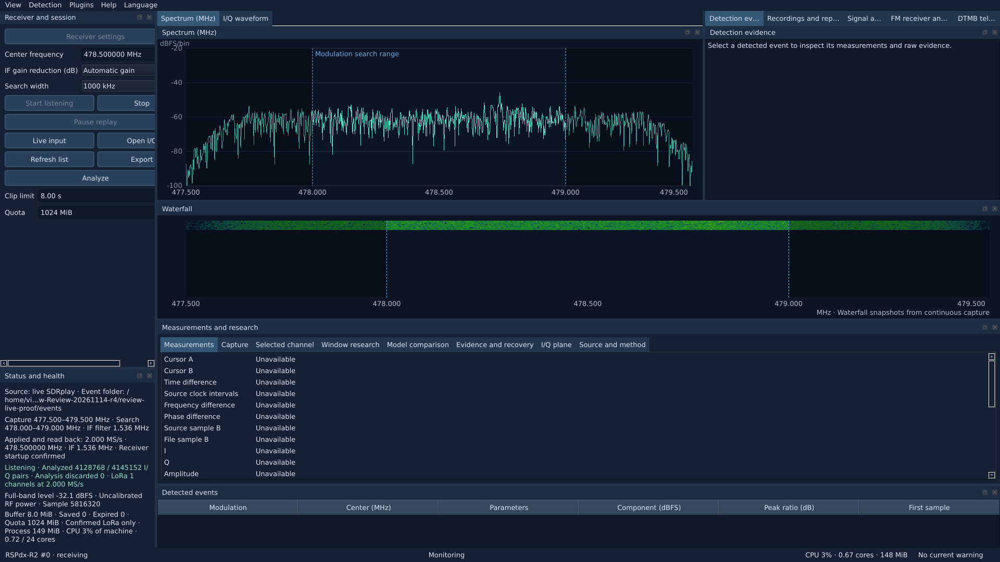

# Independent base, receiver service and Windows/Linux r4 qualification

English · [简体中文](2026-11-14-receiver-service-review.zh-CN.md)

Foreshadow **0.2.12 r4** delivers a separately composed base application and an
optional SDRplay service client. Runtime/source/material freeze:
`f763a3053db6e9edca4be23e50fb6c67ae42fab5`. The later documentation commit records
this freeze; it does not change those qualified binaries. Both native review
deployments are installed and start with the English UI. The
[machine evidence](2026-11-14-receiver-service-proof.json) contains archive hashes,
commands/results, source rebuilds, module observations and deployment identities.
No official catalog, production signature, release tag or public upload was made.

## Selection and implementation

SDRconnect was evaluated first against the existing acquisition/control contract.
Its published WebSocket 1.0.3 contract did not establish full IF gain reduction,
hardware AGC, hardware IF filter or advanced-setting parity. SDRconnect was not
installed on the receiver workstation, and its official installation-script URL
returned HTTP 403. No installer was executed or vendor terms accepted. This is a
published-contract assessment with native validation externally blocked, rather
than a failed native trial. The [service guide](../receiver-services.md) links the
official specification, capability matrix and installation instructions.

The fallback is unmodified upstream **SoapyRemote 0.5.4**, revision
`bd10a2e4a916bf66f0faa36dca7f043d4268138c`, under BSL-1.0. The application/client
does not redistribute the vendor API, local SoapySDRPlay3 driver or server binary.
Its client invokes only the remote registry, without the SoapySDR global factory
or local module loading. The previous Windows vendor DLL preload path is removed.
The receiver machine runs the independently installed upstream server with its
existing user-installed driver/API. No new vendor or firmware permission is claimed.

| Change axis | Owner and assembly | Stable consumers |
|---|---|---|
| Service endpoint, hardware rules and readback | SDRplay receiver provider, its resources and receiver CMake assembly | Generic settings UI, CLI and shared receiver sessions |
| Pre-discovery connection settings | Receiver request protocol 2; C ABI remains 1, legacy request behavior retained | Generic descriptors and settings passthrough; unsupported protocol rejected |
| Optional application contents | Provider-declared `bundle_with_application`, resource/runtime ownership | Generic composer, installer and signer |
| Corresponding source and notices | Package roots and reviewed platform profiles | Generic collector, archive gates and license viewer |

The host contains no new vendor-ID routing. Existing IDs, settings roots, command
names and recording metadata remain compatible. Independent-provider/resource
tests prove extension without changing the host binary. The client requires host
0.2.12; update older managed direct-link SDRplay toolboxes before using this setup.

Endpoint editing precedes discovery. Refresh/probe/application carry the same
saved connection settings; changing the endpoint invalidates stale device results.
Existing antenna/rate/gain/filter/advanced controls remain provider-owned. TCP
native CS16 streaming uses bounded frames and rate-based socket budgets. Reported
client reads are explicitly distinguished from unknown server-driver/hardware
loss counts. Overflow, abrupt end, cancellation and service death preserve the
accepted prefix and produce explicit outcomes.

## Verified results

| Check | Windows | Linux |
|---|---|---|
| Full native regression at `cb6fedf` | 106 total: 105 passed, 1 existing FM output-device compatibility skip, 0 failures | 107 total: 107 passed, 0 skips/failures |
| Licensing/package contracts | 17 passed | Included in the full native run |
| Actual application, RTL-SDR, service-client and research archives | All four reopened and qualified; real installation transactions passed | Same |
| Independent composed base | RTL-SDR only; no optional SDRplay module/private runtime | Same |
| Chinese/non-BMP extraction, toolbox discovery and native desktop/media workflows | Passed from final archives | Passed from final archives |
| Formal mechanical material gate | All four archives passed with no recorded issues | Same |
| Clean build from final delivered source | Configure/build, CLI build info, receiver modules and research startup passed | Same |
| Native license viewer and compatible QtCore substitution | Passed; actual replacement load path recorded | Same |
| Final packaged physical acquisition | 2 MS/s × 8 s = 16,000,000 accepted I/Q pairs | Same |
| Physical monitoring in the installed review GUI | CLI hardware proof plus native package GUI regressions | Listening state, confirmed hardware readback and advancing analysis observed |

The final source differs from `cb6fedf` only in the packaged-desktop CMake checker.
CMake 4.1.2 on Windows crashed with 0xC0000409 when normalizing an existing
non-BMP DLL path. A minimal matrix reproduced this with `file(REAL_PATH)` and
`cmake_path(NORMAL_PATH)`; an ASCII DLL worked. The checker now counts literal
Windows DLL entries; Unix retains real-path de-duplication for symlinks. The
original Unicode directories and complete workflow checks remain enabled. The
full native CTest suite was not relabelled as a run at the later freeze; final
extracted-archive workflows and source rebuilds were run at that freeze.

Native contracts use the actual upstream server with a separate test hardware
provider: continuous paced input, short reads, overflow, startup failure,
cancellation, malformed addresses, absent service, service death/restart and
retained-prefix byte counts. A local-driver constructor trap on the client side
proves that discovery does not autoload hardware modules. Connection-aware
independent providers, legacy callbacks, future/fractional/missing protocol
metadata, English/Chinese UI, saved endpoint precedence and resource fallback are
covered. Existing PSK/OFDM, PCM, FM, television, persistence and workspace
regressions remain in the package qualification.

Source rebuilds start from the actual delivered production-source archive and
pinned dependency source material. They rebuild first-party application,
providers/helpers and the SoapyRemote client, reusing the exact existing Qt/native
SDKs. They do not claim a fresh build of every dependency. QtCore substitution uses
a compatible copied DLL/ELF with an inert trailer and verifies the loaded path;
it is evidence of replacement/loading, not arbitrary ABI compatibility or a Qt
source rebuild.

## Physical service and UI

The receiver-connected Debian 13 workstation runs
`foreshadow-receiver.service` as a user service, bound explicitly to its trusted
LAN address. The independently built server lives under
`/home/vicliu/Applications/SoapyRemote-0.5.4-bd10a2e4` and carries upstream source,
BSL terms and build instructions. Observed process maps put the SDRplay API and
hardware driver in this service. Neither final Windows nor Linux Foreshadow
capture process loaded them. The service's observed hardware module set contains
the MIT SDRplay driver; no additional hardware module was observed.

The hardware is an RSPdx-R2. Development-native runs additionally completed
2 MS/s for 30 seconds on both clients and 10 MS/s for 10 seconds on Linux. These
are finite accepted-sample observations. They do not establish long-term hardware
continuity, a hardware loss counter, all possible settings, all radio signals or
concurrent ownership by multiple clients.

This native settings dialog uses the final extracted package and real hardware
query on the receiver-connected workstation. It shows the service address and
provider controls; the displayed compatibility table is not a guarantee of
detection, payload decoding or successful RF reception.

This is the installed r4 English GUI on the same workstation, with real input at
478.5 MHz and 2 MS/s. Its final status snapshot records `listening`, 8,241,152 source
pairs and 8,192,000 processed pairs, confirmed activation/readback and zero analysis
discard in this short run. Detection events were empty in that snapshot. Client
and server process maps, source counts and screenshot hashes are retained separately.

## Review entry points and artifacts

| Platform | Review directory | Base portable archive SHA-256 |
|---|---|---|
| Windows | `C:\Users\vicliu\Apps\Foreshadow-Review-20261114-r4` | `09c1430e449d8e05b65e39e990f23ab9760668b5e462de96dbaddd998b876271` |
| Linux | `/home/vicliu/Applications/Foreshadow-Review-20261114-r4` | `915c691378648ff7a902fe4429ad49f8714d567ee4c246574d39f0c8534a747c` |

The Windows **Foreshadow Review** desktop shortcut and existing Linux application
menu point to r4. Each deployment was byte-checked against its accepted base, then
received the independently installed receiver/research toolboxes through the
normal installation transaction. The test-only installation harness is outside
the application; its ephemeral signing fixture is not a production key or an
online publication. Existing profiles and six synthetic review cases were carried
forward into the new directory; the r3 directories remain intact.

Open **Receiver settings → SDRplay → Refresh devices**, inspect antenna/rate/gain
and advanced controls, then **Apply → Start listening**. The launcher already has
the service address. Use **View** for FM/television/live research, or open the six
offline cases through the waveform laboratory. Stop the receiver user before
starting a second client on the same hardware. The review folders contain both
`REVIEW.md` and `REVIEW.zh-CN.md`. See **Help → Licenses and source** and each
independent package's material directory for the applicable source/notices.

## External and unverified scope

- SDRconnect native trial remains externally blocked; the fallback decision uses
  its published contract, not invented native failure evidence.
- SoapyRemote has no authentication/encryption and negotiates additional TCP
  stream/status ports. The deployed endpoint is for a trusted private network;
  the guide describes this operating boundary.
- Vendor API redistribution and embedded firmware clearance remain separate. The
  base/client mechanical gates do not supply upstream permissions for other works.
- macOS, all-dependency SDK rebuilds, arbitrary Qt ABI changes, broad performance
  qualification and long-duration RF losslessness were not accepted in this phase.
- Actual archives and local review deployments are qualified; a public catalog
  signature, formal release/tag and public upload have not been performed.
