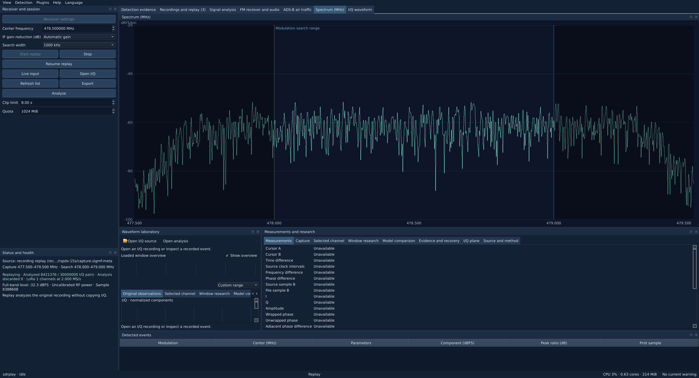
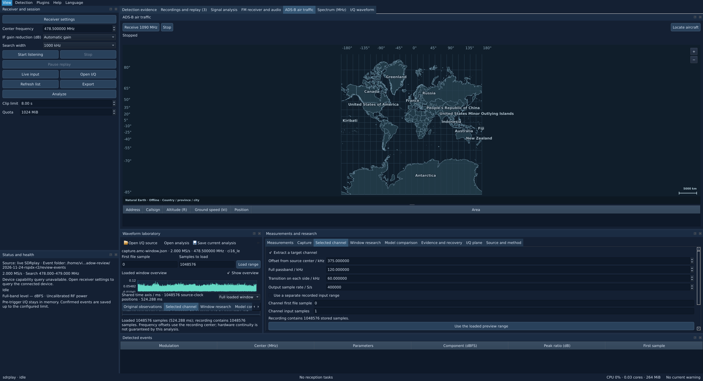
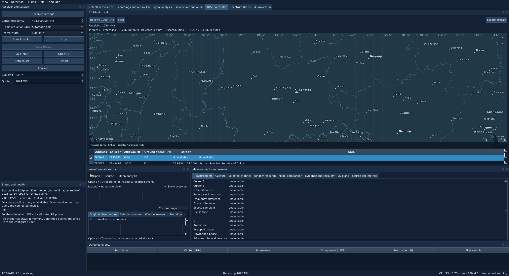
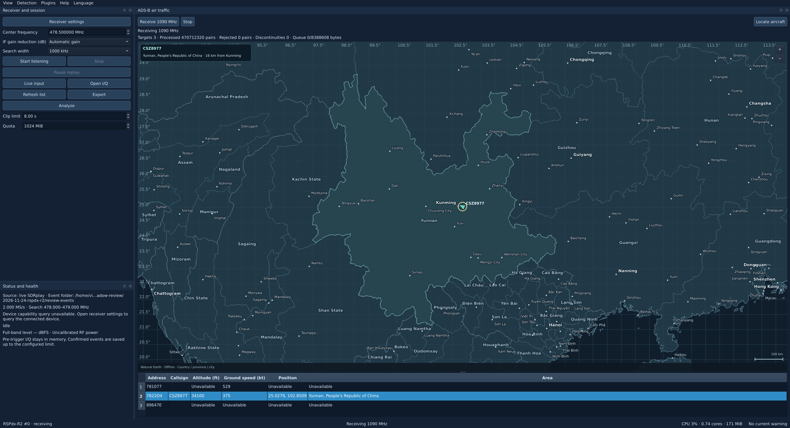
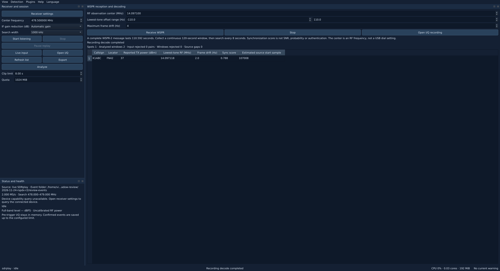
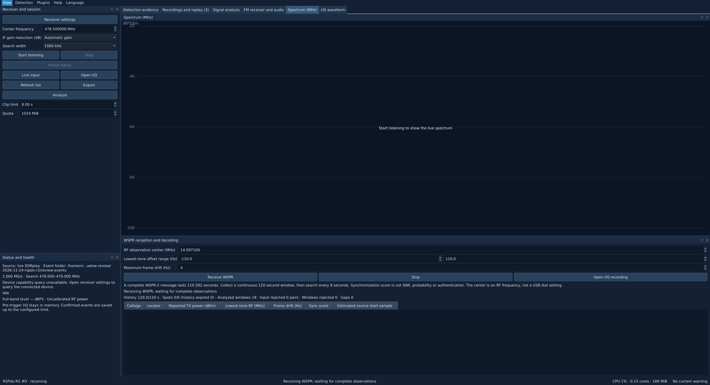

# Foreshadow 0.2.15 release and workstation acceptance — 2026-11-24

English · [简体中文](2026-11-24-0.2.15-release-and-update.zh-CN.md)

**[Foreshadow 0.2.15 is published](https://github.com/vicliu624/Foreshadow/releases/tag/v0.2.15)** for Windows x64, Debian 13 x64 and Debian 13 ARM64 / uConsole. The immutable source is `34983c16700dcbf28aa9e001339e3c8986031afc`. [PR #2](https://github.com/vicliu624/Foreshadow/pull/2), [ADS-B geography #3](https://github.com/vicliu624/Foreshadow/pull/3), [sustained-input correction #4](https://github.com/vicliu624/Foreshadow/pull/4) and [WSPR integration #5](https://github.com/vicliu624/Foreshadow/pull/5) are in `main`. WSPR includes the requested `2ec2c1322338a5b7ccc0b9c5c5f2b64bbc409ae2` input. The [machine-readable evidence](2026-11-24-0.2.15-release-and-update-proof.json) separates public artifacts, deployment, real RF and independent synthetic reference input.

## Formal artifacts and source delivery

| Platform | Full CTest | Actual artifact and runtime |
|---|---|---|
| Windows x64 | 127 passed, 2 audio-device skips, 0 failed | Native extracted application, independent toolboxes, media, Unicode/non-BMP paths and provider discovery passed |
| Debian 13 x64 | 128 passed, 2 audio-device skips, 0 failed | Native extracted application, independent toolboxes, media, Unicode/non-BMP paths and provider discovery passed |
| Debian 13 ARM64 / uConsole | 128 passed, 2 audio-device skips, 0 failed | Native extracted application, independent toolboxes, media, Unicode/non-BMP paths and provider discovery passed |

[Formal workflow](https://github.com/vicliu624/Foreshadow/actions/runs/45378748549) · [release qualification](https://github.com/vicliu624/Foreshadow/releases/download/v0.2.15/release-qualification.json) · [SHA256SUMS](https://github.com/vicliu624/Foreshadow/releases/download/v0.2.15/SHA256SUMS.txt).

All 22 public assets were checked against the approved local files and GitHub digests. All twelve application/receiver/research catalog entries are 0.2.15, sequence `1795520330`, signed with the unchanged official trust key. Public unauthenticated downloads, the latest catalog and independent Ed25519 verification passed. The private signing key stayed on the publisher computer, outside the repository and CI. Hosted formal staging transferred exact approved files and reused only hash-pinned dependency source; it did not sign or publish.

The delivered production source was extracted into a fresh tree, configured with `BUILD_TESTING=OFF`, completely compiled and installed on the receiver workstation using its unchanged Qt 6.8.2/OpenSSL 3.5.7 runtime. This is a functional rebuild, not a byte-identical reproduction of the hosted OpenSSL 3.5.9 SDK build. Each package includes its matching first-party and required dependency source, notices and replacement instructions. Original WSJT-X Fano notices, GPL and pinned bytes are included on all three platforms. Vendor SDRplay API/service and firmware remain separately installed. Full television/media functionality is retained under the existing codec assessment.

## Normal workstation update

The `.42` workstation used its existing Foreshadow desktop entry and **Plugins → Toolbox Center → Check for updates**. It downloaded and installed the application, RTL-SDR Support, SDRplay Support and I/Q power report from the public signed catalog, then completed **Restart to apply** and its startup health check. Installed and loaded versions were verified separately; the final application and all three independent toolboxes loaded 0.2.15. A subsequent cold GUI launch through the original entry and a cold CLI launch with an intentionally stale inherited store both used the selected managed store.

Custom desktop arguments and the wrapper were preserved byte-for-byte by activation. English UI and receiver settings were preserved, and twelve existing recording/analysis source files retained their SHA-256 values. Any later retirement of obsolete review comments is recorded separately in the proof, after the preservation check. The accepted Windows forwarding route remains in use; Windows must stay online for this update connection.

## Actual capture, replay and research

A fresh RSPdx-R2 capture at 478.5 MHz, 2 MS/s, Antenna B completed three seconds / **6,000,000 I/Q pairs**, with `core:recorder = Foreshadow 0.2.15`. Both complex components were checked for non-degenerate variation. The new recording replayed; the historical fifteen-second recording replayed and exported with byte-identical data and metadata. The independent updated Power Report executed on all six million newly captured pairs.

The real GUI started, paused, held a stable paused position, resumed and completed all **30,000,000** pairs of the existing physical recording. Reopening the existing captured-window analysis restored **1,048,576** original samples and **209,676** channel samples at 400 kS/s, including its explicit 100-source-sample FIR delay. Old files were not rewritten. These digital statistics are not calibrated RF power.

## ADS-B: geography and sustained input

The actual installed application received 1090 MHz through the independent receiver service, recovered aircraft positions and displayed country/province containment with named city references. The map highlights the selected region, shows a separate nearby-city distance, and supplies an Area column, zoom controls and scale. It does not report the nearest city as a municipal containment result. Natural Earth geometry is bundled for offline use; no online tile service or new Qt module is involved.

The first 0.2.14 live RF check exposed sustained queue rejection. Precomputed integration plans and equivalent-phase elimination preserve PPM/CRC and source-clock semantics while removing repeated work. The registered sixty-second noisy 2 MS/s test requires **120,000,000** processed pairs, **6,000** known frames and zero rejection/discontinuities. A separate pre-release physical observation processed 1,351,204,864 pairs with zero software rejection/discontinuities; its older native source is explicitly distinct from the final artifacts. Final public-package RF counters and images are in the proof. Status summaries now use the generic live-tool contract, and receiver notifications are queued to the owning GUI thread.

The final public ADS-B package processed **1,184,350,208 pairs** in the bounded observation, with zero rejected pairs and zero discontinuities. The focused capture shows the actual CSZ8977 position in Yunnan and a separate **16 km from Kunming** reference. These are observations at the recorded times; current aircraft positions and coverage can change.

## WSPR: complete observations and native workflow

WSPR-2 live and I/Q-recording decoding use the same provider-owned engine, separate conversion/search workers, bounded queues, gap segments and traceable source coordinates. The full 140-second 2 MS/s independent-reference regression is part of every platform's formal CTest. The actual uConsole supplementary native check processed **280,000,000** pairs, rejected no input/windows and retained one decoded station after four windows; its source/library verification scope is recorded separately.

After the public update, the actual English desktop opened the independent **synthetic** WSJT-X-symbol recording from a Chinese/non-BMP path and decoded **K1ABC / FN42 / 37 dBm**, with zero rejected input, rejected windows and source gaps. The power field is the transmitted message value; the synchronization score is not SNR, probability or authentication. The source-start coordinate includes channelizer delay and search-hop quantization. Unknown hashes remain unresolved. The separate live-HF observation is recorded in the proof; a synthetic reference is not evidence of a decoded physical HF station. WSPR-15 and automatic WSPRnet upload are not implemented.

The separate live-HF observation used the driver-confirmed **14.097100 MHz, 62.5 kS/s, CI16, Antenna A** configuration. It processed **17,367,040 pairs and 20 windows** with zero input/window rejection and zero discontinuities. The 285-second GUI observation includes startup; no physical HF station was decoded. This qualifies the running input/search path, while physical station decoding remains unverified. The module's actual configuration is separate from the idle main-monitor controls shown on the left. Receiver serial identifiers are omitted from the public evidence; a SHA-256 identifies the complete local record.

## Actual native captures

All new captures below came from the receiver workstation's actual installed public 0.2.15 GUI. The proof records whether an image was captured from X11 or by the application's native widget capture when the original desktop was behind the greeter. Neither method is a mockup. Physical ADS-B, replay, installation state and explicitly synthetic WSPR input have distinct labels.

Actual historical RSPdx-R2 recording, paused at 8,421,376 analyzed pairs. It subsequently resumed and completed all 30,000,000 pairs without analysis discard.

Existing captured-window analysis reopened in the preserved multi-panel layout; original files remain unchanged. The source and channel counts are also recorded from the actual native labels in the proof.

Actual 1090 MHz reception in the existing multi-panel layout. Unavailable or expired positions remain explicit.

The same public application focused through normal workspace controls: actual CSZ8977, Yunnan containment, province highlight and the separate Kunming distance reference.

Independent synthetic WSJT-X-symbol recording, opened through the real native file picker. K1ABC/FN42/37 is reference decoding, not a physical HF station claim.

Actual physical HF input/search observation before final shutdown. The empty results are retained honestly; the final diagnostic export records 20 completed windows and no decoded station.

macOS is outside this release selection. The two physical-audio checks remained explicitly skipped where no audio endpoint existed. Software acceptance and bounded physical observations do not establish a hardware sample counter, indefinite losslessness, calibrated RF power or universal decoding of unknown on-air signals. Historical 0.2.13/0.2.14 reports and their unsuccessful exploratory input conditions remain historical evidence.
