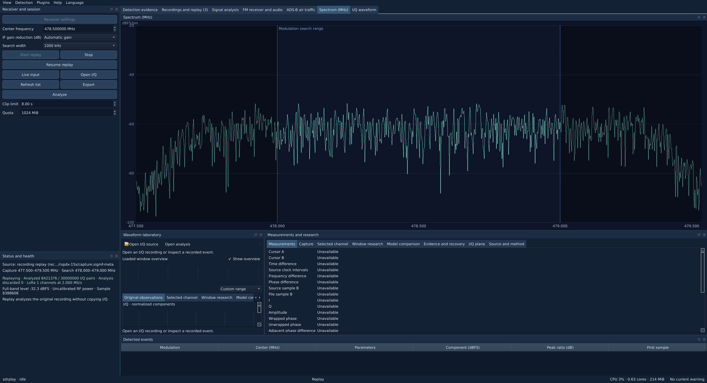
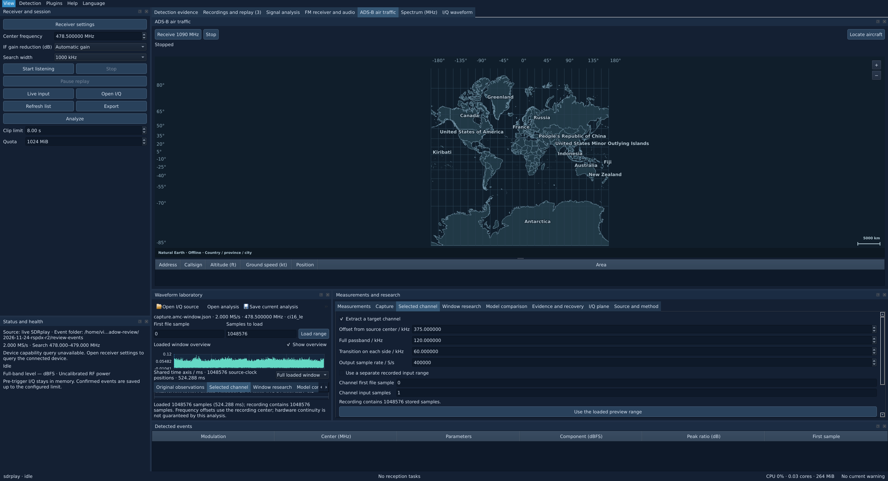
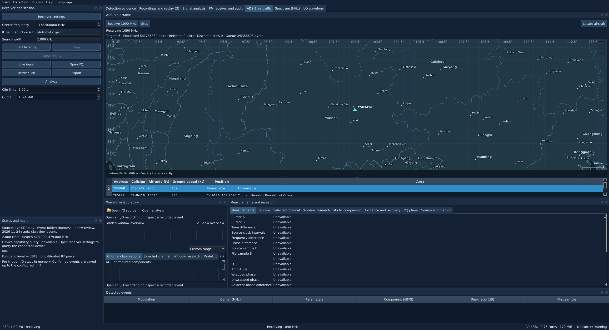
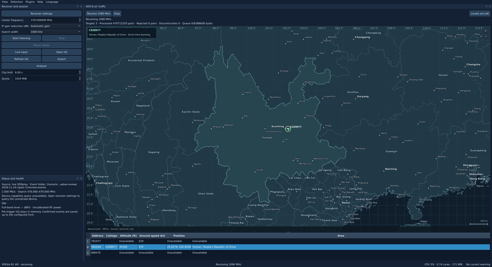
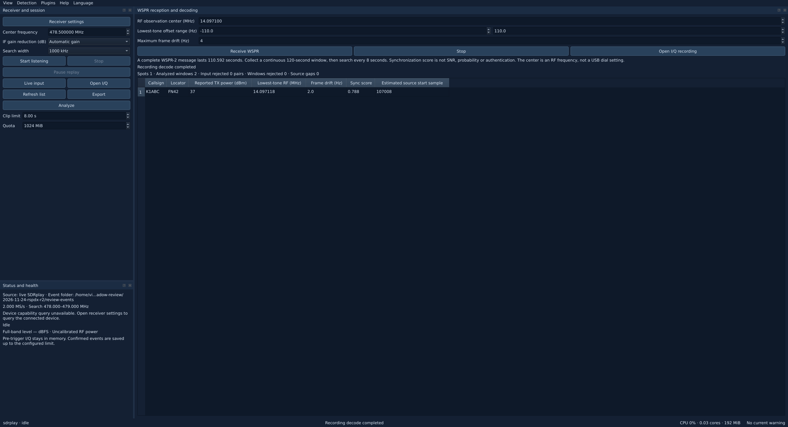
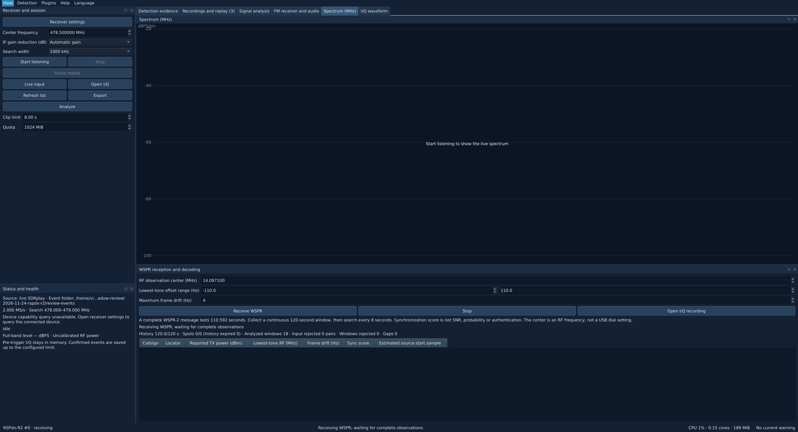

# Foreshadow 0.2.15 发布与工作站验收——2026-11-24

[English](2026-11-24-0.2.15-release-and-update.md) · 简体中文

**[Foreshadow 0.2.15 已公开发布](https://github.com/vicliu624/Foreshadow/releases/tag/v0.2.15)**，包含 Windows x64、Debian 13 x64 和 Debian 13 ARM64／uConsole。冻结源码为 `34983c16700dcbf28aa9e001339e3c8986031afc`。PR [#2](https://github.com/vicliu624/Foreshadow/pull/2)、[ADS-B 地图 #3](https://github.com/vicliu624/Foreshadow/pull/3)、[持续输入修复 #4](https://github.com/vicliu624/Foreshadow/pull/4)、[WSPR 整合 #5](https://github.com/vicliu624/Foreshadow/pull/5) 均已进入 `main`，包含指定 WSPR 提交 `2ec2c1322338a5b7ccc0b9c5c5f2b64bbc409ae2`。[机器证据](2026-11-24-0.2.15-release-and-update-proof.json)分别记录正式产物、升级、实体射频和独立合成参考输入。

## 正式产物与源码交付

| 平台 | 完整 CTest | 实际包与运行验证 |
|---|---|---|
| Windows x64 | 127 项通过，2 项因声音设备跳过，0 项失败 | 实际解压主程序、独立工具箱、媒体、中文／非 BMP 路径与提供者发现均通过 |
| Debian 13 x64 | 128 项通过，2 项因声音设备跳过，0 项失败 | 实际解压主程序、独立工具箱、媒体、中文／非 BMP 路径与提供者发现均通过 |
| Debian 13 ARM64 / uConsole | 128 项通过，2 项因声音设备跳过，0 项失败 | 实际解压主程序、独立工具箱、媒体、中文／非 BMP 路径与提供者发现均通过 |

[正式构建](https://github.com/vicliu624/Foreshadow/actions/runs/45378748549) · [验收记录](https://github.com/vicliu624/Foreshadow/releases/download/v0.2.15/release-qualification.json) · [SHA256SUMS](https://github.com/vicliu624/Foreshadow/releases/download/v0.2.15/SHA256SUMS.txt)。表中两项跳过均为缺少声音端点的实体音频检查；实际解压包、独立工具箱、媒体、中文／非 BMP 路径和提供者发现均通过。

22 个公开文件已与本机批准文件及 GitHub 哈希核对，12 个应用／接收机／研究目录条目均为 0.2.15，目录序号 `1795520330`，沿用既有信任公钥。匿名公开下载、latest 目录和独立 Ed25519 验签均通过。私钥只在发布电脑、仓库和 CI 之外使用；托管正式发布环境仅转存已批准文件或复用哈希固定的依赖源码，不负责签名或公开发布。

交付的生产源码已解压至新目录，以 `BUILD_TESTING=OFF` 完整构建和安装，使用接收机工作站未升级的 Qt 6.8.2／OpenSSL 3.5.7。该结果是功能性重建，不是托管 OpenSSL 3.5.9 SDK 构建的字节复现。各包包含匹配的自研及依赖源码、通知与替换说明；WSJT-X Fano 原作者通知、GPL 和固定源码已覆盖三个平台。厂商 SDRplay API／服务、固件仍由用户单独安装。电视／媒体完整功能及既有编解码评估保留。

## 正常更新流程

`.42` 从既有 Foreshadow 入口进入 **Plugins → Toolbox Center → Check for updates**，经公开签名目录下载并安装主程序、RTL-SDR Support、SDRplay Support 和 I/Q power report，执行 **Restart to apply** 并通过启动健康检查。分别核对已安装与已加载版本，最终主程序和三个独立工具箱均加载 0.2.15。再次从原桌面冷启动，以及带有故意过期父进程工具箱路径的 CLI 冷启动，均使用正确的受控目录。

激活过程逐字节保留自定义桌面参数和启动包装器，英文界面和接收机设置保留，十二份旧录音／分析源文件 SHA-256 全部不变。若随后清理过期评审注释，机器证据在保留验证之后另行记录。更新继续使用已经接受的 Windows 转发连接，Windows 需要保持在线。

## 实采、回放与研究

RSPdx-R2、478.5 MHz、2 MS/s、Antenna B 完成三秒 **6,000,000 对 I/Q** 新采集，录制标注 `Foreshadow 0.2.15`，并检查复数两路均有非退化变化。新录音成功回放；历史十五秒录音成功回放和完整导出，数据及元数据字节一致。独立更新的 Power Report 分析了全部六百万对新采样。

真实 GUI 完成旧录音开始、暂停、暂停位置保持、恢复和全部 **30,000,000** 对采样回放。重新打开旧实采窗口分析，恢复 **1,048,576** 个原始样本及 **209,676** 个 400 kS/s 信道样本，并显示一百个原始样本的 FIR 延迟；旧文件未改写。数字统计不等于校准射频功率。

## ADS-B：地域信息与持续输入

实际正式包通过独立接收服务接收 1090 MHz，恢复带坐标的飞机并显示国家／省级归属、城市参照、选中区域、附近城市距离、Area 列、缩放与比例尺。附近城市不被当成市级行政区归属。Natural Earth 数据离线随包，不依赖在线瓦片或新 Qt 模块。

首次 0.2.14 实机检查发现持续队列拒收；预计算积分方案、合并等价相位保留 PPM／CRC 和源时钟语义，并移除重复计算。注册的六十秒带噪 2 MS/s 回归要求处理 **120,000,000** 对输入、恢复 **6,000** 帧且拒收／中断为零。另一次发布前实机观测处理 1,351,204,864 对、软件拒收和中断为零，其旧本机源码与最终产物分别留证。最终正式包的射频计数、截图见机器记录。接收摘要经通用工具协议呈现，接收通知安全投递至所属界面线程。

最终公开的 ADS-B 包在这次有界观察中处理 **1,184,350,208 对**，拒收和中断均为零。重点截图显示实际 CSZ8977 位于云南，另列距**昆明约 16 km**的城市参照。这是记录时刻的结果，当前飞机位置和覆盖条件可能变化。

## WSPR：完整观察与原生操作

WSPR-2 实时和 I/Q 录音解析共享提供者内核，采集转换与搜索使用分离工作线程，具有独立队列预算、断点分段和源坐标。140 秒、2 MS/s 独立参考回归进入全部正式平台 CTest。实际 uConsole 补充原生检查处理 **280,000,000** 对、输入／窗口拒收均为零，四次分析保留一个解码站；其旧库与当前未变 WSPR 源码的校验范围单独记录。

公开升级后，实际英文桌面从中文／非 BMP 路径打开独立 WSJT-X 符号生成的**合成**参考录音，解码 **K1ABC / FN42 / 37 dBm**，输入拒收、窗口拒收和源断点均为零。功率字段来自发射消息；同步分数不是 SNR、概率或认证。源开始位置保留信道器延迟和搜索跳距量化，未知哈希不猜测。独立的 HF 实际接收观察见证据；合成参考不能证明实体 HF 电台已经解码。实现不含 WSPR-15 或自动 WSPRnet 上传。

独立 HF 观察的驱动实际回读为 **14.097100 MHz、62.5 kS/s、CI16、Antenna A**，处理 **17,367,040 对、20 个窗口**，输入拒收、窗口拒收和中断均为零。285 秒 GUI 观察包含启动时间，未解出实体 HF 电台；输入和搜索路径已运行，物理电台解码仍未验证。模块实际配置与左侧空闲主监听参数分别记录。公开证据省略接收机序列号，以 SHA-256 标识保留在本地的完整记录。

## 真实原生界面

下列新图均来自接收机工作站实际安装的正式 0.2.15 GUI。原桌面位于登录界面时使用程序自身的原生控件截图，其余使用 X11；具体方式见来源清单，均非设计稿。实体 ADS-B、回放、安装状态和明确的合成 WSPR 输入分开标注。

实际旧 RSPdx-R2 录音，暂停在已分析 8,421,376 对的位置；随后恢复并完成全部 30,000,000 对，分析丢弃为零。

在保留的多面板布局中重新打开旧实采窗口分析，源文件未改写；机器证据另从真实原生标签记录原始与信道计数。

既有多面板布局中的实际 1090 MHz 接收；不可用和过期的位置明确保留。

同一正式程序通过正常工作区控件聚焦地图：实际 CSZ8977、云南归属、省级高亮与单独的昆明距离参照。

经真实文件选择器打开的独立 WSJT-X 符号合成录音；K1ABC／FN42／37 是参考解码，不是实体 HF 电台实收。

停止之前的实际 HF 输入与搜索观察，空结果如实保留；最终诊断记录完成二十个窗口，未解出电台。

本次不含 macOS。无声音端点的两项实体音频检查明确跳过。软件验收与有限实机观察不建立硬件样本计数、任意时长无损、校准 RF 功率或任意未知空口信号的解码保证。历史 0.2.13／0.2.14 报告和失败的探索输入条件继续保留。
