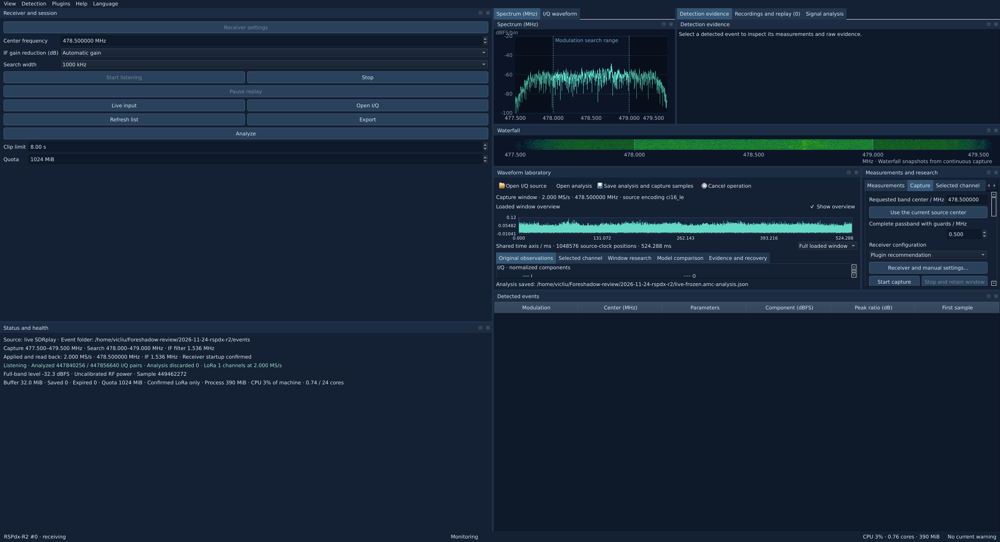
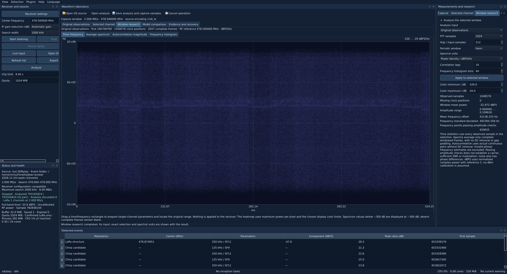
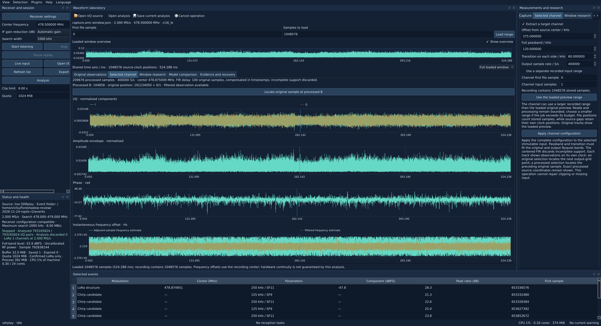
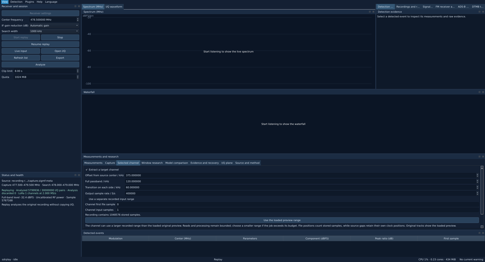
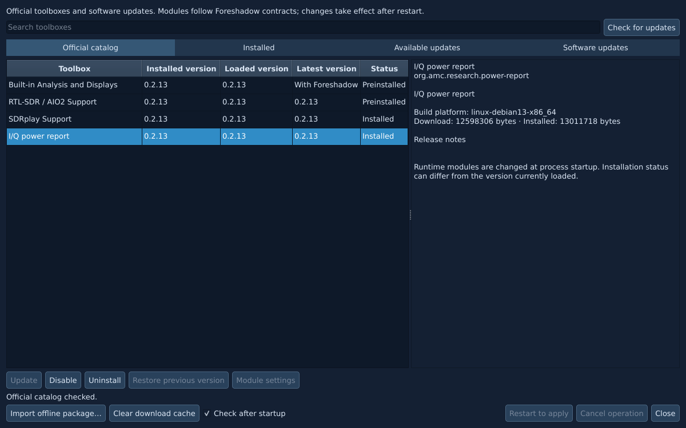
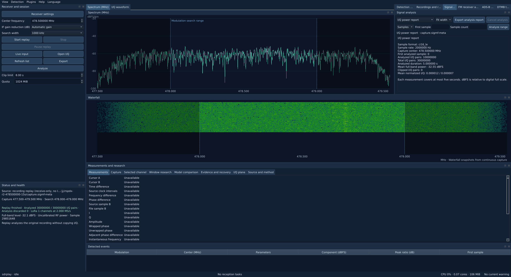

# RSPdx-R2 end-to-end hardware workflow review — 2026-11-24

English · [简体中文](2026-11-24-rspdx-r2-workflow-review.zh-CN.md)

The receiver-connected Debian 13 x86_64 workstation (`.42`) completed actual acquisition, recording, replay, waveform research and the independent toolbox lifecycle. Four implementation issues found during this work were fixed and deployed in a **machine-local source-fix review based on 0.2.13**, source `c53e02fc27f895ac447c0072ddff85bddfa0955c`. The public v0.2.13 release and its signed catalog/downloads remain unchanged. The [machine-readable evidence](2026-11-24-rspdx-r2-workflow-proof.json) identifies the baseline, fixes, counters, verification scope and screenshot methods.

## Verified operating sequence

| Operation | Actual result |
|---|---|
| Receiver discovery/configuration | RSPdx-R2 through the existing independent SoapySDRServer/vendor installation. Requested/actual tuning, rate, antenna and IF filter were inspected; no vendor API was added to the application. |
| Direct recording | Antenna B, 478.5 MHz, 2 MS/s, actual IF 1.536 MHz, 15 s: **30,000,000 I/Q pairs / 120,000,000 bytes**, `ci16_le`, complete, software rejected pairs 0. One client read timeout was recorded. |
| Sustained GUI monitoring | Default antenna A, 397.684 s elapsed; **793,165,824** source, analysis and recording-consumer pairs at stop. Main analysis discarded 0; FSK skipped pairs 0; software analysis gaps 0. Peak process RSS 410,755,072 bytes. |
| Live capture/freeze | Shared the actual input, froze **1,048,576** observed samples / 524.288 ms and saved its immutable source with an analysis. This window had no missing clock positions. |
| Replay | Actual GUI start, pause, stable paused position, resume and completion of all **30,000,000** recorded pairs. Replay did not copy the I/Q source. |
| Slice/export integrity | A 3 s slice starting at source sample 4,000,000 contained **6,000,000** pairs and matched the original sample bytes exactly. Full export preserved both data and metadata hashes; source files remained unchanged. |
| Window research | Actual captured samples, Hann FFT 1024 / hop 512, 2047 complete frames, STFT/PSD/statistics. Digital dBFS/Hz and observation counts remained explicit. |
| Target channel | +375 kHz translation, 120 kHz passband, 60 kHz transitions, 400 kS/s output: **209,676** processed samples. The 100-source-sample FIR delay and incomplete support were explicit. Save/reopen reproduced the applied result. |
| External research plugin | The independently installed I/Q power report executed against the real recording. The selected range covered sample 4,000,000 through the next 6,000,000 pairs; its report showed 3 s, −32.56 dBFS and 0 digitally clipped pairs. The default five-second report is also shown in a screenshot. |
| Fixed recorder provenance | A fresh 2 s RSPdx-R2 capture through the review CLI produced 4,000,000 pairs and `core:recorder = Foreshadow 0.2.13`. Existing historical metadata was left intact. |

The first short GUI waveform capture reported **16,384 rejected input pairs**; this is separate from the main monitor's zero analysis-discard count. It was visible rather than hidden. The subsequent dedicated physical lease test reported zero rejected samples in each of its three acquisition generations. Neither observation establishes hardware-wide losslessness.

## Toolbox installation and update

An archived **0.2.11 I/Q power report package and catalog were verified with the current official public key** in an isolated store. The actual review GUI checked the live official catalog, downloaded 0.2.13, validated/installed it and showed installed 0.2.13 versus loaded 0.2.11 until restart. The real activation helper then completed its startup health check; the restarted process loaded 0.2.13.

The same GUI subsequently completed disable/restart, enable, rollback/restart to 0.2.11, roll-forward/restart to 0.2.13, uninstall/confirmation/restart, and import/restart of the original official offline package. Installed, loaded, latest, disabled and restart-pending states were checked. The final state was enabled 0.2.13, loaded 0.2.13, with a successful official catalog check.

A user wrapper/desktop entry containing the accepted Windows forwarding context survived these activations byte-for-byte. A cold CLI launch with a deliberately stale inherited store still loaded the SDRplay module from its selected store. The final real desktop entry was cold-launched and its GUI **Check for updates** again showed `Official catalog checked.` The original application trust anchor and catalog authority were retained; no private signing key was placed on the workstation.

## Fix ownership and regression

| Trigger and correction | Owner / stable consumers |
|---|---|
| New recordings incorrectly claimed `SignalScope 0.1.0`; record the CMake build version and Foreshadow brand. Preserve old-file reading and byte-preserving export. | I/Q `Recorder` and its build assembly; capture, recording, replay and views remain generic. |
| Linux activation overwrote custom desktop launch options; preserve an existing entry backed by the same valid managed bootstrap. | Distribution activation helper; no receiver/toolbox-ID routing. |
| A cold bootstrap lost a separately selected toolbox store; optional absolute UTF-8 `distribution_root` binds both GUI and CLI to that store, overriding a stale parent value. | Standalone launcher configuration and helper writer; legacy configurations remain accepted. |
| Accessibility row selection left the keyboard-current cell elsewhere, disabling or targeting the wrong package action; derive actions from the selected row. | Generic Toolbox Center selection; independently named package tests require no provider-specific UI logic. |

The self-hosted regression at `dd301b3` completed **115 tests: 113 passed, 2 audio-device-dependent skips, 0 failures**, with installed-package checks. The skipped tests were `research_audio_output` and `fm_playback_recovery`; this review does not claim their physical audio-output qualification. [CI run](https://github.com/vicliu624/Foreshadow/actions/runs/45335855573).

A separately invoked **physical** waveform/lease acceptance tool then passed 60.005 s of capture plus the five-second independent-consumer check. It covered sharing, freezing, release/reconfiguration, restored sharing, an incompatible request reporting conflict, save/reopen identity, stopping capture while the other consumer continued, and final receiver users **0**. Its raw queue stayed within 2 MiB, each block within 256 KiB and retention within 8 MiB / 1 s.

The initial physical-test attempt had incorrectly treated the protocol-permitted `starting` state during an explicitly requested lease reconfiguration as a spontaneous capture stop. The test now permits that state only in the two declared reconfiguration phases, requires recovery to `receiving`, and retains the strict error, timeout, budget and frozen-identity checks elsewhere. The failed initial record and successful repeat are retained in the private evidence directory; the production session implementation was not loosened to make the test pass.

## Review installation and material

The normal **Foreshadow** entry on `.42` now uses the local review application, a stable launcher, English UI and the accepted Windows update forwarding. The three final toolbox packages are the unchanged official 0.2.13 archives. Receiver service settings and existing user recordings remain available.

The application copy contains the matching first-party source archive, original dependency source/notices, a review build explanation in both languages, updated source identity in the license viewer and refreshed runtime fingerprints. The existing material validator passed in explicitly **non-formal local-review mode** for 20 application runtimes. This does not replace a new formal cross-platform release qualification.

Private workstation evidence and recordings are under `/home/vicliu/Foreshadow-review/2026-11-24-rspdx-r2`. The review recording list contains `rspdx-15s`, `slice-3s` and `fixed-recorder-2s`. Open `live-processed.amc-analysis.json` through **Waveform laboratory → Open analysis** for the saved physical window/channel/FFT workflow. Raw RF data is retained on the workstation rather than added to this repository.

## Actual UI captures

All captures were produced on the receiver workstation with English UI and actual installation or physical-recording state. The first four are X11 captures of the public-baseline application. The toolbox image is a native capture of the real Toolbox Center built from the same GUI objects, using the actual upgraded store and live official transport. The final image uses the existing screenshot facility of the actual review application process. It shows recorded-input replay and the external plugin, rather than implying that replay is live reception.

## Verification limits

The receiver service does not expose a hardware sample counter or continuous ADC-overload telemetry. Calibration remains unknown; digital clipping and dBFS are not calibrated RF power. The run does not establish continuous hardware losslessness, an RF signal's modulation/payload identity, television programme decoding, or physical PSK/OFDM EVM against unknown over-the-air training. Existing synthetic/contract coverage is separate from this physical evidence.

Some steps occurred with the desktop locked. Actual application controls were driven through AT-SPI/X11, with native widget capture where X11 could not capture a new window; no unlocked manual-pointer assessment is claimed. The Windows forwarding host/connection must remain online for updates. No new Windows/macOS build qualification is asserted by this Linux hardware review.
