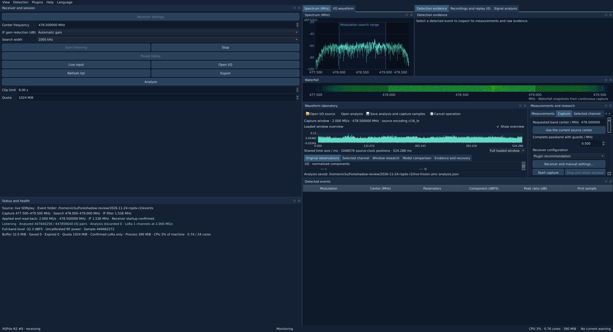
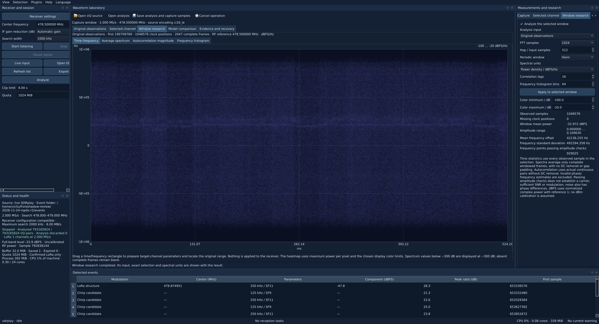
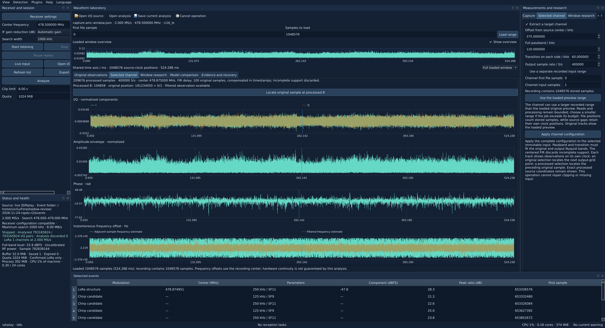
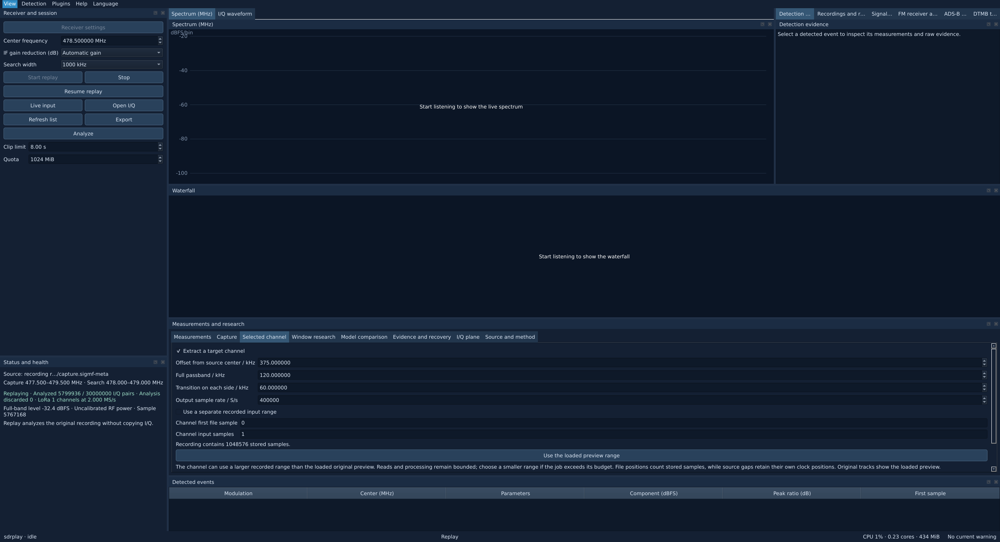
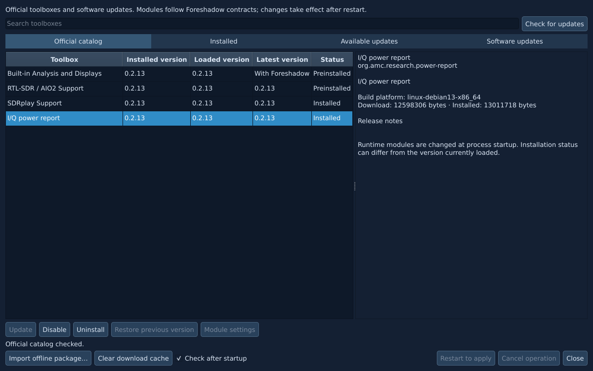
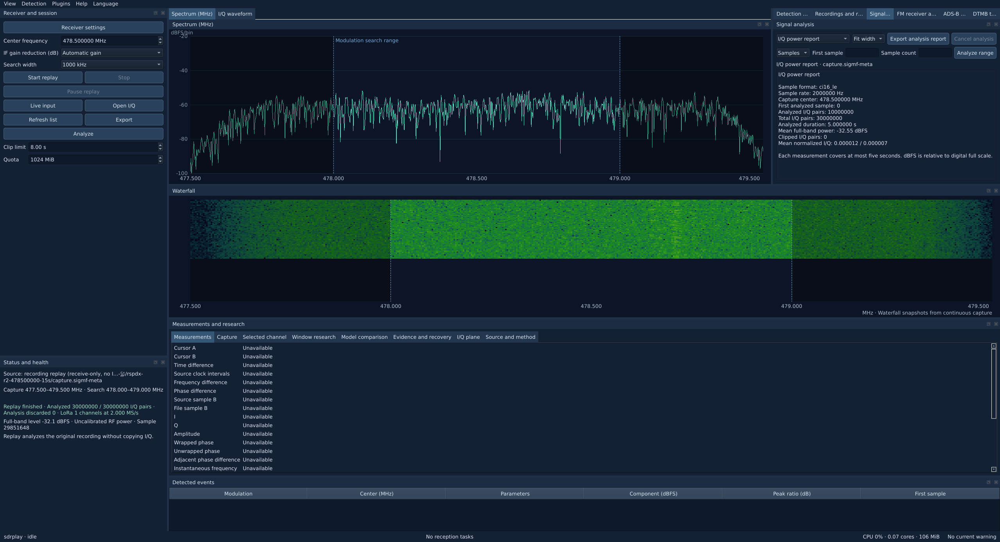

# RSPdx-R2 完整操作流程实机评审 — 2026-11-24

[English](2026-11-24-rspdx-r2-workflow-review.md) · 简体中文

接收机连接工作站 `.42`（Debian 13 x86_64）已完成真实采集、录制、回放、波形研究和独立工具箱生命周期验证。本轮发现的四项实现问题已修复，并以**基于 0.2.13 的本机源码修复评审版**部署，源码提交为 `c53e02fc27f895ac447c0072ddff85bddfa0955c`。公开 v0.2.13、签名目录及下载文件保持原样。[机器可读证据](2026-11-24-rspdx-r2-workflow-proof.json) 记录基线、修复、计数、范围和截图方法。

## 已验证的操作顺序

| 操作 | 实际结果 |
|---|---|
| 设备发现及配置 | RSPdx-R2 经原有独立 SoapySDRServer／厂商安装接入，核对请求和实际频率、速率、天线、IF 滤波器；主程序没有新增厂商 API。 |
| 直接录制 | 天线 B、478.5 MHz、2 MS/s、实际 IF 1.536 MHz，15 秒产生 **30,000,000 对 I/Q／120,000,000 字节**，`ci16_le`，状态 complete，软件拒收 0，记录到一次客户端读取超时。 |
| GUI 持续监听 | 默认天线 A，经过 397.684 秒，停止时源、主分析及录制消费者均处理 **793,165,824 对 I/Q**；主分析丢弃 0，FSK 跳过 0，软件分析缺口 0，进程内存峰值 410,755,072 字节。 |
| 实时采集与冻结 | 共享真实输入，冻结 **1,048,576** 个已观测样本／524.288 ms，并随分析保存不可变来源；该窗口缺失源时钟位置为 0。 |
| 回放 | 在实际 GUI 中启动、暂停、确认暂停位置不变、继续，最终处理全部 **30,000,000** 对录制样本；回放没有复制源 I/Q。 |
| 切片与导出 | 从源样本 4,000,000 起截取 3 秒，得到 **6,000,000** 对，与原文件对应样本逐字节一致；整段导出的数据、元数据哈希保持一致，原文件未改动。 |
| 窗口研究 | 对真实冻结样本使用 Hann、FFT 1024、hop 512，得到 2047 个完整帧，完成 STFT／PSD／统计；明确显示数字 dBFS/Hz 和观测计数。 |
| 目标信道 | 平移 +375 kHz、通带 120 kHz、两侧过渡 60 kHz、输出 400 kS/s，得到 **209,676** 个处理样本；显示 100 个源样本的 FIR 延迟和不完整支持排除，保存后重新打开可恢复结果。 |
| 外部研究插件 | 独立安装的 I/Q power report 对真实录制运行；指定源样本 4,000,000 后的 6,000,000 对，报告 3 秒、−32.56 dBFS、数字削顶 0；截图另展示其默认五秒报告。 |
| 修复后的录制来源 | 使用评审 CLI 再实采 2 秒，得到 4,000,000 对，`core:recorder` 正确写入 `Foreshadow 0.2.13`；历史录制元数据未被重写。 |

首次短时 GUI 波形采集显示 **16,384 对输入拒收**，与主监听分析丢弃 0 属于不同计数；该数值明确暴露。后续独立实机租约验收的三个采集代次均记录到拒收 0。这两种观察都不能外推为硬件绝无丢样。

## 工具箱安装与更新

在隔离目录中，使用**现有官方公钥**验证归档的 **0.2.11 功率报告插件及目录**。实际评审 GUI 检查当前官方目录，下载、校验并安装 0.2.13，明确显示“已安装 0.2.13／已加载 0.2.11”，直到重启。实际激活助手通过启动健康检查，重启进程加载 0.2.13。

随后通过同一 GUI 完成：禁用并重启、启用、回退并重启至 0.2.11、再次升级并重启至 0.2.13、确认卸载并重启、导入原始官方离线包并重启。核对已安装、已加载、最新、禁用及待重启状态，最终为启用且加载 0.2.13，官方目录检查成功。

包含已确认 Windows 转发环境的自定义启动器／桌面入口，在这些激活后逐字节保留。故意继承错误目录后冷启动 CLI，仍从正确目录加载 SDRplay 模块。最后从真实桌面入口冷启动，再在 GUI 点击 **Check for updates**，仍显示 `Official catalog checked.`。信任公钥及目录来源保持不变，发布私钥没有复制到工作站。

## 修复边界与回归

| 问题及修复 | 所有者／稳定消费者 |
|---|---|
| 新录制错误标注 `SignalScope 0.1.0`，改为 CMake 实际构建版本及 Foreshadow 品牌，继续支持旧文件并保留导出字节。 | I/Q `Recorder` 及其构建组装；采集、录制、回放和视图保持通用。 |
| Linux 激活覆盖用户启动选项，改为保留由同一有效受控启动器支持的已有桌面入口。 | 分发激活助手，无接收机／工具箱 ID 路由。 |
| 冷启动丢失独立工具箱目录，增加可选绝对 UTF-8 `distribution_root`，让 GUI／CLI 使用所属目录并覆盖旧继承值。 | 独立启动器配置及助手写入，旧配置继续兼容。 |
| 无障碍选行没有移动键盘当前单元格，导致按钮禁用或按旧行操作，改为依据已选行。 | 通用工具箱中心；独立命名的测试包无需增加提供者专属界面逻辑。 |

`dd301b3` 的自托管回归为 **115 项：113 通过、2 项音频设备相关跳过、0 失败**，安装包检查通过。跳过项为 `research_audio_output`、`fm_playback_recovery`，本轮不宣称完成它们的物理音频输出验收。[CI 记录](https://github.com/vicliu624/Foreshadow/actions/runs/45335855573)。

另行显式运行的**实物硬件**波形／租约验收，通过 60.005 秒采集及额外五秒独立消费者观察，覆盖共享、冻结、释放及重配置、恢复共享、冲突拒绝、保存／重开身份、停止波形采集后另一消费者继续，以及最终接收机使用者 **0**。原始输入队列不超过 2 MiB、单块不超过 256 KiB、保留窗口不超过 8 MiB／1 秒。

首次运行的验收工具把明确租约切换时协议允许的 `starting` 过渡误判为自发停止。现仅在两个已声明的重配置阶段允许该状态，并要求恢复到 `receiving`；其他阶段的错误、超时、预算与冻结身份检查仍严格保留。首次失败记录与复验成功记录都保留在私有证据目录，没有放宽生产会话实现来迎合测试。

## 评审安装及材料

`.42` 的正常 **Foreshadow** 入口现运行本机修复版，使用稳定启动器、英文界面和已确认的 Windows 更新转发。最终三个工具箱仍是原始官方 0.2.13 包；接收机服务地址和已有用户录制继续保留。

应用副本包含匹配的自研源码归档、原依赖源码／声明、中英文本机评审说明、许可证查看器中的新源码身份及更新后的运行库指纹。现有材料校验器在明确的**非正式、本机评审模式**下验证 20 个应用运行文件通过；这不替代新的跨平台正式发布验收。

工作站私有证据及录制位于 `/home/vicliu/Foreshadow-review/2026-11-24-rspdx-r2`。评审录制列表包括 `rspdx-15s`、`slice-3s`、`fixed-recorder-2s`。使用 **Waveform laboratory → Open analysis** 打开 `live-processed.amc-analysis.json`，可复核真实冻结窗口、信道及 FFT 流程。原始 RF 文件保留在工作站，没有加入仓库。

## 实际界面截图

所有图片都在接收机工作站生成，使用英文界面及真实安装状态／实采数据。前四张是公开基线程序的 X11 窗口截图；工具箱图使用同一 GUI 目标文件中的真实 Toolbox Center，连接本次实际升级目录和正式传输；最后一张使用实际修复评审进程自带截图功能，显示录制回放及外部插件，不将回放表述为实时接收。

## 验证边界

接收服务没有提供硬件样本计数或连续 ADC 过载遥测，校准状态仍未知；数字削顶及 dBFS 不是校准 RF 功率。本轮不证明硬件长期无丢样、空口信号的调制／载荷身份、电视节目解码，或未知训练条件下的实采 PSK／OFDM EVM；既有合成／契约测试与本轮实物证据分开。

部分步骤发生在桌面锁屏期间，使用 AT-SPI／X11 驱动实际应用控件，新窗口无法由 X11 抓图时使用原生控件抓图，不宣称完成解锁后的手工鼠标评估。更新仍要求 Windows 转发主机及连接在线。本轮 Linux 实机评审不宣称完成新的 Windows／macOS 构建验收。
