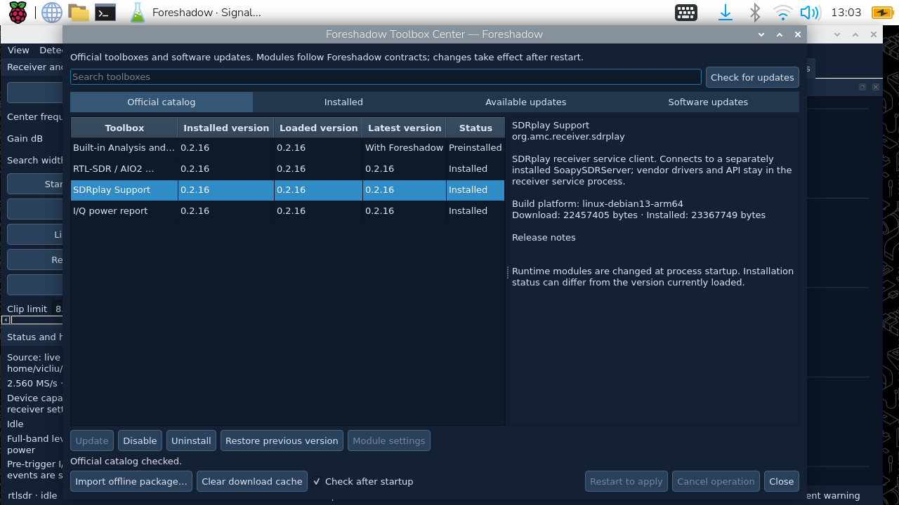

# Foreshadow 0.2.16 release and update verification — 2026-11-25

English · [简体中文](2026-11-25-0.2.16-release-and-update.zh-CN.md)

## Published identity

[Foreshadow 0.2.16](https://github.com/vicliu624/Foreshadow/releases/tag/v0.2.16)
was published on 2026-11-25 at 12:51 China Standard Time. The immutable tag uses
`d33e438c0c2ca8c693dd4905c6ce2392aec5bcd8`. Later documentation commits do not
change that source snapshot or the accepted binaries.

The release has 22 assets: three portable archives, twelve application/toolbox
packages, three platform entry files, the first-party source archive, the signed
catalog, the qualification record and SHA-256 checksums. The catalog contains
twelve entries at sequence `1795581896`, greater than the previous
`1795520330`; the trust key remains `d66ddd3c8e498e42`.

All server asset digests/sizes matched the reviewed local files. Anonymous public
API access, all 22 download endpoints, the byte-identical latest catalog and its
Ed25519 signature were checked. The signature was created on the publisher
computer, independently verified in Python, and never exposed the private key to
CI or deployment hosts. See the published
[qualification record](https://github.com/vicliu624/Foreshadow/releases/download/v0.2.16/release-qualification.json)
and [checksums](https://github.com/vicliu624/Foreshadow/releases/download/v0.2.16/SHA256SUMS.txt).

## Frozen-source platform gates

[Formal workflow 45543592669](https://github.com/vicliu624/Foreshadow/actions/runs/45543592669)
passed on the same frozen commit for all selected platforms.

| Platform | Registered | Passed | Skipped | Failed |
|---|---:|---:|---:|---:|
| Windows x64 | 131 | 129 | 2 | 0 |
| Debian 13 x64 | 132 | 130 | 2 | 0 |
| Debian 13 ARM64 | 132 | 130 | 2 | 0 |

The skips are `research_audio_output` and `fm_playback_recovery`, because formal
jobs have no physical audio output device. All suites passed recording/receiver
resource checks, 140-second WSPR and 60-second ADS-B sustained-input regressions.
Actual archives extracted under Chinese/non-BMP paths passed component discovery,
GUI/media checks, AVS+/DRA decoding and generic toolbox transactions. SDK source
identities and corresponding-source materials passed the publication checks.

The [self-hosted full regression](https://github.com/vicliu624/Foreshadow/actions/runs/45543399372)
also passed 130 cases, with the same two audio skips, plus installed-tree checks.
The delivered production source built and installed with testing disabled on the
receiver workstation's unchanged Qt 6.8.2/OpenSSL 3.5.7 SDK. That is a functional
corresponding-source rebuild, not a byte-identical reproduction of the hosted
OpenSSL 3.5.9 SDK build.

Native Windows preflights rejected the original leaking client and inherited lock
flag, then passed with the fixes. The child-readiness test handles startup stderr,
complete stdout lines, deadlines and Windows line endings; lock handles are
matched by file identity rather than path spelling. The
[resource audit](2026-11-25-resource-lifetime.md) records ownership, negative
controls, counts and the limits of attributing the restarted overnight incident.

## Actual package and RSPdx-R2 checks on `.42`

The actual 0.2.16 x64 archive and optional SDRplay package ran in an isolated
Chinese/non-BMP directory on the receiver workstation. English providers,
recording/replay and offline geography provenance passed. The packaged receiver
module completed 32 probes and 32 success/consumer-stop/cancellation/activation-
failure stream cycles against an independent native service in one client process,
with equal resource counts before and after.

The same packaged module then used the real RSPdx-R2 through the existing separate
service. Twelve physical probe/stream cycles covered normal completion, immediate
cancellation and consumer stop. A subsequent 60-second 2 MS/s stream delivered
120 million I/Q pairs and returned to its initial resource count.

The actual packaged CLI recorded six million CI16 pairs, identified the recorder
as `Foreshadow 0.2.16`, replayed the new recording, replayed an older recording and
exported its metadata/data byte-for-byte. The actual 0.2.16 external Power Report
package analyzed the new capture. All 26 original recording/saved-analysis files
retained their hashes.

These checks use the actual release binaries, not only a source build. They do
not claim a hardware sample-loss counter: the independent service exposes none.

**The original `.42` desktop is still on 0.2.15.** It switched to LightDM; the
operator answered that it would be unlocked later. Normal foreground Toolbox
Center upgrade, restart, loaded-version verification and new receiver-workstation
screenshots remain pending that unlock. The isolated archive checks above do not
stand in for an activated desktop installation. The accepted Windows forwarding
route remains available for that workstation's update connection.

## Normal uConsole upgrade

The uConsole first passed native checks of the actual ARM64 archive in a
Chinese/non-BMP path, including module discovery, English providers, recording/
replay and the packaged receiver's repeated public-ABI resource cycles.

Its original desktop then fetched the published signed catalog through
**Plugins → Toolbox Center → Check for updates**. The three toolboxes and
application were installed through the native UI. The pre-restart table correctly
showed installed 0.2.16 versus loaded 0.2.15; **Restart to apply** performed the
ordinary application activation and recorded an applied health check.

After restart, the running executable and inventory matched the frozen commit.
All four rows showed installed/loaded 0.2.16, including SDRplay Support. Cold CLI
launches resolved the correct managed store despite an intentionally stale parent
store variable. Existing desktop/wrapper entry bytes, receiver/language settings
and all 201 original user-data file hashes were preserved.

The approved archive cache was populated from publisher-hash-verified downloads.
The GUI still fetched and authenticated the public catalog, validated the packages
and performed normal installation/activation; this does not claim that Qt
redownloaded every archive over the public network. Only one current launch entry
is used; the updater's managed recovery copy is retained.

This is an unmodified `grim` capture from the actual uConsole desktop after the
verified restart. It is not a mockup or a receiver-workstation screenshot.

## Remaining limits

- The original overnight process was restarted, so its unique failure path cannot
  be reconstructed from its descriptor table.
- Bounded software/physical checks do not establish overnight stability or
  indefinite hardware losslessness.
- Physical receiver operation was not exercised on the uConsole during this update.
- Physical audio-output qualification and macOS acceptance remain outside this release.
- Vendor API, independent receiver service and firmware are not bundled or changed.
  Full ADS-B, WSPR, waveform/PSK/OFDM, television and toolbox functionality is retained.
