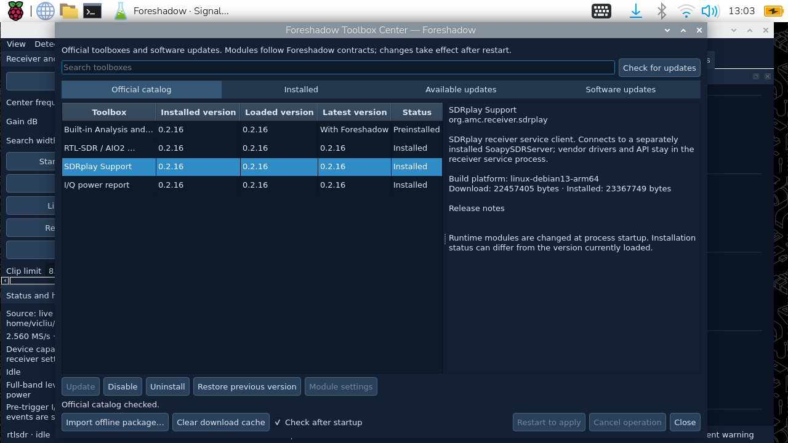

# Foreshadow 0.2.16 发布与更新复验 — 2026-11-25

[English](2026-11-25-0.2.16-release-and-update.md) · 简体中文

## 正式发布身份

[Foreshadow 0.2.16](https://github.com/vicliu624/Foreshadow/releases/tag/v0.2.16)
已于 2026-11-25 北京时间 12:51 发布。不可变标签对应
`d33e438c0c2ca8c693dd4905c6ce2392aec5bcd8`；后续文档提交不改变该源码快照和已验收二进制。

共 22 项资产：三个便携归档、十二个应用／工具箱包、三份平台目录条目、主程序源码
归档、签名目录、验收记录和 SHA-256 校验和。目录包含十二个条目，序号为
`1795581896`，大于此前的 `1795520330`；信任密钥仍为 `d66ddd3c8e498e42`。

服务器端全部资产的哈希／大小与本地审核文件一致；匿名公开 API、22 个下载入口、
逐字节一致的 latest 目录及 Ed25519 签名均已检查。签名在发布电脑完成并使用 Python
独立验签，私钥未进入 CI 或部署主机。详见公开的
[验收记录](https://github.com/vicliu624/Foreshadow/releases/download/v0.2.16/release-qualification.json)
和[校验和](https://github.com/vicliu624/Foreshadow/releases/download/v0.2.16/SHA256SUMS.txt)。

## 冻结源码的平台检查

[正式工作流 45543592669](https://github.com/vicliu624/Foreshadow/actions/runs/45543592669)
在三个选定平台使用同一冻结提交，全部成功。

| 平台 | 注册 | 通过 | 跳过 | 失败 |
|---|---:|---:|---:|---:|
| Windows x64 | 131 | 129 | 2 | 0 |
| Debian 13 x64 | 132 | 130 | 2 | 0 |
| Debian 13 ARM64 | 132 | 130 | 2 | 0 |

跳过项为 `research_audio_output` 与 `fm_playback_recovery`，原因是正式任务没有实体
声音输出设备。各套测试均通过录制／接收机资源检查、140 秒 WSPR 和 60 秒 ADS-B
持续输入回归。实际归档在中文／非 BMP 路径解压后，通过组件发现、GUI／媒体、
AVS+/DRA 解码及通用工具箱事务检查；SDK 源码身份和对应源码材料通过发布检查。

[自托管完整回归](https://github.com/vicliu624/Foreshadow/actions/runs/45543399372)同样
通过 130 项，另有上述两项音频跳过，并通过安装目录检查。交付生产源码在接收机电脑
使用未升级的 Qt 6.8.2／OpenSSL 3.5.7 SDK、关闭测试夹具后重建并安装成功；这是功能性
对应源码重建，不是托管 OpenSSL 3.5.9 SDK 构建的字节复现。

Windows 原生预检在恢复原始泄漏客户端及可继承锁标志时失败，恢复修正后通过。
子进程就绪测试处理启动 stderr、完整 stdout 行、截止时间及 Windows 行尾；锁句柄
按文件身份匹配，不依赖路径拼写。[资源审核](2026-11-25-resource-lifetime.zh-CN.md)
记录所有权、反向对照、计数及对已重启昨夜故障归因的限制。

## `.42` 的实际包与 RSPdx-R2 检查

实际 0.2.16 x64 归档和独立 SDRplay 包已在接收机工作站的中文／非 BMP 隔离目录运行，
英文提供者、录制／回放和离线地域数据来源均通过。包内接收机模块在同一客户端进程
中，对独立原生服务完成 32 轮探测及 32 轮成功、消费者停止、取消和激活失败采集，
前后资源计数相等。

同一包内模块随后通过既有独立服务操作真实 RSPdx-R2：十二轮实体探测／采集覆盖正常
结束、立即取消和消费者停止；随后完成 60 秒、2 MS/s、1.2 亿对 I/Q 采集，结束后资源
计数返回初始值。

实际包内 CLI 录制了 600 万对 CI16，记录器标识为 `Foreshadow 0.2.16`，完成新录音
回放、旧录音回放及旧元数据／数据逐字节一致导出。实际 0.2.16 外部 Power Report 包
分析了新录音；原有 26 个录音／已保存分析文件的哈希全部保留。

这些检查使用实际发布二进制，并非仅验证源码构建；独立服务没有提供硬件采样丢失
计数，因此不据此宣称硬件零丢样。

**`.42` 原桌面仍为 0.2.15。** 它已切回 LightDM，用户回复稍后解锁。前台工具箱中心
正常升级、重启、加载版本确认及新的接收机工作站截图，仍等待该次解锁；上述隔离包
检查不冒充已激活的桌面安装。该电脑此前认可的 Windows 更新转发仍可用。

## uConsole 正常升级

uConsole 先在中文／非 BMP 路径对实际 ARM64 归档完成原生验证，包括模块发现、英文
提供者、录制／回放，以及包内接收机模块的重复公共 ABI 资源检查。

随后在原桌面通过 **Plugins → Toolbox Center → Check for updates** 获取公开签名
目录，在原生界面安装三个工具箱和主程序。重启前正确显示已安装 0.2.16、仍加载
0.2.15；**Restart to apply** 执行普通应用激活，并记录健康检查已应用。

重启后，运行中的可执行文件与清单匹配冻结提交，四行组件均显示已安装／实际加载
0.2.16，包括 SDRplay Support。冷启动 CLI 在故意设置过期父进程存储环境变量时，仍
解析到正确的受管安装；已有桌面／包装器入口字节、接收机和语言设置，以及 201 个
原有用户数据文件的哈希均保留。

归档缓存来自发布者校验过哈希的下载文件；GUI 仍获取并认证公开目录、校验包并执行
正常安装／激活，不将本次方法写成“Qt 从公网重新下载了每个归档”。当前使用一个
最新启动入口，保留更新器管理的正常恢复副本。

图片为验证重启后，在实际 uConsole 桌面通过 `grim` 原样截取；不是设计稿，也不是
接收机工作站截图。

## 剩余限制

- 昨夜进程已被重启，无法从其描述符表还原唯一故障路径。
- 有界软件／实机检查不构成整夜稳定性或无限期硬件无损保证。
- 本次 uConsole 更新没有验证其实体接收机操作。
- 实体声音输出与 macOS 验收仍不在本次范围。
- 厂商 API、独立接收机服务及固件不随包分发，也未被修改；ADS-B、WSPR、波形／
  PSK／OFDM、电视及工具箱功能完整保留。
