# Foreshadow screenshot gallery

English · [简体中文](screenshots.zh-CN.md)

The core research images below were captured from the **receiver-connected Linux workstation**, using the actual **English native UI**. The original set is from 13 November 2026; the separately labelled service set is from 14 November. The newer uConsole update view is explicitly identified separately. All are application captures, without mockups or generated imagery. Panels were arranged through the normal workspace controls.

Display and research providers supply the views below; the generic workspace hosts their panels. The [plugin guide](plugins.md) maps functionality to its owner and distribution form.

Real RF, device queries and explicitly synthetic research cases are labelled separately. The first research images use the native build; receiver settings, FM, television and Toolbox Center use the staged package built from the same frozen source. Hashes and dimensions are in [image provenance](images/provenance.json). Historical Mac/release images remain in their dated reports and are not substituted for this capture set.

[Detailed user guide](09-delivery-and-user-guide.md) · [Documentation index](README.md)

## Public 0.2.16: normal uConsole update, 25 November

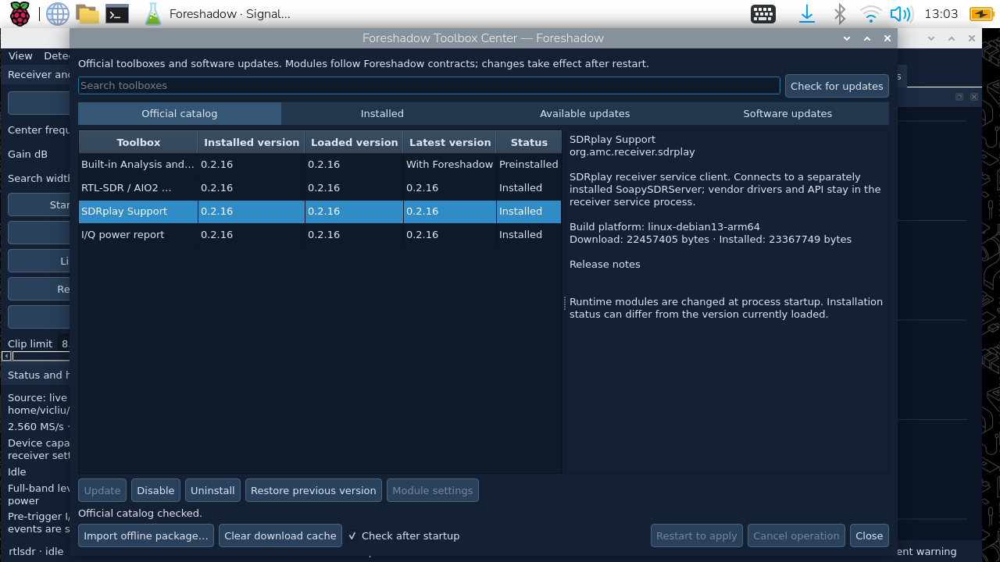

Actual English ARM64 desktop after fetching the public signed catalog, installing the application/toolboxes and passing restart health checks. Installed and loaded versions are 0.2.16. All 201 original data files retained their hashes. This is not a physical-reception demonstration or a receiver-workstation capture; the latter's original desktop awaits operator unlock. See the [release/update evidence](reports/2026-11-25-0.2.16-release-and-update.md) and [image provenance](images/reviews/2026-11-25-0.2.16/provenance.json).

## Public 0.2.15: ADS-B and WSPR, 24 November

These images come from the receiver workstation’s actual installed public English UI. The [acceptance report](reports/2026-11-24-0.2.15-release-and-update.md) records per-image hashes, dimensions, capture methods and input sources. ADS-B uses physical RSPdx-R2 input; the WSPR reference is explicitly independent synthetic input and does not establish physical HF station reception.

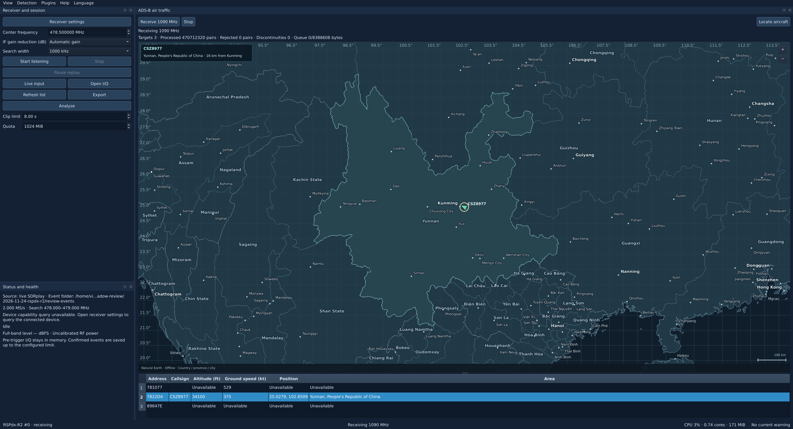

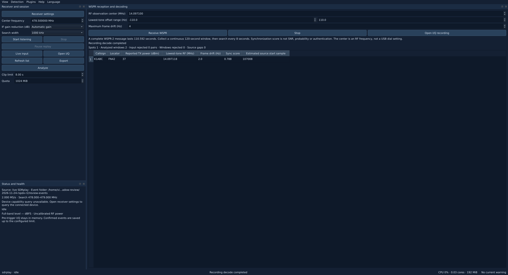

## 24 November RSPdx-R2 workflow review

The [dated hardware workflow report](reports/2026-11-24-rspdx-r2-workflow-review.md) adds six actual English UI captures: live spectrum/frozen input, window research, reopened channel analysis, paused recording replay, the upgraded toolbox store, and the local source-fix review running an independent research plugin. It distinguishes the public 0.2.13 baseline from the local review source, capture methods, measured software losses and external conditions. These newer captures do not requalify the older television or synthetic cases below.

## Live receiver workspace

The historical 0.2.12 r4 service deployment (14 November) uses an independently installed receiver service. This is real 478.5 MHz, 2 MS/s input in the installed review GUI. The recorded final status shows listening, confirmed activation/readback and advancing source/analysis counts; no detection event is asserted. See the [r4 qualification](reports/2026-11-14-receiver-service-review.md) and [service image provenance](images/receiver-service-provenance.json).

## Receiver service and real device controls

Final extracted package, 14 November: provider-owned service address, actual RSPdx-R2 discovery and existing advanced controls. The settings dialog's compatibility table is an assessment of configuration, not decoding or RF reception evidence.

## Earlier directly connected workspace (13 November)

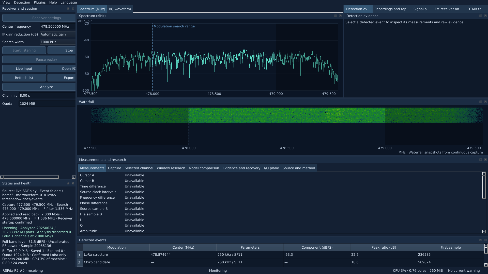

Actual RSPdx-R2 input at 478.5 MHz, 2 MS/s, Antenna B. Spectrum, waterfall, readback and events share a dockable workspace. A structural event is not decoded payload or device identity.

## Receiver parameters and assessment

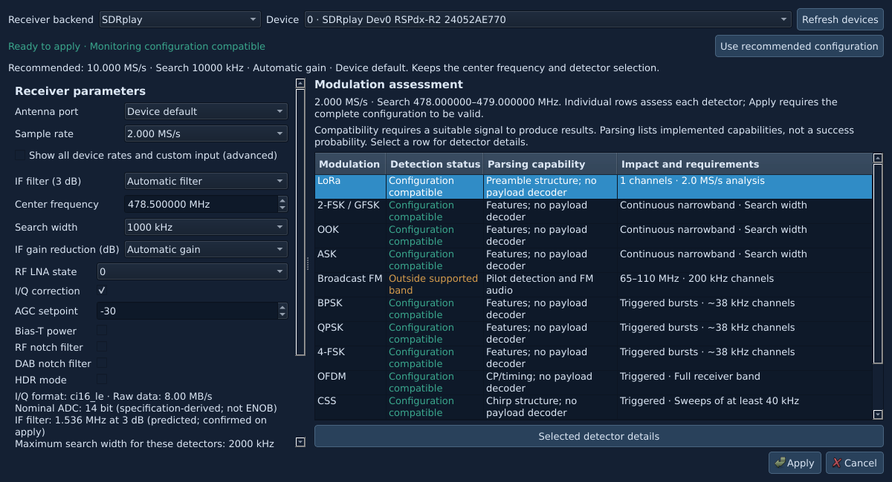

Actual RSPdx-R2 discovery and provider-described parameters. The table evaluates detector configuration; research recovery is a separate workflow. This screenshot does not claim every setting was applied.

## Original observations and measurements

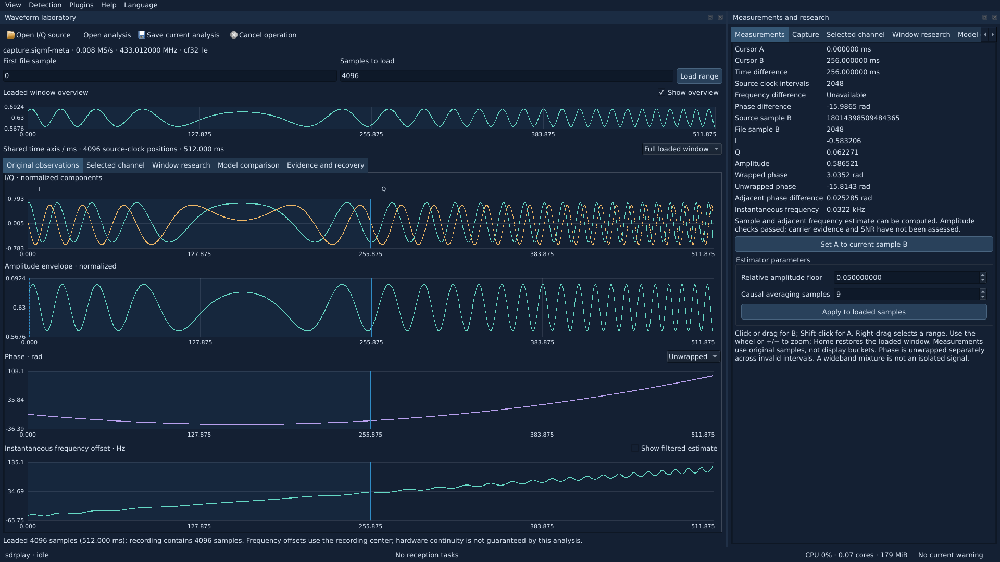

Synthetic case 01: I/Q, envelope, unwrapped phase, adjacent frequency and source-based A/B measurements. Blue cursor positions refer to original input.

## Time-frequency research

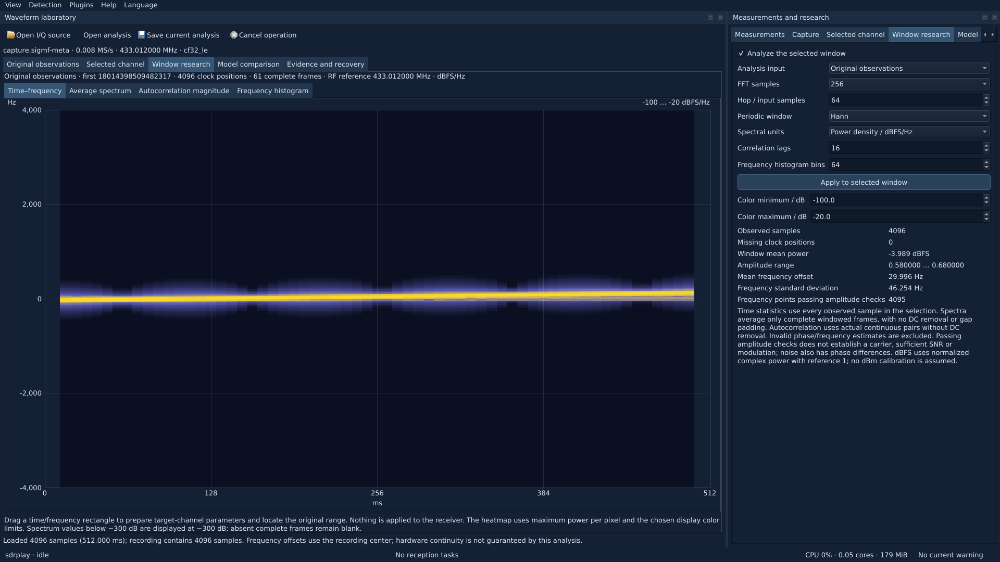

Synthetic case 01: configurable STFT and dBFS/Hz, with explicit window, hop, observed/missing counts and units. Other tabs expose average spectrum, autocorrelation and frequency histogram.

## Reference comparison and residual

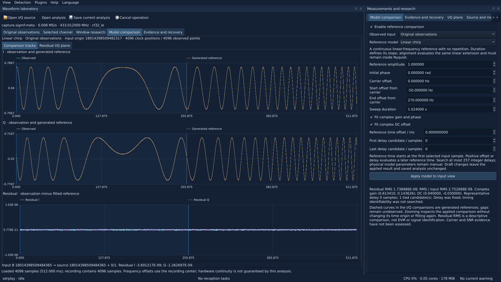

Synthetic case 01: measured traces and a generated linear-chirp reference, declared complex gain/DC fitting, and residual. A low residual is not modulation identification or EVM.

## Byte evidence

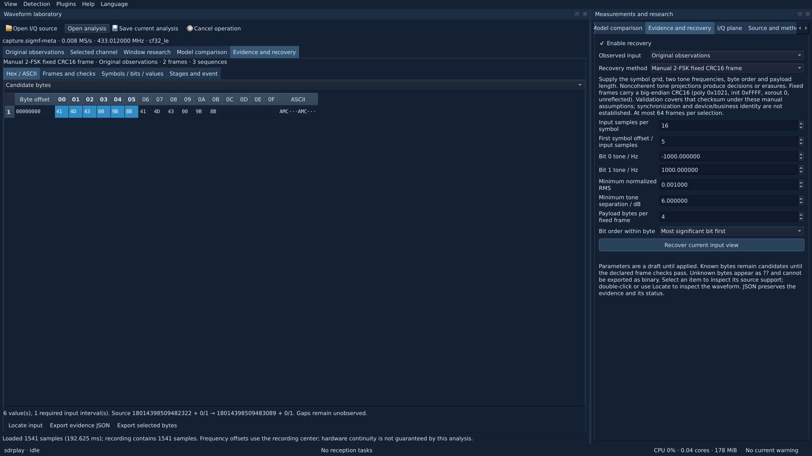

Synthetic case 02: manual 2-FSK symbol grid, candidate bytes and declared CRC16 framing. Input samples and payload bytes remain distinct.

## Frames and required checks

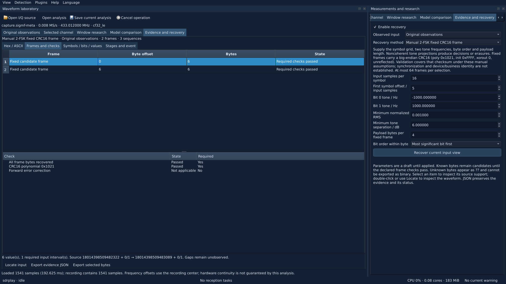

Synthetic case 02: frame ranges and individual required checks are visible. Passing the declared CRC does not identify a transmitter or business protocol.

## LoRa PHY recovery

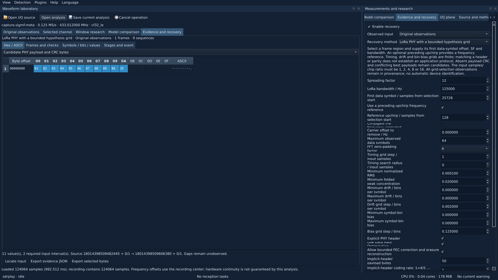

Synthetic case 03: bounded hypothesis search with explicit SF, bandwidth, timing and PHY settings. The bytes are recovered from configured I/Q, without generic LoRaWAN or device attribution.

## Paired-code repair remains a candidate

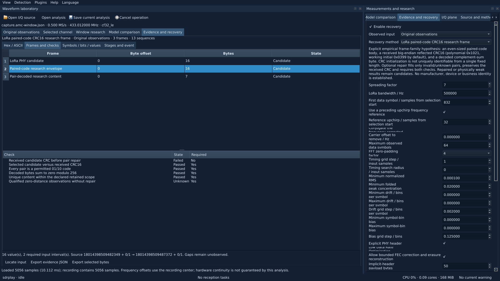

Synthetic case 04: the original CRC failure, bounded repair, surviving checks and unknown physical qualification remain visible. The empirical frame family is explicitly selected.

## QPSK synchronization, equalization and EVM

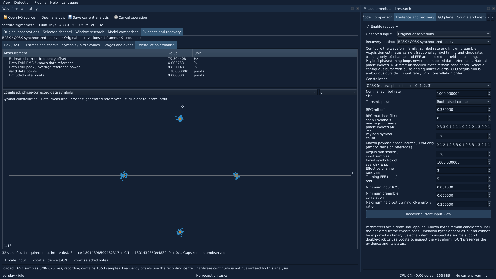

Synthetic case 05: trained reception, estimated frequency offset, equalized constellation and known-data RMS EVM 4.005753%, with 128 valid data points. Generated references are crosses. These values describe this case.

## OFDM channel/equalization and EVM

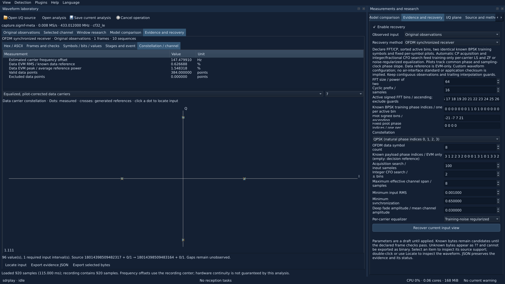

Synthetic case 06: CP/training acquisition, carrier correction, channel/equalizer and pilot tracking. Known-data RMS EVM 0.626688%, 384 valid points. Training, pilots and erased points do not enter data EVM.

## Compact research layout

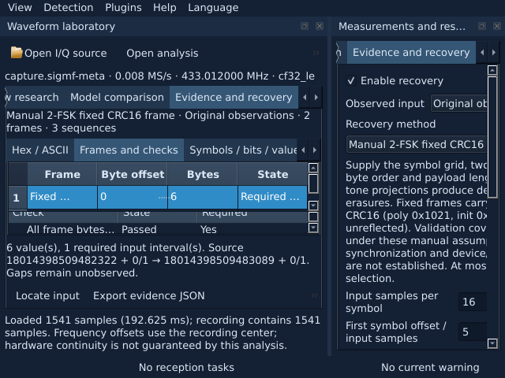

The same English native application at 640 × 480, using synthetic case 02. Tabs and scroll areas retain access to controls and evidence; larger screens display more at once.

## Independent FM reception

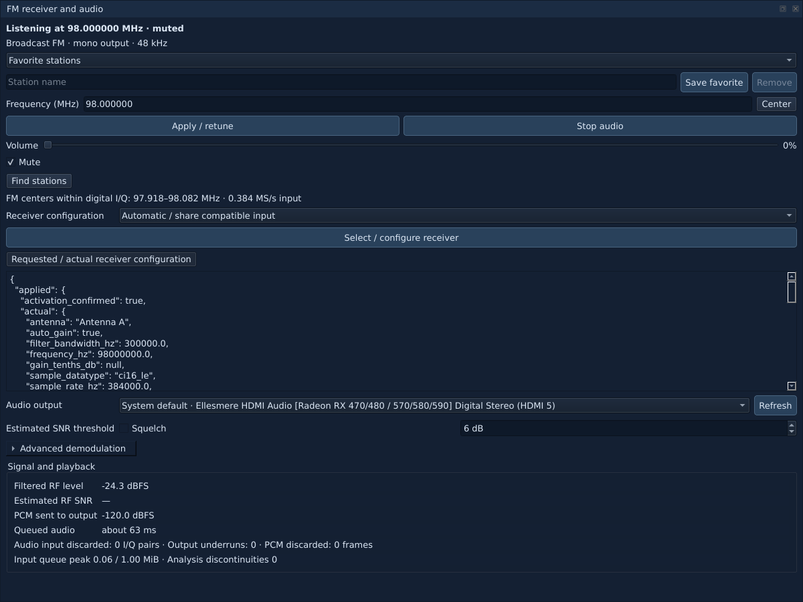

Actual RSPdx-R2 reception at 98 MHz, automatic 384 kS/s input and 300 kHz filter readback. Muted output at volume zero; the image verifies the running path and counters, without human listening or long-term continuity qualification.

## Transport-stream program playback

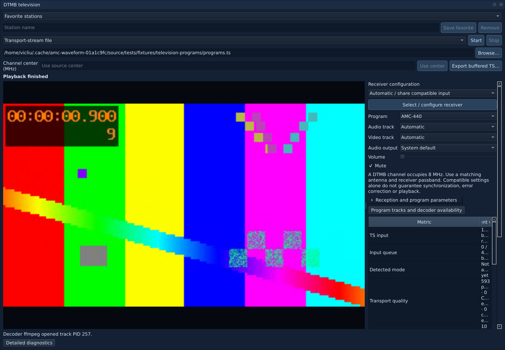

The television provider plays the repository's CC0 synthetic programs.ts through the actual installed native media chain. The final test frame is retained after playback finishes. This is file playback, without local antenna DTMB reception or AVS+/DRA qualification from this particular fixture.

## Controlled toolboxes and updates

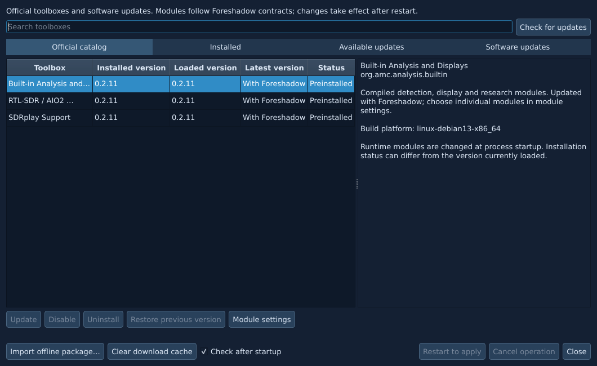

Actual installed Linux Toolbox Center, showing built-in analysis and receiver packages at 0.2.11. No online check or installation is implied by this catalog view.
