# Foreshadow 核心功能截图

[English](screenshots.md) · 简体中文

以下展示图均在**连接接收机的 Linux 工作站**上，用实际的**英文原生界面**截取。原始组为 2026 年 11 月 13 日；单独标注的服务组为 11 月 14 日。它们是应用截图，没有使用效果图或生成图片；面板通过正常工作区功能整理。

下列视图由显示和研究提供者交付，通用工作区承载其面板。[插件指南](plugins.zh-CN.md)说明功能归属与分发形式。

真实 RF、设备查询和明确的合成研究用例分别标注。最初的研究页面来自原生构建；接收机设置、FM、电视与工具箱中心来自同一冻结源码构建的安装树。哈希和尺寸见[图片来源清单](images/provenance.json)。历史 Mac/发布截图保留在对应日期的报告中，不混入本组新截图。

[详细用户指南](09-交付与使用说明.md) · [文档索引](README.zh-CN.md)

## 正式 0.2.15：ADS-B 与 WSPR，11 月 24 日

本组来自接收机工作站实际安装的正式英文界面。[验收报告](reports/2026-11-24-0.2.15-release-and-update.zh-CN.md)记录每张图的哈希、尺寸、截图方式和输入来源。ADS-B 为实体 RSPdx-R2 输入；WSPR 参考图为明确的独立合成录音，不能证明 HF 电台实收。

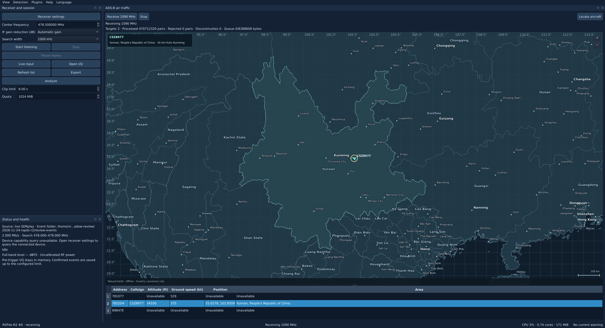

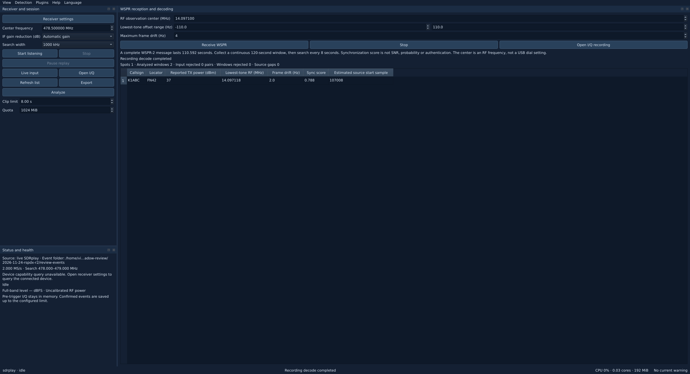

## 11 月 24 日 RSPdx-R2 流程评审

[本次实机流程报告](reports/2026-11-24-rspdx-r2-workflow-review.zh-CN.md)新增六张实际英文界面截图：实时频谱与冻结输入、窗口研究、重新打开的目标信道分析、录制回放暂停、升级后的工具箱和运行独立研究插件的本地修复评审版。报告区分正式 0.2.13 基线与本地评审源码、截图方式、软件丢样计数及外部条件。这组新截图不构成对下列历史电视或合成用例的重新验收。

## 实体接收工作区

历史 0.2.12 r4 服务部署（11 月 14 日）使用独立安装的接收服务。下图是已安装评审 GUI 的 478.5 MHz、2 MS/s 实体输入；最终状态记录监听、激活／回读确认及源／分析计数前进，不声称检测到事件。见 [r4 验收](reports/2026-11-14-receiver-service-review.zh-CN.md)与[服务图片来源](images/receiver-service-provenance.json)。

## 接收服务与实体设备控制

11 月 14 日最终解包程序：提供者维护的服务地址、真实 RSPdx-R2 发现及原有高级控制。兼容性表是配置评估，不是解码或实收证据。

## 较早的直连工作区（11 月 13 日）

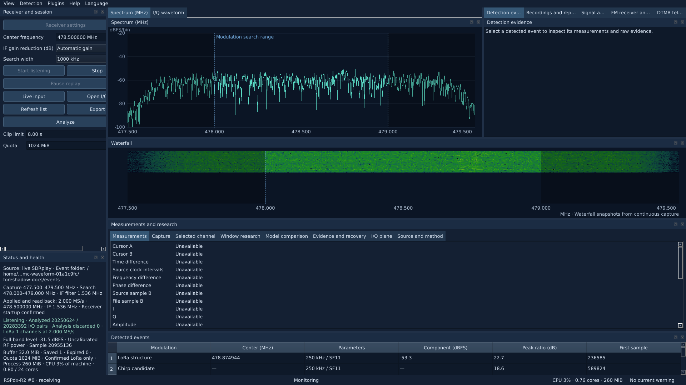

RSPdx-R2 在 478.5 MHz、2 MS/s、天线 B 的真实输入。频谱、瀑布、回读和事件共享可停靠工作区。结构事件不等于载荷或设备身份。

## 接收机参数与评估

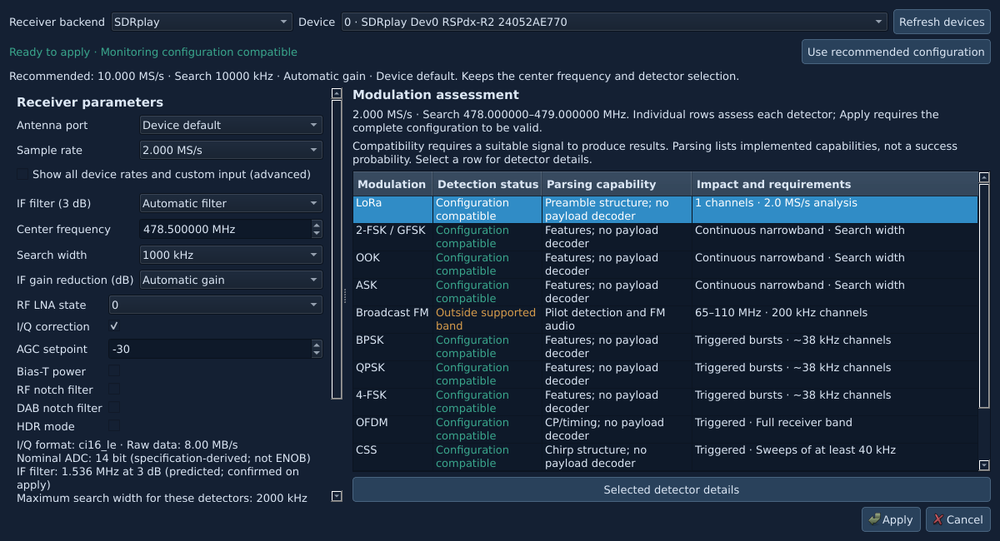

实际发现 RSPdx-R2，显示提供者描述的参数。表格评估检测器配置，研究恢复是独立流程；截图不表示所有设置都已经应用。

## 原始观测与测量

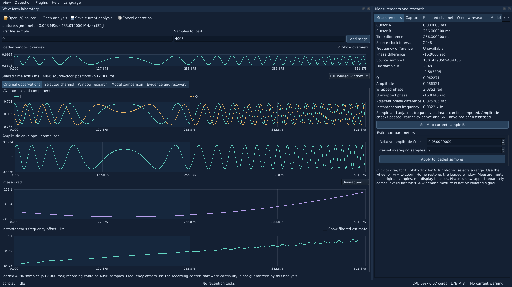

合成用例 01：I/Q、包络、展开相位、相邻频率与原始输入 A/B 测量。蓝色光标对应来源坐标。

## 时频研究

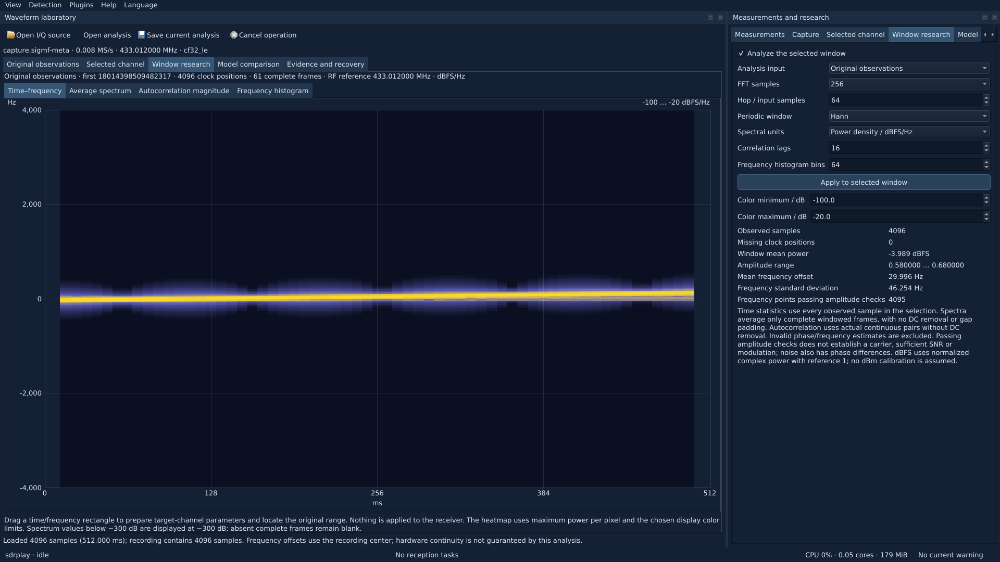

合成用例 01：可配置 STFT 与 dBFS/Hz，明确窗口、步进、已观测/缺失数量及单位；其他标签提供平均谱、自相关和频率直方图。

## 参考对照与残差

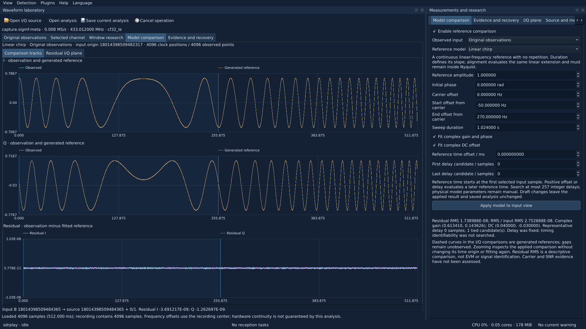

合成用例 01：观测与生成线性 Chirp 参考、声明的复增益/直流拟合和残差。低残差不等于调制识别，也不是 EVM。

## 字节证据

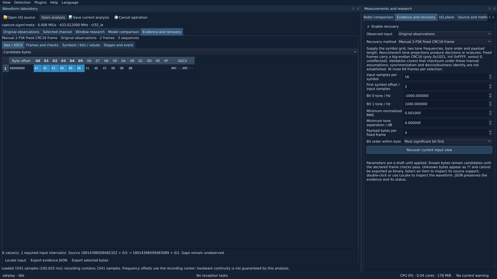

合成用例 02：手动 2-FSK 符号网格、候选字节与声明的 CRC16 成帧；采样存储字节与空口载荷分开。

## 帧与必要校验

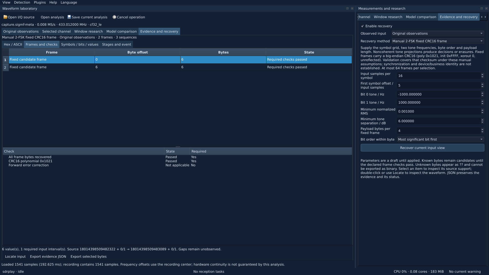

合成用例 02：显示帧范围及每项必要校验。通过声明 CRC 不证明发射设备或业务协议。

## LoRa PHY 恢复

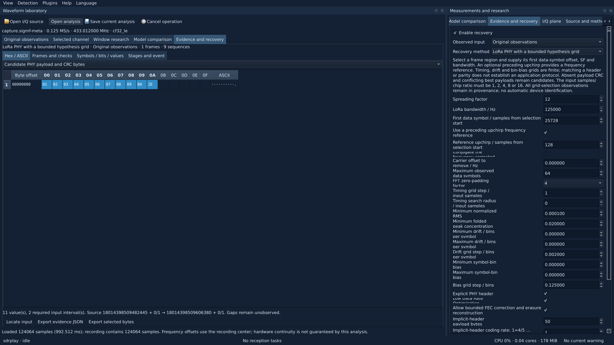

合成用例 03：明确 SF、带宽、时序及 PHY 设置的有界假设搜索；从配置的 I/Q 恢复字节，不作通用 LoRaWAN 或设备归因。

## 成对编码修复保持候选状态

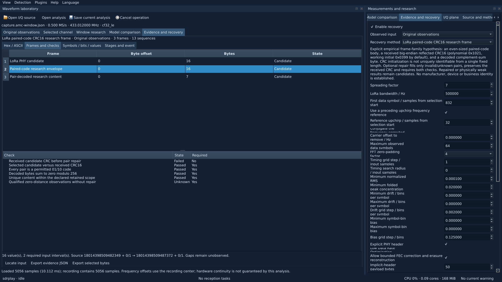

合成用例 04：原始 CRC 失败、有界修复、后续校验与未知物理资格保留。经验帧族由用户明确选择。

## QPSK 同步、均衡与 EVM

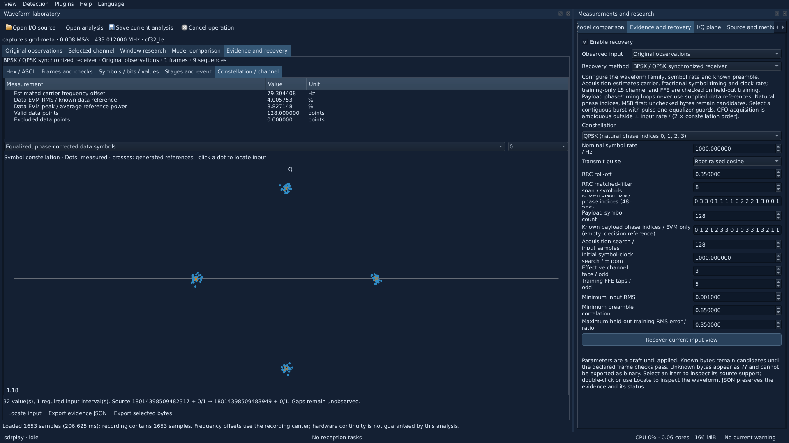

合成用例 05：训练式接收、频偏估计、均衡星座，已知数据 RMS EVM 4.005753%，128 个有效数据点，叉号为生成参考。数值仅对应该用例。

## OFDM 信道、均衡与 EVM

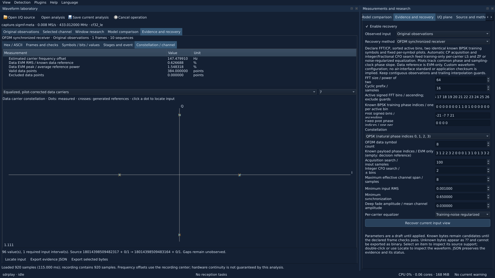

合成用例 06：CP/训练捕获、载波校正、信道/均衡和导频跟踪。已知数据 RMS EVM 0.626688%，384 个有效点；训练、导频及擦除点不计入数据 EVM。

## 紧凑研究布局

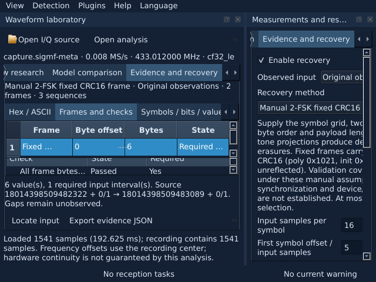

同一英文原生应用以 640 × 480 显示合成用例 02，通过标签和滚动区访问参数与证据；大屏能同时显示更多内容。

## 独立 FM 接收

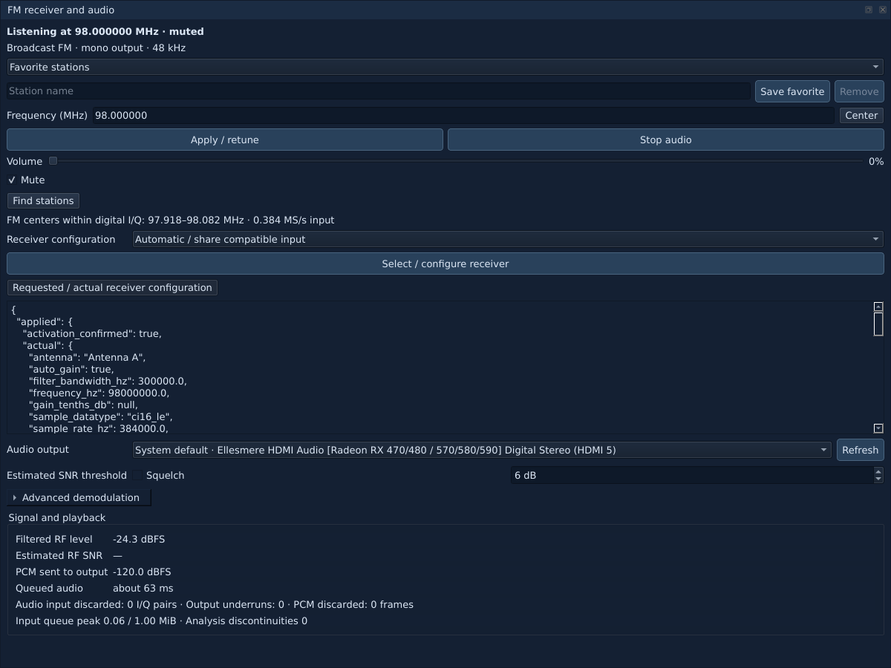

RSPdx-R2 在 98 MHz 的实际接收，自动选择 384 kS/s 输入并回读 300 kHz 滤波器。音量为零且静音，展示运行路径和统计，不代表人工听感或长稳验收。

## 传输流节目播放

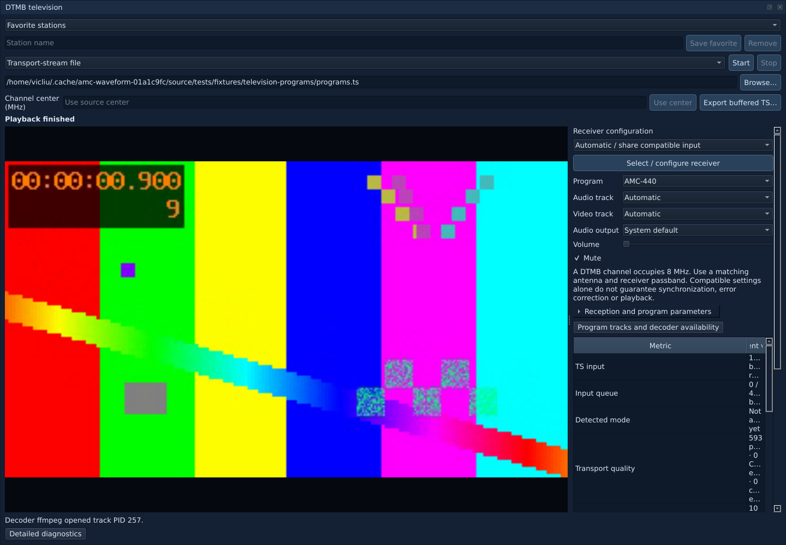

电视提供者通过实际安装的原生媒体链播放仓库 CC0 合成 programs.ts，播放结束后保留最后测试帧。这是文件播放，不是当地天线 DTMB 实收，也不以本样本证明 AVS+/DRA。

## 受控工具箱与更新

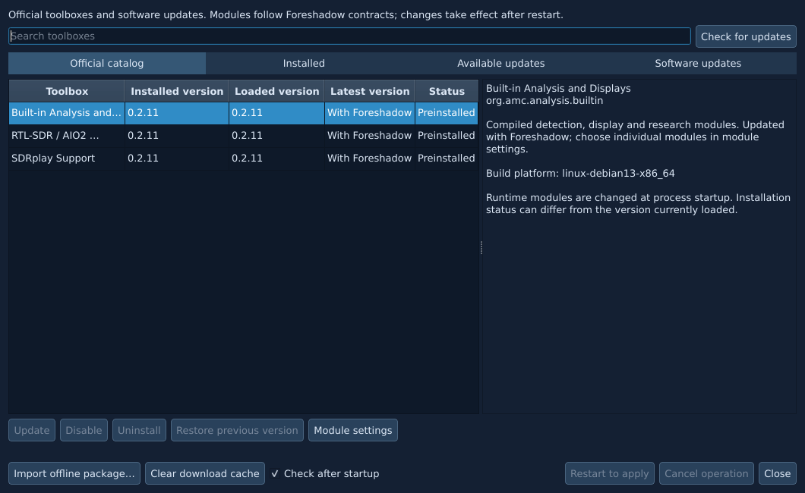

实际 Linux 安装中的工具箱中心，显示 0.2.11 内置分析与接收机包。该目录画面不表示已经执行联网检查或安装。
